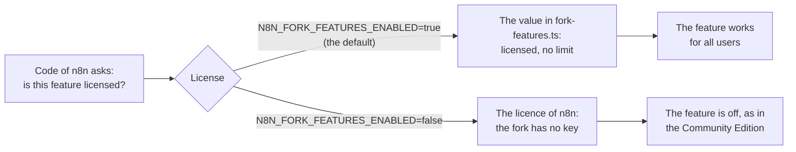

# FORK-ADOPTION.md

How the fork gives the enterprise features of n8n to all users, and how an organisation starts to
use them. This guide is for admins and for the people who build workflows. To change the fork,
read [FORK.md](FORK.md) and [FORK-MAP.md](FORK-MAP.md).

## What you get

- **The features of the Enterprise Edition, for all users.** Each instance of the fork has them.
  You need no licence key and no registration.
- **No limits.** Team projects, the workflows with evaluations, the history of insights and the
  workflow history have no limit.
- **The features of the fork on top:** Git sync, Send a copy, the audit log, the publish check of
  open triggers, Gateway credits, Google Cloud Storage, the node Google Cloud OCR, and the public
  API routes for reviews ([README.md](README.md#the-features-of-the-fork)).
- **The n8n documentation applies.** The features work as in the Enterprise Edition, so use the
  pages of [docs.n8n.io](https://docs.n8n.io) that the tables below link. A few places differ on
  purpose ([FORK-MAP.md](FORK-MAP.md#deliberate-differences)).

## How it works

1. **n8n checks a licence.** Before each enterprise feature, the code of n8n asks the licence
   whether the feature is on. Without a licence (the Community Edition), the features are off.
2. **The fork has no enterprise code.** The enterprise code of n8n is under the n8n Enterprise
   License, and production use of it needs a paid licence. The fork removed all of it. In its
   place, the fork has its own versions of the features. They were written only from the public
   documentation of n8n, the ordinary code and the behaviour of a running n8n. Golden tests
   compare each rebuilt feature with the enterprise code of each upstream version.
3. **The fork switch answers the licence checks.** The fork keeps the licence checks of n8n. The
   setting `N8N_FORK_FEATURES_ENABLED` is `true` by default. While it is on, the licence says
   "licensed" for each feature in `packages/cli/src/fork-features.ts`, and "no limit" for each
   quota there. So each of these features works as with an Enterprise licence. The owner of the
   fork chooses each feature of the list ([FORK-FEATURES.md](FORK-FEATURES.md#licence-features)).
4. **Some features need a setting too, as in upstream n8n:** a module, a feature flag or queue
   mode. `deploy/` sets most of them. The tables below tell which.

## Check that the features are on

- Open **Settings > Usage and plan**. While the switch is on, the page says "Fork features are on.
  Sharing, team projects, SSO, external secrets, and the other rebuilt features of the Enterprise
  Edition work without a license." The plan still says "Community", because the instance has no
  licence certificate.
- An admin can add a team project. Without the switch, n8n allows no team projects.

## The features

The admins are the instance owner and the users with the admin role. "Builders" are all users who
build workflows.

### Sign-in and access

| Feature | Who sets it up, and where | Also needs | n8n documentation |
|---|---|---|---|
| Sign-in with OIDC | An admin on **Settings > SSO**, or `deploy/` from the environment ([deploy/README.md](deploy/README.md#sso)) | | [OIDC](https://docs.n8n.io/user-management/oidc/) |
| Sign-in with SAML | An admin on **Settings > SSO** | | [SAML](https://docs.n8n.io/user-management/saml/) |
| Sign-in and user sync with LDAP | An admin on **Settings > LDAP** | | [LDAP](https://docs.n8n.io/user-management/ldap/) |
| Roles from the groups of the identity provider | An admin on **Settings > SSO**. `deploy/platform/setup.mjs` makes the SSO group rules ([deploy/platform/README.md](deploy/platform/README.md)) | OIDC or SAML | [OIDC](https://docs.n8n.io/user-management/oidc/), [SAML](https://docs.n8n.io/user-management/saml/) |
| Two-factor sign-in for all users | An admin who uses 2FA, on **Settings > Security & policies**. `deploy/` turns it on from the environment (`MFA_ENFORCED`) | | [Two-factor authentication](https://docs.n8n.io/user-management/two-factor-auth/) |
| The admin role and custom roles | The owner and the admins on **Settings > Roles** | | [Roles](https://docs.n8n.io/administer/manage-users-and-access/set-permissions-and-roles-rbac/see-available-roles.md), [custom roles](https://docs.n8n.io/administer/manage-users-and-access/set-permissions-and-roles-rbac/create-custom-roles.md) |
| API keys with scopes | Each user on **Settings > n8n API** | | [API authentication](https://docs.n8n.io/api/authentication/) |
| Token exchange | An admin, with the environment | `N8N_ENV_FEAT_TOKEN_EXCHANGE=true`, then `N8N_TOKEN_EXCHANGE_ENABLED=true` with trusted keys. `deploy/` does not set them | |

### Teams and sharing

| Feature | Who sets it up, and where | Also needs | n8n documentation |
|---|---|---|---|
| Team projects with the admin, editor and viewer roles, without a limit | The owner and the admins. A custom role with **Projects: Create** lets other users create them. `deploy/platform/setup.mjs` makes the team projects of a config file | | [Projects](https://docs.n8n.io/administer/manage-users-and-access/set-permissions-and-roles-rbac/organize-work-in-projects.md) |
| Sharing of workflows and credentials | Builders, with **Share** on a workflow and the **Sharing** tab of a credential | | [Workflows](https://docs.n8n.io/workflows/sharing/), [credentials](https://docs.n8n.io/credentials/credential-sharing/) |
| Folders | Builders, on the workflows page | | |
| Rules for personal spaces | An admin on **Settings > Security & policies**. `deploy/` stops the publishing and the sharing from personal spaces ([deploy/README.md](deploy/README.md#safer-defaults)) | | |
| Workflow reviews before a publish | An admin turns them on at **Settings > Security & policies**. `deploy/` turns them on. Builders send a version to a reviewer | | [Workflow reviews](https://docs.n8n.io/build/manage-workflows/workflow-reviews/) |
| Variables (`$vars`) | Admins and project admins, on the **Variables** page | | [Variables](https://docs.n8n.io/code/variables/) |
| The workflow history without a time limit, with the comparison and the names of versions | Builders, in the workflow history. `WORKFLOW_HISTORY_PRUNE_TIME` can set a limit | | [Workflow history](https://docs.n8n.io/workflows/history/) |
| Debug in editor | Builders, on a past execution | | [Debug](https://docs.n8n.io/workflows/executions/debug/) |
| Execution annotations and the search of executions by custom data | Builders, in the executions of a workflow | | [Custom execution data](https://docs.n8n.io/workflows/executions/custom-executions-data/) |

### Credentials and secrets

| Feature | Who sets it up, and where | Also needs | n8n documentation |
|---|---|---|---|
| External secrets from HashiCorp Vault, Infisical, 1Password, AWS, Azure or Google Cloud | An admin on **Settings > External secrets** | | [External secrets](https://docs.n8n.io/administer/manage-credentials/use-external-secret-stores/) |
| End-user credentials (dynamic credentials) | Each user connects their own account. An admin adds the credential resolvers on **Settings > Credential resolvers** ([deploy/README.md](deploy/README.md#end-user-credentials)) | `N8N_ENV_FEAT_DYNAMIC_CREDENTIALS=true`. `deploy/` sets it | [End-user credentials](https://docs.n8n.io/administer/manage-credentials/end-user-credentials) |

### Change control

| Feature | Who sets it up, and where | Also needs | n8n documentation |
|---|---|---|---|
| Source control with a Git branch (environments) | An admin on **Settings > Environments**, with a Git server, for example Forgejo ([deploy/forgejo/README.md](deploy/forgejo/README.md)) | | [Source control](https://docs.n8n.io/source-control-environments/) |
| Git connections, which move work between instances | An admin on **Settings > Environments v2** ([the README of the module](packages/cli/src/modules/promotions/README.md)) | The module `promotions` in `N8N_ENABLED_MODULES`, and `N8N_ENV_FEAT_PROMOTIONS=true`. `deploy/` sets both | |
| Git sync of a project (fork) | An admin on **Settings > Git sync**, for one project of the instance ([the README of the module](packages/cli/src/modules/git-sync/README.md)) | | |
| The publish check of open triggers (fork) | `deploy/` turns it on (`OPEN_TRIGGERS_NEED_APPROVAL`). Builders use the one-click fixes or **Request approval**. Admins see the list on **Settings > Open triggers** | | |

### Monitoring and compliance

| Feature | Who sets it up, and where | Also needs | n8n documentation |
|---|---|---|---|
| Log streaming to a webhook, syslog or Sentry | An admin on **Settings > Log streaming** | | [Log streaming](https://docs.n8n.io/log-streaming/) |
| The audit log for 90 days (fork) | Admins see it on **Settings > Audit log** and in the public API ([deploy/README.md](deploy/README.md#governance)) | | |
| Insights without a limit of history | Users with access see them on the overview pages. `N8N_INSIGHTS_MAX_AGE_DAYS` keeps 365 days by default | | [Insights](https://docs.n8n.io/insights/) |
| Data redaction | An admin sets the floor for the instance (`REDACTION_FLOOR` in `deploy/`), and builders set it in the settings of a workflow | | |
| Custom attributes of OpenTelemetry spans | An admin, when OpenTelemetry sends traces | | [OpenTelemetry](https://docs.n8n.io/hosting/logging-monitoring/opentelemetry/) |
| Node type policies | An admin, with the public API (`/api/v1/node-type-policies` and `/api/v1/credential-type-policies`) | | |
| Community nodes from a private registry | An admin, with `COMMUNITY_PACKAGES_REGISTRY` and its token | | |
| The public API routes for reviews (fork) | An admin, with an API key ([packages/cli/src/governance/README.md](packages/cli/src/governance/README.md)) | | |

### Scale and storage

| Feature | Who sets it up, and where | Also needs | n8n documentation |
|---|---|---|---|
| Files and execution data in Amazon S3, Azure Blob Storage or Google Cloud Storage | An admin, with the environment ([the FORK.md of the blob storage](packages/@n8n/blob-storage/FORK.md#set-up)) | A bucket or a container | [External storage](https://docs.n8n.io/hosting/scaling/external-storage/) |
| Multiple main instances | An admin, with the environment | Queue mode and `N8N_MULTI_MAIN_SETUP_ENABLED=true` | [Queue mode](https://docs.n8n.io/hosting/scaling/queue-mode/) |
| The worker view | Admins on **Settings > Workers** | Queue mode | [Queue mode](https://docs.n8n.io/hosting/scaling/queue-mode/) |
| Worker pools | An admin sets the pool of a project in the settings of the project | Queue mode, `N8N_WORKER_POOLS_ENABLED=true`, and `N8N_WORKER_POOL_NAME` on the workers of a pool. `deploy/` does not set them | |

### AI

| Feature | Who sets it up, and where | Also needs | n8n documentation |
|---|---|---|---|
| Evaluations without a limit of workflows | Builders, on the **Evaluations** tab of a workflow | The collections and the evaluations of configs and agents follow feature flags of n8n: `deploy/` turns them on, with 5 parallel cases | |
| Gateway credits (fork): AI nodes without an API key of the user | An admin on **Settings > Gateway credits admin** ([deploy/README.md](deploy/README.md#gateway-credits)). Users pick **Use Gateway credits** on an AI node | A credential of each provider | [Gateway credits](https://docs.n8n.io/deploy/use-n8n-cloud/gateway-credits) |
| The n8n Assistant with a model of your own | An admin, with the settings `N8N_INSTANCE_AI_*` | | |

## An order to adopt the features

For an organisation that starts with the fork:

1. **Run the fork.** Follow [deploy/README.md](deploy/README.md). The defaults turn on the switch,
   the settings of the tables above and the safer defaults.
2. **Set up the sign-in.** Use SSO with OIDC or SAML, with SSO group rules, or LDAP
   ([deploy/README.md](deploy/README.md#sso)). Keep the owner account with a password for
   emergencies.
3. **Make the team projects.** Make one team project for each team, with the roles from the groups.
   `deploy/platform/setup.mjs` makes the team projects, the SSO group rules and the team
   credentials from one config file ([deploy/platform/README.md](deploy/platform/README.md)).
4. **Put the credentials in the team projects.** Keep the keys of the organisation in external
   secrets. Use end-user credentials where each user needs their own access.
5. **Set the rules of change.** Use workflow reviews, the rules for personal spaces and the publish
   check of open triggers ([deploy/README.md](deploy/README.md#safer-defaults)). To move work
   between instances, use source control or Git connections.
6. **Watch the instance.** Use the audit log, log streaming to your log system, insights and the
   weekly governance report ([deploy/README.md](deploy/README.md#governance)).
7. **Add the AI features.** Set up Gateway credits, so that AI nodes need no personal API keys.
   Use evaluations to test AI workflows.
8. **Tell the builders what they can use:** the team projects, sharing and folders, variables, the
   workflow history, debug in editor, workflow reviews, the one-click fixes of open triggers,
   evaluations, Gateway credits, Git sync and Send a copy.

[deploy/platform-setup-checklist.md](deploy/platform-setup-checklist.md) gives these steps in detail
for a server of `deploy/` with sign-in through Entra ID, with the checks of each tier.
[deploy/ai-gateway-checks.md](deploy/ai-gateway-checks.md) has the checks of Gateway credits.

## What is different from the Enterprise Edition

- **No licence actions.** Settings > Usage and plan has no activation key, no registration and no
  plan links ([packages/cli/src/license/FORK.md](packages/cli/src/license/FORK.md)).
- **No AI services of n8n.** The chat of the AI assistant and of the AI builder, and AI credits,
  need a service of n8n. The fork does not have them. Gateway credits use the accounts of your
  organisation with the AI providers.
- **No banner.** The banner of a non-production instance is off. An instance turns it on with
  `N8N_FORK_NON_PRODUCTION_BANNER=true`.
- **Git connections stay.** Upstream n8n 2.45 replaced Git connections with environments, which
  are enterprise code. The fork keeps Git connections as they are.
- **Some deliberate differences.** [FORK-MAP.md](FORK-MAP.md#deliberate-differences) lists them.

## Turn the features off

Do not turn the switch off on an instance that keeps its files or its execution data in Amazon S3,
Azure Blob Storage or Google Cloud Storage. Without the licence, n8n does not start in these
storage modes.

1. Set `N8N_FORK_FEATURES_ENABLED=false` on each instance: the main instances, the workers and the
   webhook instances. In `deploy/`, set `FORK_FEATURES_ENABLED=false` in `.env`, or the same name in
   the settings of the other options.
2. Restart n8n.

Then the licence decides, as in upstream n8n. Without a licence key, these features go off: each
feature of the tables above that is not marked (fork), and the audit log, log streaming and Gateway
credits. Git sync, Send a copy, the publish check of open triggers and the node Google Cloud OCR
stay on, because they need no licence. The data stays in the database. Try the change on a copy of
the instance first.
