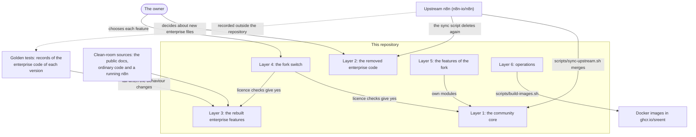

# FORK-MAP.md

The map of the fork. It tells the six layers of the repository, the areas of fork code in each
layer, and how each layer changes. [FORK.md](FORK.md) has the rules of the fork.
[FORK-ADOPTION.md](FORK-ADOPTION.md) tells users how the enterprise features work in the fork.

[scripts/fork-map.txt](scripts/fork-map.txt) lists each path that the fork adds, in its area.
Container CI checks that the list is complete (see [The map file](#the-map-file)).

## The layers

| Layer | What it holds | Where it is | How it changes |
|---|---|---|---|
| 1. Community core | Upstream n8n under the Sustainable Use License. The fork changes about 500 of its files, most of them only in their import paths. | Each file that the map does not list, and the areas of the layer `core` | Only with upstream updates. [FORK-UPSTREAM.md](FORK-UPSTREAM.md) lists the fork lines that need care. |
| 2. Removed enterprise code | The `*.ee.*` files and `*.ee/` folders of upstream n8n, under the n8n Enterprise License | [scripts/removed-enterprise-paths.txt](scripts/removed-enterprise-paths.txt) | The sync script deletes these paths again after each upstream update. The owner decides about each new enterprise file. |
| 3. Rebuilt enterprise features | The fork's own versions of the enterprise features. They keep the names of the enterprise code, so ordinary code calls them. | The areas of the layer `rebuilt` | The golden tests compare them with the enterprise code of each upstream version. The fork follows each change, or records a deliberate difference. |
| 4. The fork switch | The licence values that turn on the enterprise features for all users, without a licence key or a registration | The areas of the layer `switch` | The owner chooses each feature. |
| 5. Features of the fork | Features that n8n does not have | The areas of the layer `fork` | Only the fork changes them. The feature freeze allows security fixes and the fixes that upstream updates need. |
| 6. Operations | `deploy/`, `scripts/`, `vendor/` and the documents of the fork | The areas of the layer `operations` | With the changes that need them. |

To see each file that the fork adds, changes or deletes, fetch the upstream commit of
`scripts/sync-upstream.base` (the sync script and container CI do this), then run
`git diff --name-status <commit> HEAD`.

## How the layers change

### 1. The community core

- Only an upstream update changes it: `scripts/sync-upstream.sh master`, then the checklist of
  [FORK-UPSTREAM.md](FORK-UPSTREAM.md), then `scripts/container-ci.sh --fork`
  ([FORK.md](FORK.md#upstream-updates)).
- Keep the fork lines in upstream files few. A pull request that adds fork lines to an upstream file
  adds a row to the first table of FORK-UPSTREAM.md.
- Two areas of fork code belong to the core and to no feature: `n8n-packages` and
  `settings-loader`.

### 2. The removed enterprise code

- The sync script deletes the removed paths again after each upstream update. The clean-room step
  of container CI fails when a removed file is in the tree, or when the fork adds or changes an
  enterprise file.
- The sync script lists the new enterprise files outside the removed paths. The owner decides about
  each one: delete it (add its path to `scripts/removed-enterprise-paths.txt`) or keep it. While
  the fork has enterprise files, keep the fork switch off on a server.
- Do not open the contents of an enterprise file (the clean room of [FORK.md](FORK.md#rules)).

### 3. The rebuilt enterprise features

- The golden tests record what the enterprise code does. After an upstream update, record them
  again against the new upstream commit, outside this repository
  ([FORK.md](FORK.md#upstream-updates)). A changed record shows a change of the enterprise code,
  also the change of a security fix. The second table of [FORK-UPSTREAM.md](FORK-UPSTREAM.md) lists
  the golden tests.
- Then change the fork code. Or keep the fork behaviour: write the difference in the document of
  the area and in [Deliberate differences](#deliberate-differences).
- Git connections do not follow upstream n8n 2.45 (see [Deliberate differences](#deliberate-differences)).

### 4. The fork switch

- `packages/cli/src/fork-features.ts` lists the licence values. The owner chooses each one
  ([FORK.md](FORK.md#the-fork-switch)).
- An upstream update can bring a new licence value. It stays off until the owner chooses it.
  [FORK-FEATURES.md](FORK-FEATURES.md#licence-features) registers each licence value.
- [FORK-ADOPTION.md](FORK-ADOPTION.md) tells users how the switch works and how to adopt the
  features.

### 5. The features of the fork

- Each feature has its own modules and documents. The fork changes them only for security fixes
  and for the fixes that upstream updates need ([FORK.md](FORK.md#feature-freeze)).
- They follow the uniformity rule of FORK.md: the stack, the patterns, the design system and the
  copy of core n8n.

### 6. Operations

- Run `scripts/container-ci.sh` before each push.
- When a file of `deploy/` changes, follow the update steps in the README of each deployment
  option.
- After each merge to `master`, build and push the images with `scripts/build-images.sh --push`
  ([FORK.md](FORK.md#docker-images)).

## Deliberate differences

In these places the fork does not do what upstream n8n or the original enterprise code does. The
sync script applies the differences that are file paths (`scripts/removed-enterprise-paths.txt`),
so an upstream update does not bring the files back. The document of each row tells the details.

| Area | What the fork does | Why | Document |
|---|---|---|---|
| `git-connections` | Git connections stay on their connection tables. The fork leaves out the environments of upstream n8n 2.45: two migrations, the tests of the migration, of the environment API and of its reviews in the inbox, the generated spec of the environment routes, and the component slot `promotion-changes`. | Environments are enterprise code, and the feature freeze stops a rebuild. The owner chose this on 2026-10-24. | [promotions/README.md](packages/cli/src/modules/promotions/README.md#git-connections-stay) |
| `db-tables` | The new upstream test `test-run.repository.ee.test.ts` of `@n8n/db` stays out. | It tests the enterprise repository of test runs, which the fork removed. The owner chose this on 2026-10-24. | [removed-enterprise-paths.txt](scripts/removed-enterprise-paths.txt) |
| `n8n-packages` | The fork reads the old field `usedByWorkflows` of the requirements of a package. | Upstream n8n 2.45 renamed the field without a new format version. The packages that the fork wrote before 2.45 would not load. | [n8n-packages/FORK.md](packages/cli/src/modules/n8n-packages/FORK.md) |
| `licence` | No registration, no enterprise trial and no entry of licence keys. | The fork switch turns on the features. The owner chose this on 2026-10-13. | [license/FORK.md](packages/cli/src/license/FORK.md) |
| `sharing` | A `null` credential in a node of a workflow update gives 400 "Invalid workflow credentials". | Upstream n8n 2.45 throws a `TypeError`, which the REST API gives as a server error. | [workflows/FORK.md](packages/cli/src/workflows/FORK.md) |
| `sharing` | After a folder transfer, the cached owner of each moved workflow changes, also in the subfolders. | Upstream n8n 2.45 keeps the old cached owner of the workflows in the subfolders until the cache expires. | [workflows/FORK.md](packages/cli/src/workflows/FORK.md) |
| `ldap` | With multiple main instances, only the leader runs the timed synchronization. A changed configuration reaches the other main instances. | The original runs the synchronization on each main instance, and changes the configuration only on the instance that gets the request. | [ldap/README.md](packages/cli/src/modules/ldap/README.md) |
| `evaluations` | Insights ask no language model and need no licence while the fork switch is on. A rerun of a collection works on SQLite. A run that the engine stops early leaves no unhandled error. | The original asks a model of the AI assistant, which needs a service of n8n. The other three are faults of the original. | [evaluation/FORK.md](packages/cli/src/evaluation/FORK.md) |
| `evaluations-editor` | The paywall says "Evaluations are off", without a button. The list of runs shows boolean metrics, and keeps the order of runs with the same start time. | The original paywall asks for a registration. The original list fails on a boolean metric. | [the editor FORK.md](packages/frontend/editor-ui/src/features/ai/evaluation/FORK.md) |
| `evaluation-nodes` | An unknown operation gives a `NodeOperationError`. A Google Sheet filter that matches no row gives "No row found". | The lint rules of the nodes ask for `NodeOperationError`. The original fails with a `TypeError` on an empty filter result. | [Evaluation/FORK.md](packages/nodes-base/nodes/Evaluation/FORK.md) |
| `external-secrets` | A key of GCP Secrets Manager that is JSON but not an object with text fields gives a `UserError`. | The original fails with a `TypeError`. | [external-secrets/FORK.md](packages/cli/src/modules/external-secrets/FORK.md) |
| `ai-workflow-builder` | No chat, no sample data, and 19 of the 34 exports of the original package. | The chat needs a service of n8n. Ordinary code uses none of the other exports. | [ai-workflow-builder/FORK.md](packages/@n8n/ai-workflow-builder/FORK.md) |
| `source-control-editor` | The pull dialog has no white space before the status `New` of an item in its DOM text. | Upstream n8n 2.45 has the space only before this status. The badge looks the same. | [the editor FORK.md](packages/frontend/editor-ui/src/features/integrations/sourceControl/FORK.md) |
| `deploy` | No telemetry, no "What's new" notes and no update notices of n8n. | The fork gets its updates from its own repository. The owner chose this on 2026-10-23. | [deploy/README.md](deploy/README.md#safer-defaults) |

The fork also does not have the chat of the AI assistant and of the AI builder, and AI credits.
They need a service of n8n ([FORK-FEATURES.md](FORK-FEATURES.md#licence-features)).

## The areas

Each area of the map has one document. Some features have more than one area, for example a
backend area and an editor area.

### Rebuilt enterprise features

| Area | What it holds | Document |
|---|---|---|
| `permissions` | The scopes, the roles and `hasScope` of `@n8n/permissions`, and the script that makes the permission data | [FORK.md](packages/@n8n/permissions/FORK.md) |
| `scope-check` | The scope check `userHasScopes` | [FORK.md](packages/cli/src/permissions/FORK.md) |
| `projects` | The project service | [FORK.md](packages/cli/src/services/FORK.md) |
| `sharing` | The sharing services of workflows and credentials | [FORK.md](packages/cli/src/workflows/FORK.md) |
| `execution-view` | The executions that a user sees, with their sharing data | [FORK.md](packages/cli/src/executions/FORK.md) |
| `sharing-ui` | The sharing UI and the `EnterpriseEdition` gate of the editor | [FORK.md](packages/frontend/editor-ui/FORK.md) |
| `sso-helpers` | The SSO helpers | [FORK.md](packages/cli/src/sso/FORK.md) |
| `oidc` | The sign-in with OIDC | [FORK.md](packages/cli/src/modules/sso-oidc/FORK.md) |
| `provisioning` | The roles from the claims of the identity provider | [FORK.md](packages/cli/src/modules/provisioning/FORK.md) |
| `saml` | The sign-in with SAML | [FORK.md](packages/cli/src/modules/sso-saml/FORK.md) |
| `ldap` | The sign-in and the user synchronization with LDAP | [README.md](packages/cli/src/modules/ldap/README.md) |
| `external-secrets` | The external secrets module with its six providers, and the repositories of the connections | [FORK.md](packages/cli/src/modules/external-secrets/FORK.md) |
| `external-secrets-editor` | The REST clients, the store and the settings page of external secrets | [FORK.md](packages/frontend/editor-ui/src/features/integrations/externalSecrets/FORK.md) |
| `secrets-providers-editor` | The settings pages of the secrets provider connections | [FORK.md](packages/frontend/editor-ui/src/features/integrations/secretsProviders/FORK.md) |
| `log-streaming` | The delivery of events to webhook, syslog and Sentry destinations | [README.md](packages/cli/src/modules/log-streaming/README.md) |
| `log-streaming-editor` | The page Settings > Log streaming and its REST client | [FORK.md](packages/frontend/editor-ui/src/features/integrations/logStreaming/FORK.md) |
| `source-control` | Source control with a Git branch (environments) | [README.md](packages/cli/src/modules/source-control/README.md) |
| `source-control-editor` | The page Settings > Environments, and the push and pull dialogs | [FORK.md](packages/frontend/editor-ui/src/features/integrations/sourceControl/FORK.md) |
| `git-connections` | Git connections (promotions), their DTOs, their public API and its spec | [README.md](packages/cli/src/modules/promotions/README.md) |
| `git-connections-editor` | The page Settings > Environments v2 and the dialogs of Git connections | [FORK.md](packages/frontend/editor-ui/src/features/integrations/promotions/FORK.md) |
| `workflow-reviews` | The workflow reviews before a publish | [README.md](packages/cli/src/modules/workflow-reviews/README.md) |
| `db-tables` | The entities and repositories of the review, annotation, agent eval, evaluation and pool settings tables | [FORK.md](packages/@n8n/db/src/entities/FORK.md) |
| `execution-annotations` | The tags and the highlighted data of executions | [FORK.md](packages/cli/src/executions/FORK.md#execution-annotations) |
| `variables` | The variables (`$vars`) and their REST API | [FORK.md](packages/cli/src/environments/variables/FORK.md) |
| `variables-editor` | The store, the completions, the modal and the usage badge of variables | [FORK.md](packages/frontend/editor-ui/src/features/settings/environments/FORK.md) |
| `evaluations` | The test runner, the REST API of test runs, the evaluation configs, the collections and the insights | [FORK.md](packages/cli/src/evaluation/FORK.md) |
| `evaluation-nodes` | The Evaluation and Evaluation Trigger nodes | [FORK.md](packages/nodes-base/nodes/Evaluation/FORK.md) |
| `evaluations-editor` | The Evaluations tab, the collections and the panels on the canvas | [FORK.md](packages/frontend/editor-ui/src/features/ai/evaluation/FORK.md) |
| `ai-workflow-builder` | The local parts of the AI workflow builder | [FORK.md](packages/@n8n/ai-workflow-builder/FORK.md) |
| `object-storage` | Binary data and execution data in Amazon S3 and Azure Blob Storage | [FORK.md](packages/@n8n/blob-storage/FORK.md) |
| `scaling` | Multiple main instances, the worker status and the worker pools | [FORK.md](packages/cli/src/scaling/FORK.md) |
| `worker-view-editor` | The page Settings > Workers | [FORK.md](packages/frontend/editor-ui/src/features/settings/orchestration/FORK.md) |
| `dynamic-credentials` | The credentials that resolve for the user of each run | [README.md](packages/cli/src/modules/dynamic-credentials/README.md) |
| `golden-tests` | The recorder that the golden tests share | [FORK-UPSTREAM.md](FORK-UPSTREAM.md#snapshot-tests-of-the-rebuilt-features) |

### The fork switch

| Area | What it holds | Document |
|---|---|---|
| `fork-switch` | The licence values of the fork and the setting `N8N_FORK_FEATURES_ENABLED` | [FORK.md](FORK.md#the-fork-switch) |
| `licence` | The removal of the registration and of the entry of licence keys | [FORK.md](packages/cli/src/license/FORK.md) |

### Features of the fork

| Area | What it holds | Document |
|---|---|---|
| `git-sync` | Git sync: a project on a branch of a Git repository | [README.md](packages/cli/src/modules/git-sync/README.md) |
| `send-copy` | Send a copy: an independent copy of a workflow for colleagues | [README.md](packages/cli/src/modules/send-copy/README.md) |
| `audit-log` | The audit log for 90 days, its public API, and the audit events of the fork features | [README.md](packages/cli/src/modules/audit-log/README.md) |
| `open-triggers` | The publish check of the triggers without authentication, and their list | [README.md](packages/cli/src/modules/open-triggers/README.md) |
| `ai-gateway` | Gateway credits: the gateway, its prices and budgets, and the page Settings > Gateway credits admin | [README.md](packages/cli/src/modules/ai-gateway/README.md) |
| `google-cloud-ocr` | The node Google Cloud OCR | [README.md](packages/nodes-base/nodes/Google/CloudOcr/README.md) |
| `google-cloud-storage` | Binary data and execution data in Google Cloud Storage | [FORK.md](packages/@n8n/blob-storage/FORK.md#google-cloud-storage) |
| `review-routes` | The public API routes for reviews: the insights of each workflow, the inventory, the API keys and the last activity of users | [README.md](packages/cli/src/governance/README.md) |

### Fork code in the community core

| Area | What it holds | Document |
|---|---|---|
| `n8n-packages` | The reader of the old requirements of packages | [FORK.md](packages/cli/src/modules/n8n-packages/FORK.md) |
| `settings-loader` | The loader of workflow reviews and of the redaction floor from the environment | [FORK.md](packages/cli/src/instance-settings-loader/FORK.md) |

### Operations

| Area | What it holds | Document |
|---|---|---|
| `deploy` | The deployment of the fork on a VM, Cloud Run, ECS, Container Apps and Kubernetes | [deploy/README.md](deploy/README.md) |
| `container-ci` | The checks and tests of the fork before a push | [FORK.md](FORK.md#cloud-sessions) |
| `upstream-updates` | The sync script and the list of removed enterprise paths | [FORK-UPSTREAM.md](FORK-UPSTREAM.md) |
| `cloud-sessions` | Node 24 and the install in a cloud session | [FORK.md](FORK.md#cloud-sessions) |
| `images` | The build of the Docker images | [FORK.md](FORK.md#docker-images) |
| `vendor` | The wa-sqlite package of the editor | [FORK.md](FORK.md#what-the-fork-adds) |
| `fork-map` | This map, its list and its check | This file |
| `fork-docs` | The documents of the fork at the root of the repository | [README.md](README.md#documents) |

## The map file

[scripts/fork-map.txt](scripts/fork-map.txt) holds the areas and their paths:

- A line `area <name> <layer> <document>` starts an area. The layers are `rebuilt`, `switch`,
  `fork`, `core` and `operations`.
- Each line after it is a path of the area. A path that ends with `/` names a folder and each file
  in it.
- A path holds fork files only: files that are not in the upstream commit of
  `scripts/sync-upstream.base`.

To find the area and the document of a file, give its path to `scripts/fork-map.sh area`. For
example, `git diff --name-only origin/master | scripts/fork-map.sh area` tells which areas a branch
changes. A path outside the map gets `-`: it is upstream code.

Container CI runs `scripts/fork-map.sh check <commit>` in the step `fork-map`, with the upstream
commit of `scripts/sync-upstream.base`. The check fails in these cases:

| The check says | Do this |
|---|---|
| A file that the fork adds is in no path | Add its path to the area of its feature. For a new area, add an area line with its document, and a row to the tables above. |
| A path holds files of the upstream commit | An upstream update put a file in a fork folder, or upstream now has a file with the name of a fork file. List the fork files of the folder one at a time, or move the fork file. |
| A path holds no file | Remove the path, or correct it. |
| A path is in a folder that is also a path | Remove the inner path. |
| The document of an area is missing | Correct the document of the area line. |
| FORK-MAP.md does not name an area | Add a row for the area to the tables above. |
