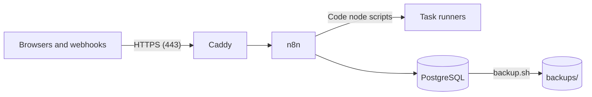

# Run n8n

Fork tooling (not in upstream n8n). This folder runs the fork in one of five ways. All five run the
same two images (n8n and the task runners), with the same n8n settings and the same safer defaults.

| Option | Folder | Tool | Database | Default |
|---|---|---|---|---|
| A Linux server (VM) | this folder | Docker Compose | PostgreSQL in a container, with `backup.sh` | One instance |
| Google Cloud Run | [cloud-run/](cloud-run/README.md) | Terraform | Cloud SQL | Queue mode |
| Amazon ECS on Fargate | [ecs/](ecs/README.md) | Terraform | Amazon RDS | One instance |
| Azure Container Apps | [container-apps/](container-apps/README.md) | Terraform | Azure Database for PostgreSQL | Queue mode |
| Kubernetes | [kubernetes/](kubernetes/README.md) | Helm | A PostgreSQL that you give | One instance |

- **The VM** is the simplest option, and costs the least. It runs on any provider and on your own
  hardware. Use it when one n8n instance is enough.
- **Cloud Run, ECS and Container Apps** have no server that you must update. The provider runs the
  containers, and the managed database keeps the backups. Terraform makes all the resources.
- **Kubernetes** is for an organisation that has a cluster and a team that runs it.
- Cloud Run and Container Apps can run an old and a new instance together for a short time when a
  new version starts. In queue mode, only the leader of the instances runs the schedules, so a
  schedule never runs two times. ECS and Kubernetes can stop the old instance before the new one
  starts, so one instance is safe there.
- Forgejo, the Git server of [forgejo/](forgejo/README.md), stays on its own VM in Google Cloud for
  all options.

Each option has a README. The rest of this file describes the VM. The sections
[End-user credentials](#end-user-credentials), [Gateway credits](#gateway-credits),
[Safer defaults](#safer-defaults), [SSO](#sso) and [Governance](#governance) describe n8n. They are
true for all options, with the names of the next table in place of the names of `.env`.

## Settings of the other options

The four other options read [settings.yaml](settings.yaml). It holds the n8n settings that the VM
gets from `docker-compose.yml` and `.env.example`, with the names of the n8n environment variables.
To change one, set it in the variable `settings` of the Terraform module, or in `settings` of the
values of the chart. This file gives the names of `.env`. This table gives the n8n name of each:

| `.env` of the VM | n8n setting |
|---|---|
| `TIMEZONE` | `GENERIC_TIMEZONE` and `TZ` |
| `GIT_SYNC_ALLOWED_HOSTS` | `N8N_GIT_SYNC_ALLOWED_HOSTS` |
| `FORK_FEATURES_ENABLED` | `N8N_FORK_FEATURES_ENABLED` |
| `NON_PRODUCTION_BANNER` | `N8N_FORK_NON_PRODUCTION_BANNER` |
| `WORKFLOW_HISTORY_PRUNE_TIME` | `N8N_WORKFLOW_HISTORY_PRUNE_TIME` |
| `TELEMETRY` | `N8N_DIAGNOSTICS_ENABLED` |
| `UPDATE_NOTICES` | `N8N_VERSION_NOTIFICATIONS_ENABLED` and `N8N_VERSION_NOTIFICATIONS_WHATS_NEW_ENABLED`, both with the same value |
| `SSRF_PROTECTION` | `N8N_SSRF_PROTECTION_ENABLED` |
| `SSRF_ALLOWED_HOSTNAMES` | `N8N_SSRF_ALLOWED_HOSTNAMES` |
| `SSRF_ALLOWED_IP_RANGES` | `N8N_SSRF_ALLOWED_IP_RANGES`. Keep `127.0.0.1/32` in it for the AI gateway. |
| `SESSION_HOURS` | `N8N_USER_MANAGEMENT_JWT_DURATION_HOURS` |
| `SESSION_RENEWAL_HOURS` | `N8N_USER_MANAGEMENT_JWT_REFRESH_TIMEOUT_HOURS` |
| `SECURITY_POLICY_FROM_ENV` | `N8N_SECURITY_POLICY_MANAGED_BY_ENV` |
| `MFA_ENFORCED` | `N8N_MFA_ENFORCED_ENABLED` |
| `PERSONAL_SPACE_PUBLISHING` | `N8N_PERSONAL_SPACE_PUBLISHING_ENABLED` |
| `PERSONAL_SPACE_SHARING` | `N8N_PERSONAL_SPACE_SHARING_ENABLED` |
| `WORKFLOW_REVIEWS` | `N8N_WORKFLOW_REVIEWS_ENABLED` |
| `REDACTION_FLOOR` | `N8N_REDACTION_ENFORCEMENT_FLOOR` |
| `OPEN_TRIGGERS_NEED_APPROVAL` | `N8N_OPEN_TRIGGERS_NEED_APPROVAL` |
| `SSO_FROM_ENV` | `N8N_SSO_MANAGED_BY_ENV`, `N8N_SSO_OIDC_LOGIN_ENABLED` and `N8N_SSO_SCOPES_USE_EXPRESSION_MAPPING`, all three with the same value |
| `OIDC_DISCOVERY_URL` | `N8N_SSO_OIDC_DISCOVERY_ENDPOINT` |
| `OIDC_CLIENT_ID` | `N8N_SSO_OIDC_CLIENT_ID` |
| `OIDC_ADDITIONAL_SCOPES` | `N8N_SSO_OIDC_ADDITIONAL_SCOPES` |
| `COMMUNITY_PACKAGES_REGISTRY` | `N8N_COMMUNITY_PACKAGES_REGISTRY` |
| `ENABLED_MODULES` | `N8N_ENABLED_MODULES` |
| `PROMOTIONS_EDITOR` | `N8N_ENV_FEAT_PROMOTIONS` |
| `CREDENTIAL_RESOLVERS` | `N8N_ENV_FEAT_DYNAMIC_CREDENTIALS` |
| `EVALUATIONS` | `N8N_EVAL_COLLECTIONS_ENABLED`, `N8N_CONFIG_EVALS_ENABLED` and `N8N_AGENT_EVALS_ENABLED` |
| `EVALUATION_CONCURRENCY` | `N8N_CONCURRENCY_EVALUATION_LIMIT` |
| `DYNAMIC_CREDENTIALS_CORS_ORIGIN` | `N8N_DYNAMIC_CREDENTIALS_CORS_ORIGIN` |

- **Secrets** go to the secret store of the option, not to `settings`: `OIDC_CLIENT_SECRET`
  becomes `N8N_SSO_OIDC_CLIENT_SECRET`, `COMMUNITY_PACKAGES_AUTH_TOKEN` becomes
  `N8N_COMMUNITY_PACKAGES_AUTH_TOKEN`, and `DYNAMIC_CREDENTIALS_ENDPOINT_AUTH_TOKEN` becomes
  `N8N_DYNAMIC_CREDENTIALS_ENDPOINT_AUTH_TOKEN`.
- **The IP limits** (`WEBHOOK_ALLOWED_RANGES` and `FORM_ALLOWED_RANGES`) are values of the module
  or of the chart. Each README tells their names.
- **Keep the options the same.** When you change `docker-compose.yml` or `.env.example`, change
  `settings.yaml` and the copy in `kubernetes/n8n/values.yaml` too.
  `node --test deploy/settings.test.mjs` checks that they agree.

## Run n8n on a Linux server

This setup runs the fork on one Linux server with Docker Compose. It does not depend on a cloud
provider: use a virtual machine on Azure, Google Cloud, AWS, Hetzner or another provider, or your
own hardware. To move to another provider, make a new server and restore a backup.



| Service | Purpose |
|---|---|
| `caddy` | Gets and renews the HTTPS certificate for your domain, and sends the traffic to n8n |
| `n8n` | The fork's n8n image |
| `runners` | Runs the JavaScript and Python code of the Code nodes, apart from n8n |
| `postgres` | All n8n data, including the files from workflows |

Only Caddy is reachable from outside. n8n, the runners and PostgreSQL have no open ports.

## What you need

- A Linux virtual machine with an x86-64 (amd64) processor, 2 CPUs, 4 GB of memory and a 30 GB
  disk. Ubuntu 24.04 LTS is a good choice. The images are for x86-64 only.
- A domain name for n8n, for example `n8n.example.com`.
- Open ports 22 (SSH), 80 and 443 in the firewall of the provider.
- The n8n image and the runners image in a registry, and a token that can read them.
  `scripts/build-images.sh --push` in the repository builds the two images and pushes them to
  GitHub Container Registry.

## Install

1. Point the DNS record (type A) of the domain at the public IP address of the server.
2. Install Docker Engine with the Compose plugin. Follow
   <https://docs.docker.com/engine/install/> for your Linux distribution.
3. Copy this folder to the server, for example to `/opt/n8n`:

   ```bash
   scp -r deploy you@your-server:/opt/n8n
   ```

4. On the server, make the settings file and set the values in it. Make each secret with
   `openssl rand -hex 32`. `HTTP_PORT` and `HTTPS_PORT` set the ports of Caddy on the server, and
   Caddy needs 80 and 443 to get the HTTPS certificate.

   ```bash
   cd /opt/n8n
   cp .env.example .env
   chmod 600 .env
   ```

5. Save `N8N_ENCRYPTION_KEY` in a password manager. A restore needs it.
6. Log in to the registry. For GitHub Container Registry, use a personal access token (classic)
   with the `read:packages` scope. Type the token at the prompt, not in the command.

   ```bash
   docker login ghcr.io -u your-github-user
   ```

7. Start n8n:

   ```bash
   docker compose up -d
   ```

8. Open `https://<your domain>` and make the owner account. Until then, anyone who reaches the
   page can make it. n8n then asks you to set up two-factor authentication for it.

`docker compose ps` shows the four services. `docker compose logs -f n8n` shows the n8n log.

## Back up

- `backup.sh` writes a database backup to `backups/`. It removes backups that are older than
  14 days (set `KEEP_DAYS` to change this).
- Run it every night with cron (`sudo crontab -e`):

  ```text
  0 3 * * * /opt/n8n/backup.sh >> /opt/n8n/backups/backup.log 2>&1
  ```

- Copy `backups/` to storage outside the server, for example a storage bucket at another
  provider. A backup on the same disk is lost with the server.
- Do a test restore from time to time.

## Restore, or move to another server

1. On the new server, do steps 2 to 7 of [Install](#install). Use the same `.env`, so that
   `N8N_ENCRYPTION_KEY` is the same.
2. Copy the backup file to the server.
3. Restore it. The script asks for a confirmation, stops n8n, restores the database, and starts
   n8n again. With `--yes` before the file name, the script does not ask for the confirmation.

   ```bash
   ./restore.sh backups/n8n-<time>.dump
   ```

4. Point the DNS record at the new server. Caddy then gets the HTTPS certificate.

## Update n8n

1. Make a backup. A new version can change the database.

   ```bash
   ./backup.sh
   ```

2. Get the new images and start them:

   ```bash
   docker compose pull
   docker compose up -d
   ```

To run a specific version, set its tag in `N8N_IMAGE` and in `N8N_RUNNERS_IMAGE`. Use the same
tag for the two images. A tag has the n8n version and the first 10 characters of the commit, for
example `2.42.0-d6cf9d5ab6`. `latest` is the newest push.

## Development and production

Use two servers, one for development and one for production. Each server has its own domain and
its own `.env`. Connect both to the same Git branch in **Settings > Git sync**: push in
development, and pull in production. See the
[Git sync README](../packages/cli/src/modules/git-sync/README.md).

For the Git repository, you can run Forgejo, a private Git server, on its own VM in Google Cloud.
Each n8n instance then connects with its own token, and the users of n8n do not use Git. See
[forgejo/README.md](forgejo/README.md).

On the development server, set `NON_PRODUCTION_BANNER=true` in `.env`. Each page then shows a
banner that tells that the instance is not for production, so that users do not mix up the two
servers.

## End-user credentials

The fork turns on end-user credentials (dynamic credentials). Each user connects their own account
to an end-user credential, for example with the OAuth flow, and a run of that user uses it. For
webhooks of apps, an admin adds a credential resolver at **Settings > Credential resolvers**: an
OAuth2 server or a Slack app then identifies the user of each request. For an app that calls the
endpoints of dynamic credentials, set `DYNAMIC_CREDENTIALS_CORS_ORIGIN` and
`DYNAMIC_CREDENTIALS_ENDPOINT_AUTH_TOKEN` in `.env`. See the
[README of the module](../packages/cli/src/modules/dynamic-credentials/README.md).

## Gateway credits

The fork has its own AI gateway for Gateway credits. Users run AI nodes (OpenAI, Anthropic, Google
Gemini, Ollama and other providers) without an API key of their own. To set it up, an admin:

1. Creates a credential for each provider, with the API key of the organisation. An Azure OpenAI
   credential can serve the OpenAI nodes, and a Google service account can serve the Gemini nodes
   and the open models of Vertex AI (for example Llama and DeepSeek) through Vertex AI. The fork
   node Google Cloud OCR reads text with the Cloud Vision API and Document AI through the gateway
   too.
2. Opens **Settings > Gateway credits admin**, picks the credential of each provider, sets the
   monthly budget, and turns on the gateway.

Users then pick **Use Gateway credits** on a supported node. The gateway records the cost of each
call and stops the calls when a budget is spent. An admin adds top-ups and sets the prices on the
same page. This stack runs the nodes in the n8n container, so the gateway needs no setting in
`.env`. In queue mode, the workers run the nodes and call the gateway on the main instances: the
other options set its address for them. See the
[README of the module](../packages/cli/src/modules/ai-gateway/README.md).

## Limits

- The scripts of the Code node can import only some modules: `crypto` and `moment` in
  JavaScript, and no modules in Python. To add modules, build an image from the runners image.
  See [Task runners](https://docs.n8n.io/hosting/configuration/task-runners/) in the n8n
  documentation.
- This setup runs one n8n instance on one server. The nightly backup is the protection against
  the loss of the server.
- This setup keeps the files of workflows in PostgreSQL. To keep them in a bucket of S3, Azure
  Blob or Google Cloud Storage, add the variables of
  [the FORK.md of the blob storage](../packages/@n8n/blob-storage/FORK.md#set-up) to the `n8n`
  service in a `docker-compose.override.yml`. The database backup then does not contain the
  files: back up the bucket too.
- This setup does not use queue mode. Queue mode with workers needs Redis and more containers.
  Cloud Run and Container Apps use queue mode by default, and ECS and Kubernetes can use it. The
  fork then also gives the worker view (Settings > Workers), worker pools
  (`N8N_WORKER_POOLS_ENABLED=true`) and multiple main instances
  (`N8N_MULTI_MAIN_SETUP_ENABLED=true`). See
  [Queue mode](https://docs.n8n.io/hosting/scaling/queue-mode/) in the n8n documentation and
  [the FORK.md of the scaling code](../packages/cli/src/scaling/FORK.md).
- deploy/ does not turn on token exchange (`N8N_ENV_FEAT_TOKEN_EXCHANGE=true`, then
  `N8N_TOKEN_EXCHANGE_ENABLED=true` with `N8N_TOKEN_EXCHANGE_TRUSTED_KEYS`) or worker pools
  (`N8N_WORKER_POOLS_ENABLED=true`, queue mode only). To use them, set the variables in a
  `docker-compose.override.yml` on the VM, or in `settings` of the other options.

## Safer defaults

This setup is for an organisation in which many people build workflows. It starts with these
defaults. Each line of `.env.example` tells how to change one of them.

| Default | What users notice | Change it in `.env` |
|---|---|---|
| SSRF protection | A node cannot call private, loopback or link-local addresses, also not the metadata server of the cloud. The error tells the user to ask an admin. | Open each internal host that workflows need: `SSRF_ALLOWED_HOSTNAMES`, `SSRF_ALLOWED_IP_RANGES`. `SSRF_PROTECTION=false` turns it off. |
| Sessions of 12 hours that renew while users work | A request in the last 3 hours of a session renews it, so users stay signed in while they work. A session without use ends after 12 hours at most, and the user signs in again. With SSO, that is one click. Deleting or disabling a user ends their sessions at once. | `SESSION_HOURS`, `SESSION_RENEWAL_HOURS` |
| Two-factor authentication | A user who signs in with a password (email or LDAP) sets up two-factor authentication first. OIDC and SAML users do not see it: their identity provider handles the second factor. | `MFA_ENFORCED` |
| No publishing and sharing from personal spaces | Users can build and run workflows in their personal spaces, with their own credentials. To publish or share a workflow, or to use the credentials of a team, they work in a team project: build there from the start, or use **Move to a team project** next to the Publish button. The owner and the admins are not limited. | `PERSONAL_SPACE_PUBLISHING`, `PERSONAL_SPACE_SHARING` |
| Workflow reviews on | A user can send a workflow version to a reviewer. The approval publishes it. | `WORKFLOW_REVIEWS` |
| Open triggers need an approval | A new webhook, form, public chat or MCP server without authentication does not publish. The editor offers a one-click fix (a token, or n8n sign-in) and **Request approval**. The triggers that are published now keep running. The test URL of such a trigger takes calls only from n8n users who may run the workflow: a builder tests in the browser as before, and a call from another system needs the token of the trigger. | `OPEN_TRIGGERS_NEED_APPROVAL` |
| No usage data to n8n.io | n8n sends no telemetry and asks users for no feedback. The editor shows no "What's new" notes and no update notices of n8n, because the fork gets its updates from its own repository. The templates of n8n stay available. | `TELEMETRY`, `UPDATE_NOTICES` |
| Limits for webhooks and forms | None until you set the IP ranges. Then other addresses get 403 for webhooks, chats and MCP servers, or for forms. | `WEBHOOK_ALLOWED_RANGES`, `FORM_ALLOWED_RANGES` |

- **Open the internal services before users start.** SSRF protection stops the calls to private
  addresses, and a builder cannot change that. List the internal services that workflows call over
  HTTP, for example an internal CRM or API, in `SSRF_ALLOWED_HOSTNAMES` (host names, also
  `*.corp.internal`) or `SSRF_ALLOWED_IP_RANGES`, then run `docker compose up -d`. When a user needs
  another host later, the error of the node tells them to ask an admin.
- **The security policy comes from `.env`.** At each start, n8n sets two-factor enforcement, the
  personal space rules, workflow reviews and the redaction floor (`REDACTION_FLOOR`) from `.env`.
  Settings > Security & policies shows them read-only, so an admin account cannot loosen them.
  `SECURITY_POLICY_FROM_ENV=false` gives the page back to the admins.
- **The AI gateway stays open.** The AI nodes call the gateway of the fork on `127.0.0.1`, so SSRF
  protection always allows that address.
- **The IP limits use the address that Caddy sees.** When a load balancer or another proxy is in
  front of Caddy, set its ranges in the `trusted_proxies` option of the `Caddyfile`, else Caddy sees
  only the address of the proxy. Then set `N8N_PROXY_HOPS: 2` for the `n8n` service in a
  `docker-compose.override.yml`, so that n8n gets the address of the caller too.
- **An existing server gets the defaults with its next update.** A `.env` without these lines uses
  the defaults of `docker-compose.yml`. Add the lines to `.env` before the update to keep the old
  behaviour.

## SSO

Users sign in with the identity provider of the organisation over OIDC, for example Microsoft Entra
ID, Okta, Google or Keycloak. Their groups give their roles: the SSO group rules map each group to
an instance role and to the roles of the team projects. `platform/setup.mjs` makes these rules, the
team projects and the team credentials from one config file. See
[platform/README.md](platform/README.md).

1. In the identity provider, register n8n as an OIDC web application with the redirect URL
   `https://<DOMAIN>/rest/sso/oidc/callback`. Give the application only to the groups of n8n.
   Make the identity provider send the groups (see
   [the groups claim](platform/README.md#the-groups-claim-of-your-identity-provider)).
2. In `.env`, set `SSO_FROM_ENV=true`, `OIDC_DISCOVERY_URL`, `OIDC_CLIENT_ID` and
   `OIDC_CLIENT_SECRET`. The discovery URL ends with `/.well-known/openid-configuration`, for
   example `https://login.microsoftonline.com/<tenant ID>/v2.0/.well-known/openid-configuration`
   for Entra ID, or `https://<host>/realms/<realm>/.well-known/openid-configuration` for Keycloak.
3. Run `docker compose up -d`. At each start, n8n sets the OIDC sign-in, and the role mapping
   method "Map rules inside n8n". Settings > SSO shows them read-only.
4. Make the team projects, the SSO group rules and the team credentials:
   `node platform/setup.mjs plan`, then `node platform/setup.mjs apply`. Without Node.js on the
   server, run the tool in a container of the stack (see [platform/README.md](platform/README.md)).
5. Sign in with a test account of each group. Settings > Users shows the role, and each team
   project shows its members.

- **The owner keeps the password.** With SSO, only the owner can sign in with an email address and
  a password (with two-factor authentication). Keep the owner account for emergencies, for example
  when the identity provider is down, and use an SSO account for daily work.
- **The rules set the roles.** When rules exist, n8n sets the roles of an SSO user at each sign-in,
  and nobody can change these roles by hand. Change the groups in the identity provider, or change
  `platform.json` and run `apply`. Start with the instance roles: project rules set the members of
  all team projects (see [platform/README.md](platform/README.md#the-sso-group-rules)).
- **SAML.** For SAML, keep `SSO_FROM_ENV=false`, and set SAML on the page Settings > SSO. With
  `SSO_FROM_ENV=true` (`N8N_SSO_MANAGED_BY_ENV=true`), n8n replaces the SAML settings at each start
  and the page cannot change them, so SAML from the environment always uses the default attribute
  mapping and signing settings. On the same page, set **Role assignment** to "Instance and project roles via SSO", and **Role mapping
  method** to "Map rules inside n8n". The SSO group rules then work the same way: set
  `groupsClaim` to the name of the group attribute.
- **Check the setup each week.** `node platform/setup.mjs check` tells whether the team projects,
  the rules and the team credentials are all there, and whether the personal space limits are on.

## Security

- Keep the server up to date. On Ubuntu, `unattended-upgrades` installs the security updates.
- Open only ports 22, 80 and 443.
- `.env` holds the secrets. Only root must be able to read it.
- The scripts of the Code nodes run in the `runners` container, not in the n8n container. That
  container gets no database password and no encryption key. It connects to n8n with
  `N8N_RUNNERS_AUTH_TOKEN`.

## Governance

The owner and the admins see all workflows, also the workflows that users build in their personal
spaces. A user cannot hide a workflow from them.

- **See what users build.** The Overview page lists all workflows, and each card shows the owner.
  The filter **Owner** shows the workflows of one user. An admin can open each workflow, its
  executions and its versions.
- **The public API.** With an API key of the owner or an admin, `GET /api/v1/workflows` lists all
  workflows, `GET /api/v1/projects` lists all projects (also the personal projects),
  `GET /api/v1/users` lists the users and their roles, and `GET /api/v1/executions` lists the
  executions. `GET /api/v1/insights/by-workflow` gives the executions, the failures, the run time
  and the time saved of each workflow (scope `insights:read`). Give an API key only the scopes that
  it needs.
- **Reviews.** `GET /api/v1/inventory/workflows` gives each workflow in one call: its status, home
  project, owner, shares, node types, credentials, triggers and newest executions (scopes
  `workflow:list` and `execution:list`). `GET /api/v1/api-keys` lists the API keys of all users,
  with the scopes, the expiry and the last use, but not the values of the keys (scope
  `apiKey:manage`). `GET /api/v1/users` gives `lastActiveAt`, the day of the last request of each
  user: an old day or null shows an unused account. See
  [packages/cli/src/governance/README.md](../packages/cli/src/governance/README.md).
- **Open triggers.** Settings > Open triggers lists each webhook, form, public chat and MCP server
  without authentication in the published workflows, and tells which ones a workflow review
  approved. `GET /api/v1/inventory/open-triggers` gives the same list (scope `workflow:list`).
  With `OPEN_TRIGGERS_NEED_APPROVAL=true`, a new open trigger publishes only after an approval. See
  [the README of the module](../packages/cli/src/modules/open-triggers/README.md).
- **A weekly report.** The workflow `workflows/governance-report.json` uses these routes. Each
  Monday at 08:00 (in the time zone `TIMEZONE` of `.env`), it sends an email with the published
  workflows in personal spaces, the published workflows with failed executions or unpublished
  changes, the open triggers without an approval, the expired and unused API keys, the inactive
  users and the old invitations. To use
  it, open a new workflow and select **⋯ > Import > From file**. The note on the workflow tells
  how to set it up.
- **The audit log.** Settings > Audit log shows who created, changed, published, archived or deleted
  a workflow, and each execution, for 90 days. Each event keeps its project, so the filter
  **Project: Personal spaces** shows what users did in their personal spaces. An API key with the
  scope `auditLogs:manage` reads the same events with `GET /api/v1/audit-log/events` and
  `GET /api/v1/audit-log/export` (filter `projectType=personal`). Log streaming (Settings > Log
  streaming) sends the same events to your log system: a webhook, a syslog server or Sentry.
  `FORK_FEATURES_ENABLED=false` turns off the audit log and log streaming, with the other features
  of the fork.
- **Log streaming from the environment.** With `N8N_LOG_STREAMING_MANAGED_BY_ENV=true`, n8n takes
  the destinations from `N8N_LOG_STREAMING_DESTINATIONS` (a JSON array) at each start, and
  Settings > Log streaming shows them read-only. See the
  [README of the module](../packages/cli/src/modules/log-streaming/README.md).
- **Rules for personal spaces.** By default, users cannot publish or share the workflows of their
  personal spaces, and no execution data is hidden (`PERSONAL_SPACE_PUBLISHING`,
  `PERSONAL_SPACE_SHARING` and `REDACTION_FLOOR` in `.env`, see [Safer defaults](#safer-defaults)).
  With `SECURITY_POLICY_FROM_ENV=false`, an admin sets these rules on Settings > Security & policies
  instead.
- **Node types.** Node type policies limit the node types and the credential types of a project or
  of the instance. Write the rules with the public API (`/api/v1/node-type-policies` and
  `/api/v1/credential-type-policies`). The editor shows a lock on a blocked node type.
- **Two-factor sign-in.** By default, all users who sign in with a password (email or LDAP) must use
  two-factor authentication (2FA): a user without 2FA sets it up before they can work
  (`MFA_ENFORCED` in `.env`). OIDC and SAML users sign in through your identity provider, which
  handles their second factor. With `SECURITY_POLICY_FROM_ENV=false`, an admin who uses 2FA sets the rule
  on Settings > Security & policies instead.
- **Workflow history.** n8n keeps each saved version of a workflow. The workflow history shows who
  saved each version, compares two versions, and can give a version a name. By default, n8n keeps
  all versions. `WORKFLOW_HISTORY_PRUNE_TIME` in `.env` sets the hours that n8n keeps old
  versions.
- **Community nodes from your own registry.** To install community nodes only from a registry
  that you control, for example AWS CodeArtifact, Azure Artifacts or Google Artifact Registry, set
  `COMMUNITY_PACKAGES_REGISTRY` and `COMMUNITY_PACKAGES_AUTH_TOKEN` in `.env`.
- **Team projects for users.** By default, only the owner and the admins can create team projects.
  To let some users create them, add a role on Settings > Roles > Instance roles with the
  permission **Projects: Create**, and give the role to these users. With SSO, a role mapping rule
  can give the role to a group. The user who creates a team project becomes its admin.

## Files

| File | Purpose |
|---|---|
| `docker-compose.yml` | The four services |
| `platform/` | The setup of the team projects, the SSO group rules and the team credentials (`setup.mjs`) |
| `Caddyfile` | The HTTPS proxy, with the IP limits for webhooks and forms |
| `.env.example` | The settings. Copy it to `.env` |
| `backup.sh` | Makes a database backup |
| `restore.sh` | Restores a backup |
| `workflows/governance-report.json` | A workflow that sends a weekly governance report by email |
| `forgejo/` | Forgejo, a private Git server for the Git features, on its own VM in Google Cloud |
| `settings.yaml` | The n8n settings of the other options |
| `settings.test.mjs` | Checks that all options use the same settings (`node --test deploy/settings.test.mjs`) |
| `cloud-run/`, `ecs/`, `container-apps/` | The Terraform modules for Cloud Run, ECS and Container Apps |
| `kubernetes/` | The Helm chart for Kubernetes |
