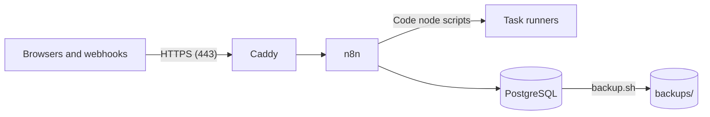

# Run n8n on a Linux server

Fork tooling (not in upstream n8n). This folder runs the fork on one Linux server with Docker
Compose. It does not depend on a cloud provider: use a virtual machine on Azure, Google Cloud,
AWS, Hetzner or another provider, or your own hardware. To move to another provider, make a new
server and restore a backup.



| Service | Purpose |
|---|---|
| `caddy` | Gets and renews the HTTPS certificate for your domain, and sends the traffic to n8n |
| `n8n` | The fork's n8n image |
| `runners` | Runs the JavaScript and Python code of the Code nodes, apart from n8n |
| `postgres` | All n8n data, including the files from workflows |

Only Caddy is reachable from outside. n8n, the runners and PostgreSQL have no open ports.

## What you need

- A Linux virtual machine with an x86-64 (amd64) processor, 2 CPUs, 4 GB of memory and a 30 GB
  disk. Ubuntu 24.04 LTS is a good choice. The images are for x86-64 only.
- A domain name for n8n, for example `n8n.example.com`.
- Open ports 22 (SSH), 80 and 443 in the firewall of the provider.
- The n8n image and the runners image in a registry, and a token that can read them.
  `scripts/build-images.sh --push` in the repository builds the two images and pushes them to
  GitHub Container Registry.

## Install

1. Point the DNS record (type A) of the domain at the public IP address of the server.
2. Install Docker Engine with the Compose plugin. Follow
   <https://docs.docker.com/engine/install/> for your Linux distribution.
3. Copy this folder to the server, for example to `/opt/n8n`:

   ```bash
   scp -r deploy you@your-server:/opt/n8n
   ```

4. On the server, make the settings file and set the values in it. Make each secret with
   `openssl rand -hex 32`.

   ```bash
   cd /opt/n8n
   cp .env.example .env
   chmod 600 .env
   ```

5. Save `N8N_ENCRYPTION_KEY` in a password manager. A restore needs it.
6. Log in to the registry. For GitHub Container Registry, use a personal access token (classic)
   with the `read:packages` scope. Type the token at the prompt, not in the command.

   ```bash
   docker login ghcr.io -u your-github-user
   ```

7. Start n8n:

   ```bash
   docker compose up -d
   ```

8. Open `https://<your domain>` and make the owner account. Turn on two-factor authentication
   for it.

`docker compose ps` shows the four services. `docker compose logs -f n8n` shows the n8n log.

## Back up

- `backup.sh` writes a database backup to `backups/`. It removes backups that are older than
  14 days (set `KEEP_DAYS` to change this).
- Run it every night with cron (`sudo crontab -e`):

  ```text
  0 3 * * * /opt/n8n/backup.sh >> /opt/n8n/backups/backup.log 2>&1
  ```

- Copy `backups/` to storage outside the server, for example a storage bucket at another
  provider. A backup on the same disk is lost with the server.
- Do a test restore from time to time.

## Restore, or move to another server

1. On the new server, do steps 1 to 7 of [Install](#install). Use the same `.env`, so that
   `N8N_ENCRYPTION_KEY` is the same.
2. Copy the backup file to the server.
3. Restore it. The script asks for a confirmation, stops n8n, restores the database, and starts
   n8n again.

   ```bash
   ./restore.sh backups/n8n-<time>.dump
   ```

4. Point the DNS record at the new server.

## Update n8n

1. Make a backup. A new version can change the database.

   ```bash
   ./backup.sh
   ```

2. Get the new images and start them:

   ```bash
   docker compose pull
   docker compose up -d
   ```

To run a specific version, set its tag in `N8N_IMAGE` and in `N8N_RUNNERS_IMAGE`. Use the same
tag for the two images. A tag has the n8n version and the commit, for example
`2.42.0-fb1b129d21`. `latest` is the newest push.

## Development and production

Use two servers, one for development and one for production. Each server has its own domain and
its own `.env`. Connect both to the same Git branch in **Settings > Git sync**: push in
development, and pull in production. See the
[Git sync README](../packages/cli/src/modules/git-sync/README.md).

On the development server, set `NON_PRODUCTION_BANNER=true` in `.env`. Each page then shows a
banner that tells that the instance is not for production, so that users do not mix up the two
servers.

## End-user credentials

The fork turns on end-user credentials (dynamic credentials). Each user connects their own account
to an end-user credential, for example with the OAuth flow, and a run of that user uses it. For
webhooks of apps, an admin adds a credential resolver at **Settings > Credential resolvers**: an
OAuth2 server or a Slack app then identifies the user of each request. An app that calls the
endpoints of dynamic credentials sets `DYNAMIC_CREDENTIALS_CORS_ORIGIN` and
`DYNAMIC_CREDENTIALS_ENDPOINT_AUTH_TOKEN` in `.env`. See the
[README of the module](../packages/cli/src/modules/dynamic-credentials/README.md).

## AI gateway

The fork has its own AI gateway for Gateway credits. Users run AI nodes (OpenAI, Anthropic, Google
Gemini, Ollama and other providers) without an API key of their own. To set it up, an admin:

1. Creates a credential for each provider, with the API key of the organization. An Azure OpenAI
   credential can serve the OpenAI nodes, and a Google service account can serve the Gemini nodes
   through Vertex AI.
2. Opens **Settings > AI gateway**, picks the credential of each provider, sets the monthly
   budget, and turns on the gateway.

Users then pick **Use Gateway credits** on a supported node. The gateway records the cost of each
call and stops the calls when a budget is spent. An admin adds top-ups and sets the prices on the
same page. This stack runs the nodes in the n8n container, so the gateway needs no setting in
`.env`. See the [README of the module](../packages/cli/src/modules/ai-gateway/README.md).

## Limits

- The scripts of the Code node can import only some modules: `crypto` and `moment` in
  JavaScript, and no modules in Python. To add modules, build an image from the runners image.
  See [Task runners](https://docs.n8n.io/hosting/configuration/task-runners/) in the n8n
  documentation.
- This setup runs one n8n instance on one server. The nightly backup is the protection against
  the loss of the server.
- This setup keeps the files of workflows in PostgreSQL. To keep them in a bucket of S3, Azure
  Blob or Google Cloud Storage, add the variables of
  [the FORK.md of the blob storage](../packages/@n8n/blob-storage/FORK.md#set-up) to the `n8n`
  service in a `docker-compose.override.yml`. The database backup then does not contain the
  files: back up the bucket too.
- This setup does not use queue mode. Queue mode with workers needs Redis and more containers. The
  fork then also gives the worker view (Settings > Workers), worker pools
  (`N8N_WORKER_POOLS_ENABLED=true`) and multiple main instances
  (`N8N_MULTI_MAIN_SETUP_ENABLED=true`). See
  [Queue mode](https://docs.n8n.io/hosting/scaling/queue-mode/) in the n8n documentation and
  [the FORK.md of the scaling code](../packages/cli/src/scaling/FORK.md).

## Security

- Keep the server up to date. On Ubuntu, `unattended-upgrades` installs the security updates.
- Open only ports 22, 80 and 443.
- `.env` holds the secrets. Only root must be able to read it.
- The scripts of the Code nodes run in the `runners` container, not in the n8n container. That
  container gets no database password and no encryption key. It connects to n8n with
  `N8N_RUNNERS_AUTH_TOKEN`.

## Governance

The owner and the admins see all workflows, also the workflows that users build in their personal
spaces. A user cannot hide a workflow from them.

- **See what users build.** The Overview page lists all workflows, and each card shows the owner.
  The filter **Owner** shows the workflows of one user. An admin can open each workflow, its
  executions and its versions.
- **The public API.** With an API key of the owner or an admin, `GET /api/v1/workflows` lists all
  workflows, `GET /api/v1/projects` lists all projects (also the personal projects),
  `GET /api/v1/users` lists the users and their roles, and `GET /api/v1/executions` lists the
  executions. `GET /api/v1/insights/by-workflow` gives the executions, the failures, the run time
  and the time saved of each workflow (scope `insights:read`). Give an API key only the scopes that
  it needs.
- **Reviews.** `GET /api/v1/inventory/workflows` gives each workflow in one call: its status, home
  project, owner, shares, node types, credentials, triggers and newest executions (scopes
  `workflow:list` and `execution:list`). `GET /api/v1/api-keys` lists the API keys of all users,
  with the scopes, the expiry and the last use, but not the values of the keys (scope
  `apiKey:manage`). `GET /api/v1/users` gives `lastActiveAt`, the day of the last request of each
  user: an old day or null shows an unused account. See
  [packages/cli/src/governance/README.md](../packages/cli/src/governance/README.md).
- **A weekly report.** The workflow `workflows/governance-report.json` uses these routes. Each
  Monday at 08:00 (in the time zone `TIMEZONE` of `.env`), it sends an email with the published
  workflows in personal spaces, the published workflows with failed executions or unpublished
  changes, the expired and unused API keys, the inactive users and the old invitations. To use
  it, open a new workflow and select **⋯ > Import > From file**. The note on the workflow tells
  how to set it up.
- **The audit log.** Settings > Audit log shows who created, changed, published, archived or deleted
  a workflow, and each execution, for 90 days. Each event keeps its project, so the filter
  **Project: Personal spaces** shows what users did in their personal spaces. An API key with the
  scope `auditLogs:manage` reads the same events with `GET /api/v1/audit-log/events` and
  `GET /api/v1/audit-log/export` (filter `projectType=personal`). Log streaming sends the same
  events to your log system.
- **Rules for personal spaces.** On Settings > Security & policies, an admin can stop publishing and
  sharing from personal spaces, and set the floor of data redaction for the instance. By default,
  users can publish and share from their personal spaces, and no data is hidden. To set these rules
  in the configuration instead, and lock the page, add `N8N_SECURITY_POLICY_MANAGED_BY_ENV=true`,
  `N8N_PERSONAL_SPACE_PUBLISHING_ENABLED` and `N8N_PERSONAL_SPACE_SHARING_ENABLED` to the
  environment of the `n8n` service.
- **Node types.** Node type policies limit the node types and the credential types of a project or
  of the instance. Write the rules with the public API (`/api/v1/node-type-policies` and
  `/api/v1/credential-type-policies`). The editor shows a lock on a blocked node type.
- **Two-factor sign-in.** On Settings > Security & policies, an admin can require two-factor
  authentication (2FA) for all users who sign in with email and password. The admin must use 2FA
  first. Users without 2FA then must set it up before they can work. SSO users sign in through
  your identity provider, which handles their second factor. To set the rule in the configuration
  instead, add `N8N_SECURITY_POLICY_MANAGED_BY_ENV=true` and `N8N_MFA_ENFORCED_ENABLED=true` to
  the environment of the `n8n` service.
- **Workflow history.** n8n keeps each saved version of a workflow. The workflow history shows who
  saved each version, compares two versions, and can give a version a name. By default, n8n keeps
  all versions. `WORKFLOW_HISTORY_PRUNE_TIME` in `.env` sets the hours that n8n keeps old
  versions.
- **Community nodes from your own registry.** To install community nodes only from a registry
  that you control, for example AWS CodeArtifact, Azure Artifacts or Google Artifact Registry, set
  `COMMUNITY_PACKAGES_REGISTRY` and `COMMUNITY_PACKAGES_AUTH_TOKEN` in `.env`.
- **Team projects for users.** By default, only the owner and the admins can create team projects.
  To let some users create them, add a role on Settings > Roles > Instance roles with the
  permission **Projects: Create**, and give the role to these users. With SSO, a role mapping rule
  can give the role to a group. The user who creates a team project becomes its admin.

## Files

| File | Purpose |
|---|---|
| `docker-compose.yml` | The four services |
| `Caddyfile` | The HTTPS proxy |
| `.env.example` | The settings. Copy it to `.env` |
| `backup.sh` | Makes a database backup |
| `restore.sh` | Restores a backup |
| `workflows/governance-report.json` | A workflow that sends a weekly governance report by email |
