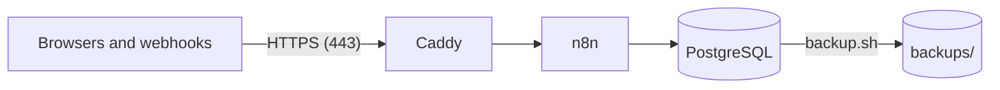

# Run n8n on a Linux server

Fork tooling (not in upstream n8n). This folder runs the fork on one Linux server with Docker
Compose. It does not depend on a cloud provider: use a virtual machine on Azure, Google Cloud,
AWS, Hetzner or another provider, or your own hardware. To move to another provider, make a new
server and restore a backup.



| Service | Purpose |
|---|---|
| `caddy` | Gets and renews the HTTPS certificate for your domain, and sends the traffic to n8n |
| `n8n` | The fork image |
| `postgres` | All n8n data, including the files from workflows |

Only Caddy is reachable from outside. n8n and PostgreSQL have no open ports.

## What you need

- A Linux virtual machine with 2 CPUs, 4 GB of memory and a 30 GB disk. Ubuntu 24.04 LTS is a
  good choice.
- A domain name for n8n, for example `n8n.example.com`.
- Open ports 22 (SSH), 80 and 443 in the firewall of the provider.
- The n8n image in a registry, and a token that can read it.

## Install

1. Point the DNS record (type A) of the domain at the public IP address of the server.
2. Install Docker Engine with the Compose plugin. Follow
   <https://docs.docker.com/engine/install/> for your Linux distribution.
3. Copy this folder to the server, for example to `/opt/n8n`:

   ```bash
   scp -r deploy you@your-server:/opt/n8n
   ```

4. On the server, make the settings file and set the values in it. Make each secret with
   `openssl rand -hex 32`.

   ```bash
   cd /opt/n8n
   cp .env.example .env
   chmod 600 .env
   ```

5. Save `N8N_ENCRYPTION_KEY` in a password manager. A restore needs it.
6. Log in to the registry. For GitHub Container Registry, use a personal access token (classic)
   with the `read:packages` scope. Type the token at the prompt, not in the command.

   ```bash
   docker login ghcr.io -u your-github-user
   ```

7. Start n8n:

   ```bash
   docker compose up -d
   ```

8. Open `https://<your domain>` and make the owner account. Turn on two-factor authentication
   for it.

`docker compose ps` shows the three services. `docker compose logs -f n8n` shows the n8n log.

## Back up

- `backup.sh` writes a database backup to `backups/`. It removes backups that are older than
  14 days (set `KEEP_DAYS` to change this).
- Run it every night with cron (`sudo crontab -e`):

  ```text
  0 3 * * * /opt/n8n/backup.sh >> /opt/n8n/backups/backup.log 2>&1
  ```

- Copy `backups/` to storage outside the server, for example a storage bucket at another
  provider. A backup on the same disk is lost with the server.
- Do a test restore from time to time.

## Restore, or move to another server

1. On the new server, do steps 1 to 7 of [Install](#install). Use the same `.env`, so that
   `N8N_ENCRYPTION_KEY` is the same.
2. Copy the backup file to the server.
3. Restore it. The script asks for a confirmation, stops n8n, restores the database, and starts
   n8n again.

   ```bash
   ./restore.sh backups/n8n-<time>.dump
   ```

4. Point the DNS record at the new server.

## Update n8n

1. Make a backup. A new version can change the database.

   ```bash
   ./backup.sh
   ```

2. Get the new image and start it:

   ```bash
   docker compose pull
   docker compose up -d
   ```

To run a specific version, set its tag in `N8N_IMAGE`.

## Development and production

Use two servers, one for development and one for production. Each server has its own domain and
its own `.env`. Connect both to the same Git branch in **Settings > Git sync**: push in
development, and pull in production. See the
[Git sync README](../packages/cli/src/modules/git-sync/README.md).

## Security

- Keep the server up to date. On Ubuntu, `unattended-upgrades` installs the security updates.
- Open only ports 22, 80 and 443.
- `.env` holds the secrets. Only root must be able to read it.

## Files

| File | Purpose |
|---|---|
| `docker-compose.yml` | The three services |
| `Caddyfile` | The HTTPS proxy |
| `.env.example` | The settings. Copy it to `.env` |
| `backup.sh` | Makes a database backup |
| `restore.sh` | Restores a backup |
