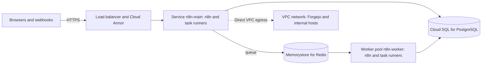

# n8n on Google Cloud Run

Fork tooling (not in upstream n8n). This Terraform module runs the fork on Cloud Run. It makes the
database (Cloud SQL for PostgreSQL), a load balancer with the HTTPS certificate and, in queue mode,
Memorystore for Redis and the workers. n8n gets the settings of [settings.yaml](../settings.yaml):
the safer defaults of the VM setup.



| Resource | Purpose |
|---|---|
| Cloud Run service `n8n-main` | The editor, the API, the webhooks and the forms. In queue mode, one to `main_max_instances` instances. Only the leader of the instances runs the schedules and the polling triggers. |
| Cloud Run worker pool `n8n-worker` | Queue mode: `worker_instances` workers that run the executions. |
| Cloud SQL instance `n8n-db` | All n8n data, also the files of workflows. It keeps a daily backup for `database.backup_days` days, and point-in-time recovery for 7 days. |
| Memorystore instance `n8n-redis` | Queue mode: the queue of the executions, with a password and TLS. |
| Load balancer and Cloud Armor | HTTPS with a certificate of Google, the redirect from HTTP to HTTPS, and the IP limits of webhooks and forms. |
| Artifact Registry repository `n8n-ghcr` | Gives the fork images of ghcr.io to Cloud Run. Cloud Run pulls only from Artifact Registry and Docker Hub. |
| Secret Manager secrets `n8n-*` | The encryption key, the token of the task runners and the passwords of the database and Redis. |

The names start with the value of `name` (default `n8n`). Each instance runs n8n and the task
runners in two containers. The task runners run the code of the Code nodes. They get no database
password and no encryption key. Only the load balancer reaches the service: the service has no URL
of its own.

## What you need

- A Google Cloud project with billing. You need the role Owner of the project, or roles that let
  you make the resources above and their IAM bindings.
- Terraform 1.9 or later and the Google Cloud CLI. Cloud Shell has both.
- A domain for n8n, for example `n8n.example.com`.
- The two fork images on ghcr.io (`scripts/build-images.sh --push`), and a GitHub user with a
  personal access token (classic) that has the scope `read:packages`.
- For queue mode: a VPC network with a subnetwork in the region. Cloud Run reaches Memorystore
  through Direct VPC egress. The network `default` works.

## Install

1. Sign in to Google Cloud:

   ```bash
   gcloud auth login
   gcloud auth application-default login
   ```

2. Keep the GitHub token in Secret Manager. Type the token at the prompt, not in a command:

   ```bash
   gcloud services enable secretmanager.googleapis.com --project=my-project
   read -rs GHCR_TOKEN
   printf '%s' "$GHCR_TOKEN" | gcloud secrets create ghcr-token --data-file=- --project=my-project
   unset GHCR_TOKEN
   ```

3. Make a folder for the instance, outside this repository, with this `main.tf`. Set the values.
   Keep the Terraform state in a private bucket, because the state holds the secrets of n8n.

   ```hcl
   terraform {
     backend "gcs" {
       bucket = "my-project-terraform"
       prefix = "n8n"
     }
   }

   provider "google" {
     project = "my-project"
   }

   module "n8n" {
     # The folder in a checkout of the fork, or
     # "git::https://github.com/sreent/n8n.git//deploy/cloud-run?ref=<commit>".
     source = "../n8n/deploy/cloud-run"

     project_id        = "my-project"
     region            = "europe-west1"
     domain            = "n8n.example.com"
     image_tag         = "2.42.0-1a2b3c4d5e"
     ghcr_username     = "my-github-user"
     ghcr_token_secret = "ghcr-token"
     network           = "projects/my-project/global/networks/default"
     subnetwork        = "projects/my-project/regions/europe-west1/subnetworks/default"
   }

   output "lb_ip_address" {
     value = module.n8n.lb_ip_address
   }
   ```

4. Make the resources. The first apply takes about 20 minutes.

   ```bash
   terraform init
   terraform apply
   ```

   If the apply stops with an error about the service agent of Artifact Registry, make the agent,
   and run `terraform apply` again:

   ```bash
   gcloud beta services identity create --service=artifactregistry.googleapis.com --project=my-project
   ```

5. Point the DNS record (type A) of the domain at the address `lb_ip_address`. With
   `dns_managed_zone`, the module makes the record. Google then makes the HTTPS certificate. This
   can take up to an hour. Until then, the browser shows a certificate error.
6. Open `https://<your domain>` and make the owner account. Until then, anyone who reaches the page
   can make it. n8n then asks you to set up two-factor authentication for the owner.
7. Keep a copy of the encryption key outside Google Cloud, for example in a password manager.
   Without the key, a backup of the database cannot be restored. This command shows the key:

   ```bash
   gcloud secrets versions access latest --secret=n8n-encryption-key --project=my-project
   ```

## Settings

- **n8n settings.** Set them in `settings`, with the names of [settings.yaml](../settings.yaml).
  [The table in the README of deploy/](../README.md#settings-of-the-other-options) gives the name
  for each value of `.env`. A value in `settings` replaces the value of settings.yaml and of the
  module.
- **Secrets.** Keep each secret in Secret Manager, and give its name in `extra_secrets`. The module
  lets the service account of n8n read it. For example, the sign-in with OIDC:

  ```hcl
  settings = {
    N8N_SSO_MANAGED_BY_ENV                = "true"
    N8N_SSO_OIDC_LOGIN_ENABLED            = "true"
    N8N_SSO_SCOPES_USE_EXPRESSION_MAPPING = "true"
    N8N_SSO_OIDC_DISCOVERY_ENDPOINT       = "https://login.microsoftonline.com/<tenant ID>/v2.0/.well-known/openid-configuration"
    N8N_SSO_OIDC_CLIENT_ID                = "<client ID>"
  }
  extra_secrets = {
    N8N_SSO_OIDC_CLIENT_SECRET = "n8n-oidc-client-secret"
  }
  ```

- **Size.** `n8n_resources` and `runners_resources` set the CPU and the memory of the two
  containers. `main_max_instances`, `worker_instances` and `worker_concurrency` set the size of
  queue mode. `database.tier` sets the size of Cloud SQL, and `database.availability_type =
  "REGIONAL"` keeps a standby in a second zone.

## Queue mode and single mode

- **Queue mode** (the default) runs the main instances and the workers. The main instances serve
  the editor, the API and the webhooks, and the workers run the executions. Only the leader of the
  main instances runs the schedules and the polling triggers. The module sets
  `N8N_MULTI_MAIN_SETUP_ENABLED=true` and `OFFLOAD_MANUAL_EXECUTIONS_TO_WORKERS=true`, so the
  workers also run the manual executions.
- **Single mode** (`mode = "single"`) runs one instance, without Redis and without workers. Cloud
  Run can run the old and the new instance together for a short time when a new version starts. A
  schedule can then run two times. Use single mode for development only.

## IP limits for webhooks and forms

`webhook_allowed_ranges` limits the addresses that can call webhooks, chats and MCP servers, and
`form_allowed_ranges` limits the addresses that can open and send forms. Cloud Armor answers other
addresses with 403. The editor, the API and the health path have no limit. Cloud Run reserves the
paths that end with z, such as `/healthz`, so the health path of n8n is `/health` here. Cloud Armor
sees the address of the caller, and n8n gets it from `X-Forwarded-For` (`N8N_PROXY_HOPS=2`).

## Redis

Memorystore signs its TLS certificate with a certificate authority of the instance. n8n checks the
certificate with that authority (`redis_verify_certificate = true`, the default). If the log of n8n
shows `Hostname/IP does not match certificate's altnames`, set `redis_verify_certificate = false`:
n8n then encrypts the connection, but does not check the certificate.

Google replaces the certificate authority of an instance rarely. Before the change, Memorystore
gives the old and the new authority together for some time. In that time, run `terraform apply`
again, and then start new instances of n8n, for example with the next `image_tag`. n8n reads the
authorities only when an instance starts.

## Forgejo and other private hosts

n8n reaches private addresses through Direct VPC egress of `network` and `subnetwork`. Other
traffic goes to the internet directly.

1. Run Forgejo ([forgejo/README.md](../forgejo/README.md)) in the same VPC network. In
   `gcp-create.sh`, set `N8N_SOURCE_RANGES` to the range of the subnetwork: Cloud Run takes the
   addresses of its instances from the whole range.
2. Give Git the root certificate of Forgejo: `git_ca_certificate = file("forgejo-root.crt")`. Git
   then trusts only this file. If the instance also uses a Git host with a public certificate, for
   example GitHub, give the certificates of the system too:
   `git_ca_certificate = join("", [file("/etc/ssl/certs/ca-certificates.crt"), file("forgejo-root.crt")])`.
3. For Git sync, set `N8N_GIT_SYNC_ALLOWED_HOSTS` in `settings` to the name of Forgejo.
4. For the nodes that call internal hosts over HTTP, open the hosts in `N8N_SSRF_ALLOWED_HOSTNAMES`
   or `N8N_SSRF_ALLOWED_IP_RANGES` (see
   [Safer defaults](../README.md#safer-defaults)).

When n8n cannot connect to Forgejo, the error tells the cause. An error about the SSL certificate
tells that Git does not trust the certificate. An error about the host name tells that the DNS zone
of Forgejo is not in the VPC network.

## Move from the VM

The data of the VM goes into Cloud SQL. n8n needs the encryption key of the VM to read the
credentials.

1. On the VM, stop n8n, and make a backup. From then on, the VM takes no changes.

   ```bash
   docker compose stop n8n
   ./backup.sh
   ```

2. Copy the backup file to your computer or to Cloud Shell.
3. Keep the encryption key of the VM (`N8N_ENCRYPTION_KEY` in `.env`) in Secret Manager. Type the
   key at the prompt:

   ```bash
   read -rs N8N_KEY
   printf '%s' "$N8N_KEY" | gcloud secrets create n8n-vm-encryption-key --data-file=- --project=my-project
   unset N8N_KEY
   ```

4. In `main.tf`, set `encryption_key_secret = "n8n-vm-encryption-key"`. Then make only the
   database:

   ```bash
   terraform apply -target=module.n8n.google_sql_user.n8n -target=module.n8n.google_secret_manager_secret_version.db_password
   ```

5. Restore the backup through the Cloud SQL Auth Proxy. Use `pg_restore` of PostgreSQL 18, the
   version of the VM, for example from the image `postgres:18-alpine`:

   ```bash
   cloud-sql-proxy my-project:europe-west1:n8n-db --port=5433 &
   export PGPASSWORD="$(gcloud secrets versions access latest --secret=n8n-db-password --project=my-project)"
   docker run --rm --network=host -e PGPASSWORD -v "$PWD:/backup:ro" postgres:18-alpine \
     pg_restore --host=127.0.0.1 --port=5433 --username=n8n --dbname=n8n --no-owner --no-acl /backup/n8n-<time>.dump
   unset PGPASSWORD
   kill %1
   ```

6. Make the other resources with `terraform apply`. n8n starts with the data of the VM. It installs
   the community nodes again.
7. Point the DNS record of the domain at the new address (step 5 of [Install](#install)).
8. Keep the VM until the new instance works. Then delete it.

## Update n8n

1. Make a backup. A new version can change the database.

   ```bash
   gcloud sql backups create --instance=n8n-db --project=my-project
   ```

2. Use the module of the commit of the tag (the part after the version), so that n8n gets the
   settings of [settings.yaml](../settings.yaml) of that commit. In a checkout of the fork, check
   out the commit. With a Git source, set `ref=` to the commit, and run `terraform init -upgrade`.
3. Set `image_tag` to the new tag, and run `terraform apply`. Cloud Run starts the new instances
   before it stops the old ones.

In queue mode, old and new instances run together for some minutes. Update when few executions
run.

## Back up and restore

- Cloud SQL keeps a daily backup for `database.backup_days` days (default 14), and the changes for
  point-in-time recovery for 7 days. The console of Cloud SQL restores a backup, or makes a new
  instance from a point in time.
- `database.deletion_protection` (default `true`) stops the deletion of the database, also by
  `terraform destroy`.
- Terraform never deletes the encryption key that it made (`prevent_destroy`). A restore needs the
  same key.

## Limits

- Cloud Run stops an instance 10 seconds after the stop signal. An execution that still runs on an
  old instance then stops.
- A request can take 60 minutes at most.
- Memorystore has the Basic tier, without a replica. A maintenance or a failure of the instance
  loses the queue: the executions that wait in the queue at that time do not run.
- The minimum instance, Cloud SQL, Memorystore and the load balancer cost money also when nobody
  uses n8n. n8n keeps its CPU between requests, because it runs schedules and other work.
- n8n keeps the files of workflows in Cloud SQL. To keep them in a bucket of Google Cloud Storage,
  add the settings of
  [the FORK.md of the blob storage](../../packages/@n8n/blob-storage/FORK.md#google-cloud-storage).
- Each new instance installs the community nodes from the npm registry
  (`N8N_REINSTALL_MISSING_PACKAGES`). The start then takes longer, and it needs the registry.

## Tests

The tests use mock providers. They need no Google Cloud project and cost nothing:

```bash
cd deploy/cloud-run
terraform init -backend=false
terraform test
```

## Files

| File | Purpose |
|---|---|
| `main.tf` | The settings of n8n, the APIs and the service account |
| `service.tf` | The Cloud Run service and the worker pool |
| `database.tf` | Cloud SQL |
| `redis.tf` | Memorystore, its password and its certificate authority |
| `load-balancer.tf` | The load balancer, the certificate, Cloud Armor and the DNS record |
| `registry.tf` | The Artifact Registry repository for ghcr.io |
| `secrets.tf` | The secrets of n8n in Secret Manager |
| `variables.tf`, `outputs.tf`, `versions.tf` | The interface of the module |
| `tests/cloud-run.tftest.hcl` | The tests with mock providers |
