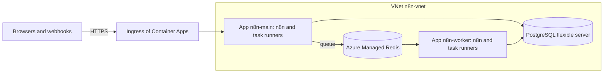

# n8n on Azure Container Apps

Fork tooling (not in upstream n8n). This Terraform module runs the fork on Azure Container Apps. It
makes a virtual network, the database (Azure Database for PostgreSQL flexible server) and, in queue
mode, Azure Managed Redis and the workers. n8n gets the settings of
[settings.yaml](../settings.yaml): the safer defaults of the VM setup.



| Resource | Purpose |
|---|---|
| Container app `n8n-main` | The editor, the API, the webhooks and the forms. Only the leader of the replicas runs the schedules and the polling triggers. |
| Container app `n8n-worker` | Queue mode: `worker_replicas` workers that run the executions. |
| PostgreSQL flexible server `n8n-db-<suffix>` | All n8n data, also the files of workflows. It has no public address, and keeps backups for `database.backup_days` days. A lock stops its deletion. |
| Azure Managed Redis `n8n-redis-<suffix>` | Queue mode: the queue of the executions, with a key and TLS, through a private endpoint. |
| VNet `n8n-vnet` | The subnets of the environment, the database and the private endpoints, in `address_space`. |
| Container Apps environment `n8n-env` and Log Analytics workspace `n8n-logs` | The environment of the apps, and their logs. |

The names start with the value of `name` (default `n8n`). The suffix makes the names of the
database and Redis unique in Azure. Each replica runs n8n and the task runners in two containers.
The task runners run the code of the Code nodes. They get no database password and no encryption
key. The secrets are secrets of the apps.

## What you need

- An Azure subscription, a resource group for n8n, Terraform 1.9 or later, and the Azure CLI. Cloud
  Shell has both. You need the role Owner of the resource group, or the roles Contributor and User
  Access Administrator.
- A domain for n8n, for example `n8n.example.com`, and access to its DNS records.
- The two fork images on ghcr.io (`scripts/build-images.sh --push`), and a GitHub user with a
  personal access token (classic) that has the scope `read:packages`.

## Install

1. Sign in to Azure:

   ```bash
   az login
   ```

2. Make a folder for the instance, outside this repository, with this `main.tf`. Set the values.
   Keep the Terraform state in a private storage account, because the state holds the secrets of
   n8n.

   ```hcl
   terraform {
     backend "azurerm" {
       resource_group_name  = "terraform-rg"
       storage_account_name = "myterraformstate"
       container_name       = "tfstate"
       key                  = "n8n.tfstate"
     }
   }

   provider "azurerm" {
     features {}
     subscription_id = "<subscription ID>"
   }

   # Give the token in the environment: read -rs TF_VAR_ghcr_token && export TF_VAR_ghcr_token
   variable "ghcr_token" {
     type      = string
     sensitive = true
   }

   module "n8n" {
     # The folder in a checkout of the fork, or
     # "git::https://github.com/sreent/n8n.git//deploy/container-apps?ref=<commit>".
     source = "../n8n/deploy/container-apps"

     resource_group_name = "n8n-rg"
     domain              = "n8n.example.com"
     image_tag           = "2.42.0-1a2b3c4d5e"
     registry            = { server = "ghcr.io", username = "my-github-user", password = var.ghcr_token }
   }

   output "app_fqdn" {
     value = module.n8n.app_fqdn
   }

   output "domain_verification_id" {
     value     = module.n8n.domain_verification_id
     sensitive = true
   }
   ```

3. Give the token, and make the resources. Type the token at the prompt. The first apply takes
   about 30 minutes, because Azure Managed Redis takes long.

   ```bash
   read -rs TF_VAR_ghcr_token && export TF_VAR_ghcr_token
   terraform init
   terraform apply
   ```

4. Add two DNS records for the domain: a CNAME record with the value of `app_fqdn`, and a TXT
   record `asuid.<domain>` with the value of `terraform output -raw domain_verification_id`.
5. Bind the domain to the app. Azure then makes a free certificate for it. This can take some
   minutes.

   ```bash
   az containerapp hostname add --resource-group n8n-rg --name n8n-main --hostname n8n.example.com
   az containerapp hostname bind --resource-group n8n-rg --name n8n-main --hostname n8n.example.com \
     --environment n8n-env --validation-method CNAME
   ```

   Terraform does not manage the domain of the app, so a later `terraform apply` keeps the
   binding.

6. Open `https://<your domain>` and make the owner account. Until then, anyone who reaches the page
   can make it. n8n then asks you to set up two-factor authentication for the owner.
7. Keep a copy of the encryption key outside Azure, for example in a password manager. Without the
   key, a backup of the database cannot be restored. This command shows the key:

   ```bash
   terraform output -raw encryption_key
   ```

   For this command, add an output `encryption_key` with the value `module.n8n.encryption_key` and
   `sensitive = true` to `main.tf`.

## Settings

- **n8n settings.** Set them in `settings`, with the names of [settings.yaml](../settings.yaml).
  [The table in the README of deploy/](../README.md#settings-of-the-other-options) gives the name
  for each value of `.env`. A value in `settings` replaces the value of settings.yaml and of the
  module.
- **Secrets.** Give them in `extra_secrets`, with the names of the environment variables. The module
  makes a secret of the app for each one. Give the values in the environment, as for the token of
  ghcr.io, not in `main.tf`. For example, the sign-in with OIDC:

  ```hcl
  variable "oidc_client_secret" {
    type      = string
    sensitive = true
  }

  module "n8n" {
    # ...
    settings = {
      N8N_SSO_MANAGED_BY_ENV                = "true"
      N8N_SSO_OIDC_LOGIN_ENABLED            = "true"
      N8N_SSO_SCOPES_USE_EXPRESSION_MAPPING = "true"
      N8N_SSO_OIDC_DISCOVERY_ENDPOINT       = "https://login.microsoftonline.com/<tenant ID>/v2.0/.well-known/openid-configuration"
      N8N_SSO_OIDC_CLIENT_ID                = "<client ID>"
    }
    extra_secrets = {
      N8N_SSO_OIDC_CLIENT_SECRET = var.oidc_client_secret
    }
  }
  ```

- **Size.** `n8n_resources` and `runners_resources` set the CPU and the memory of the two
  containers. Container Apps takes 0.5 Gi of memory for each 0.25 CPU, and at most 4 CPUs for each
  replica. `worker_replicas` and `worker_concurrency` set the size of queue mode.
  `database.sku_name` sets the size of the database. `database.zone_redundant = true` keeps a
  standby in a second zone, and needs a General Purpose size, for example `GP_Standard_D2ds_v5`.

## Queue mode and single mode

- **Queue mode** (the default) runs the main app and the workers. The main app serves the editor,
  the API and the webhooks, and the workers run the executions. Only the leader of the main replicas
  runs the schedules and the polling triggers. The module sets
  `N8N_MULTI_MAIN_SETUP_ENABLED=true` and `OFFLOAD_MANUAL_EXECUTIONS_TO_WORKERS=true`, so the
  workers also run the manual executions.
- **Single mode** (`mode = "single"`) runs one replica, without Redis and without workers. Container
  Apps can run the old and the new replica together for a short time when a revision changes. A
  schedule can then run two times. Use single mode for development only.
- Keep `main_replicas` at 1. The editor keeps a connection to one replica. Container Apps can send
  all requests of a browser to the same replica (session affinity), but the Terraform provider does
  not set it yet.

## IP limits

- `allowed_ranges` limits the addresses that can reach n8n at all. The ingress of Container Apps
  answers other addresses with 403.
- `webhook_allowed_ranges` limits the addresses that can call webhooks, chats and MCP servers, and
  `form_allowed_ranges` limits the addresses that can open and send forms. Container Apps limits the
  addresses of a whole app, not of a path, so the module then adds a Caddy container in front of n8n
  with the rules of the VM setup. Caddy answers other addresses with 403. The editor, the API and the
  health path have no limit.

## Forgejo and other private hosts

The apps reach the hosts of the VNet and of the networks that the VNet connects to. Forgejo
([forgejo/README.md](../forgejo/README.md)) runs in Google Cloud and has only an internal address.
n8n on Azure reaches it only through a VPN between the two networks.

1. Connect the VNet and the VPC network of Forgejo, for example with an Azure VPN gateway and Cloud
   VPN. The gateway needs a subnet `GatewaySubnet` in the VNet. The module uses only the first /22
   of `address_space` (`10.40.0.0/22` by default), so put the subnet after it, for example
   `10.40.4.0/27`. In `gcp-create.sh`, set `N8N_SOURCE_RANGES` to the range of the subnet `apps`,
   the first /23 of `address_space` (`10.40.0.0/23` by default).
2. Let the apps resolve the name of Forgejo, for example with an Azure private DNS zone for the
   domain of Forgejo, linked to the VNet.
3. Give Git the root certificate of Forgejo: `git_ca_certificate = file("forgejo-root.crt")`. Git
   then trusts only this file. If the instance also uses a Git host with a public certificate, for
   example GitHub, give the certificates of the system too:
   `git_ca_certificate = join("", [file("/etc/ssl/certs/ca-certificates.crt"), file("forgejo-root.crt")])`.
4. For Git sync, set `N8N_GIT_SYNC_ALLOWED_HOSTS` in `settings` to the name of Forgejo.
5. For the nodes that call internal hosts over HTTP, open the hosts in `N8N_SSRF_ALLOWED_HOSTNAMES`
   or `N8N_SSRF_ALLOWED_IP_RANGES` (see [Safer defaults](../README.md#safer-defaults)).

## Move from the VM

The data of the VM goes into the flexible server. n8n needs the encryption key of the VM to read
the credentials. The database has no public address, so you restore the backup from a host that
reaches the VNet, for example a VM in a peered network.

1. On the VM, stop n8n, and make a backup. From then on, the VM takes no changes.

   ```bash
   docker compose stop n8n
   ./backup.sh
   ```

2. In `main.tf`, add a sensitive variable `vm_encryption_key`, and set
   `encryption_key = var.vm_encryption_key` in the module. Give the key of the VM
   (`N8N_ENCRYPTION_KEY` in `.env`) in the environment: `read -rs TF_VAR_vm_encryption_key && export
   TF_VAR_vm_encryption_key`.
3. Make only the database:

   ```bash
   terraform apply -target=module.n8n.azurerm_postgresql_flexible_server_database.n8n
   ```

4. In the Terraform folder, show the password of the database:

   ```bash
   terraform state pull | jq -r '.resources[] | select(.module == "module.n8n" and .type == "random_password" and .name == "db") | .instances[0].attributes.result'
   ```

5. Copy the backup file to the host. On the host, restore it with `pg_restore` of PostgreSQL 18,
   the version of the VM. Type the password at the prompt.

   ```bash
   pg_restore --host=n8n-db-<suffix>.postgres.database.azure.com --username=n8n --dbname=n8n --password --no-owner --no-acl n8n-<time>.dump
   ```

6. Make the other resources with `terraform apply`. n8n starts with the data of the VM. It installs
   the community nodes again.
7. Point the domain at the app, and bind it (steps 4 and 5 of [Install](#install)).
8. Keep the VM until the new instance works. Then delete it.

## Update n8n

1. Make a backup. A new version can change the database. The flexible server keeps automatic
   backups. For a backup of your own, use `pg_dump`, or make an on-demand backup in the portal.
2. Use the module of the commit of the tag (the part after the version), so that n8n gets the
   settings of [settings.yaml](../settings.yaml) of that commit. In a checkout of the fork, check
   out the commit. With a Git source, set `ref=` to the commit, and run `terraform init -upgrade`.
3. Set `image_tag` to the new tag, and run `terraform apply`. Container Apps starts the new
   revision before it stops the old one.

## Back up and restore

- The flexible server keeps automatic backups for `database.backup_days` days (default 14), with
  point-in-time recovery. The portal restores a backup to a new server.
- `database.deletion_protection` (default `true`) adds a lock that stops the deletion of the
  database, also by `terraform destroy`.
- Terraform never deletes the encryption key that it made (`prevent_destroy`). A restore needs the
  same key.

## Limits

- The ingress of Container Apps stops a request after 240 seconds. A webhook call that takes longer
  gets an error. Long work belongs in a workflow that answers first and then works on.
- n8n keeps the files of workflows in the database. To keep them in a container of Azure Blob
  Storage, add the settings of
  [the FORK.md of the blob storage](../../packages/@n8n/blob-storage/FORK.md#set-up).
- Each new replica installs the community nodes from the npm registry
  (`N8N_REINSTALL_MISSING_PACKAGES`). The start then takes longer, and it needs the registry.

## Tests

The tests use mock providers. They need no Azure subscription and cost nothing:

```bash
cd deploy/container-apps
terraform init -backend=false
terraform test
```

## Files

| File | Purpose |
|---|---|
| `main.tf` | The settings of n8n, the Caddyfile and the environment |
| `apps.tf` | The main app and the worker app |
| `network.tf` | The VNet and its subnets |
| `database.tf` | The PostgreSQL flexible server and its lock |
| `redis.tf` | Azure Managed Redis and its private endpoint |
| `variables.tf`, `outputs.tf`, `versions.tf` | The interface of the module |
| `tests/container-apps.tftest.hcl` | The tests with mock providers |
