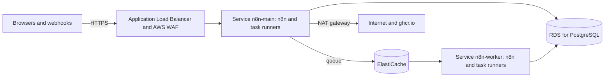

# n8n on Amazon ECS

Fork tooling (not in upstream n8n). This Terraform module runs the fork on Amazon ECS with AWS
Fargate. It makes the database (Amazon RDS for PostgreSQL), an Application Load Balancer and, in
queue mode, Amazon ElastiCache and the workers. n8n gets the settings of
[settings.yaml](../settings.yaml): the safer defaults of the VM setup.



| Resource | Purpose |
|---|---|
| ECS service `n8n-main` | The editor, the API, the webhooks and the forms. One task in single mode, `main_count` tasks in queue mode. Only the leader of the tasks runs the schedules and the polling triggers. |
| ECS service `n8n-worker` | Queue mode: `worker_count` workers that run the executions. |
| RDS instance `n8n-db` | All n8n data, also the files of workflows. It is encrypted, has no public address, and keeps automated backups for `database.backup_days` days. RDS keeps its password in a secret of its own. |
| ElastiCache group `n8n-redis` | Queue mode: the queue of the executions, with a password and TLS. |
| Application Load Balancer `n8n-alb` | HTTPS with your ACM certificate, and the redirect from HTTP to HTTPS. |
| AWS WAF `n8n` | Only with IP limits: the limits of webhooks and forms. |
| Cloud Map namespace `n8n.internal` | Queue mode: the workers reach the AI gateway on the main tasks at `main.n8n.internal`. |
| Secrets Manager secrets `n8n/*` | The encryption key, the token of the task runners and the password of Redis. |
| CloudWatch log group `/ecs/n8n` | The logs of the containers. |

The names start with the value of `name` (default `n8n`). Each task runs n8n and the task runners
in two containers. The task runners run the code of the Code nodes. They get no database password
and no encryption key. The internet reaches only the load balancer, and only the tasks reach the
database and Redis.

## What you need

- An AWS account, Terraform 1.10 or later, and the AWS CLI with your credentials.
- A VPC with two or more public subnets for the load balancer, and private subnets for the tasks,
  the database and Redis. The private subnets need a NAT gateway: the tasks pull the images from
  ghcr.io, and the nodes call services on the internet.
- A domain for n8n, for example `n8n.example.com`, and an ACM certificate for it in the region of
  the module.
- The two fork images on ghcr.io (`scripts/build-images.sh --push`), and a GitHub user with a
  personal access token (classic) that has the scope `read:packages`.

## Install

1. Keep the user and the token of ghcr.io in Secrets Manager. Type the token at the prompt, not in
   a command. The command shows the ARN of the secret.

   ```bash
   read -rs GHCR_TOKEN
   export GHCR_TOKEN
   jq -n '{username: "my-github-user", password: env.GHCR_TOKEN}' |
     aws secretsmanager create-secret --name n8n/ghcr --secret-string file:///dev/stdin --query ARN --output text
   unset GHCR_TOKEN
   ```

2. Make a folder for the instance, outside this repository, with this `main.tf`. Set the values.
   Keep the Terraform state in a private bucket, because the state holds the secrets of n8n.

   ```hcl
   terraform {
     backend "s3" {
       bucket       = "my-terraform-state"
       key          = "n8n/terraform.tfstate"
       region       = "eu-west-1"
       use_lockfile = true
     }
   }

   provider "aws" {
     region = "eu-west-1"
   }

   module "n8n" {
     # The folder in a checkout of the fork, or
     # "git::https://github.com/sreent/n8n.git//deploy/ecs?ref=<commit>".
     source = "../n8n/deploy/ecs"

     domain                          = "n8n.example.com"
     certificate_arn                 = "arn:aws:acm:eu-west-1:123456789012:certificate/<ID>"
     vpc_id                          = "vpc-<ID>"
     public_subnet_ids               = ["subnet-<ID>", "subnet-<ID>"]
     private_subnet_ids              = ["subnet-<ID>", "subnet-<ID>"]
     image_tag                       = "2.42.0-1a2b3c4d5e"
     registry_credentials_secret_arn = "arn:aws:secretsmanager:eu-west-1:123456789012:secret:n8n/ghcr-<ID>"
   }

   output "alb_dns_name" {
     value = module.n8n.alb_dns_name
   }
   ```

3. Make the resources. The first apply takes about 15 minutes.

   ```bash
   terraform init
   terraform apply
   ```

4. Point the domain at `alb_dns_name` with a CNAME record or an alias record. With
   `route53_zone_id`, the module makes an alias record.
5. Open `https://<your domain>` and make the owner account. Until then, anyone who reaches the page
   can make it. n8n then asks you to set up two-factor authentication for the owner.
6. Keep a copy of the encryption key outside AWS, for example in a password manager. Without the
   key, a backup of the database cannot be restored. This command shows the key:

   ```bash
   aws secretsmanager get-secret-value --secret-id n8n/encryption-key --query SecretString --output text
   ```

## Settings

- **n8n settings.** Set them in `settings`, with the names of [settings.yaml](../settings.yaml).
  [The table in the README of deploy/](../README.md#settings-of-the-other-options) gives the name
  for each value of `.env`. A value in `settings` replaces the value of settings.yaml and of the
  module.
- **Secrets.** Keep each secret in Secrets Manager, and give its ARN in `extra_secrets`. The module
  lets the execution role `n8n-execution` read it. A secret that a KMS key of your own encrypts also
  needs `kms:Decrypt` on that key for the role. For example, the sign-in with OIDC:

  ```hcl
  settings = {
    N8N_SSO_MANAGED_BY_ENV                = "true"
    N8N_SSO_OIDC_LOGIN_ENABLED            = "true"
    N8N_SSO_SCOPES_USE_EXPRESSION_MAPPING = "true"
    N8N_SSO_OIDC_DISCOVERY_ENDPOINT       = "https://login.microsoftonline.com/<tenant ID>/v2.0/.well-known/openid-configuration"
    N8N_SSO_OIDC_CLIENT_ID                = "<client ID>"
  }
  extra_secrets = {
    N8N_SSO_OIDC_CLIENT_SECRET = "arn:aws:secretsmanager:eu-west-1:123456789012:secret:n8n/oidc-<ID>"
  }
  ```

- **Size.** `task_cpu` and `task_memory` set the size of each task, for n8n and the task runners
  together. `main_count`, `worker_count` and `worker_concurrency` set the size of queue mode.
  `database.instance_class` sets the size of RDS, and `database.multi_az = true` keeps a standby in
  a second availability zone.
- **The database certificate.** RDS asks for TLS. Without `database_ca_certificate`, n8n encrypts
  the connection but does not check the certificate. Give the certificates of RDS for the region to
  let n8n check it:

  ```hcl
  database_ca_certificate = file("eu-west-1-bundle.pem")
  ```

  Download the file from `https://truststore.pki.rds.amazonaws.com/eu-west-1/eu-west-1-bundle.pem`.

## Single mode and queue mode

- **Single mode** (the default) runs one task. A deploy stops the old task before the new one
  starts, so two tasks never run the same schedule. n8n is not available for some minutes during a
  deploy.
- **Queue mode** (`mode = "queue"`) runs the main tasks and the workers. The main tasks serve the
  editor, the API and the webhooks, and the workers run the executions. Only the leader of the main
  tasks runs the schedules and the polling triggers. The module sets
  `N8N_MULTI_MAIN_SETUP_ENABLED=true` and `OFFLOAD_MANUAL_EXECUTIONS_TO_WORKERS=true`, so the
  workers also run the manual executions. A deploy starts the new tasks before it stops the old
  ones.

## IP limits for webhooks and forms

`webhook_allowed_ranges` limits the addresses that can call webhooks, chats and MCP servers, and
`form_allowed_ranges` limits the addresses that can open and send forms. AWS WAF answers other
addresses with 403. The editor, the API and the health path have no limit. The load balancer has
only IPv4 addresses, so the module ignores IPv6 ranges. `alb_allowed_ranges` limits the addresses
that can reach the load balancer at all. The calls of n8n to its own public URL, for example the
calls of the weekly governance report, come from the address of the NAT gateway, so put that
address in the ranges.

## Forgejo and other private hosts

The tasks reach the hosts of the VPC and of the networks that the VPC connects to. Forgejo
([forgejo/README.md](../forgejo/README.md)) runs in Google Cloud and has only an internal address.
n8n on AWS reaches it only through a VPN or an interconnect between the two networks.

1. Connect the VPC and the VPC network of Forgejo, for example with an AWS Site-to-Site VPN and
   Cloud VPN. In `gcp-create.sh`, set `N8N_SOURCE_RANGES` to the ranges of the private subnets.
2. Let the tasks resolve the name of Forgejo, for example with a Route 53 private hosted zone for
   the domain of Forgejo.
3. Give Git the root certificate of Forgejo: `git_ca_certificate = file("forgejo-root.crt")`. Git
   then trusts only this file. If the instance also uses a Git host with a public certificate, for
   example GitHub, give the certificates of the system too:
   `git_ca_certificate = join("", [file("/etc/ssl/certs/ca-certificates.crt"), file("forgejo-root.crt")])`.
4. For Git sync, set `N8N_GIT_SYNC_ALLOWED_HOSTS` in `settings` to the name of Forgejo.
5. For the nodes that call internal hosts over HTTP, open the hosts in `N8N_SSRF_ALLOWED_HOSTNAMES`
   or `N8N_SSRF_ALLOWED_IP_RANGES` (see [Safer defaults](../README.md#safer-defaults)).

## Move from the VM

The data of the VM goes into RDS. n8n needs the encryption key of the VM to read the credentials.
The database has no public address, so you restore the backup from a host in the VPC, for example
an EC2 instance or a VPC environment of AWS CloudShell in the security group `n8n-tasks`.

1. On the VM, stop n8n, and make a backup. From then on, the VM takes no changes.

   ```bash
   docker compose stop n8n
   ./backup.sh
   ```

2. Keep the encryption key of the VM (`N8N_ENCRYPTION_KEY` in `.env`) in Secrets Manager. Type the
   key at the prompt. The command shows the ARN of the secret.

   ```bash
   read -rs N8N_KEY
   printf '%s' "$N8N_KEY" | aws secretsmanager create-secret --name n8n/vm-encryption-key --secret-string file:///dev/stdin --query ARN --output text
   unset N8N_KEY
   ```

3. In `main.tf`, set `encryption_key_secret_arn` to that ARN. Then make only the database:

   ```bash
   terraform apply -target=module.n8n.aws_db_instance.n8n
   ```

4. Copy the backup file to the host in the VPC. On the host, restore it with `pg_restore` of
   PostgreSQL 18, the version of the VM. The password is in the secret of RDS (`aws rds
   describe-db-instances --db-instance-identifier n8n-db --query
   'DBInstances[0].MasterUserSecret.SecretArn'`):

   ```bash
   export PGPASSWORD="$(aws secretsmanager get-secret-value --secret-id <ARN of the RDS secret> --query SecretString --output text | jq -r .password)"
   pg_restore --host=<address of n8n-db> --username=n8n --dbname=n8n --no-owner --no-acl n8n-<time>.dump
   unset PGPASSWORD
   ```

5. Make the other resources with `terraform apply`. n8n starts with the data of the VM. It installs
   the community nodes again.
6. Point the domain at the load balancer (step 4 of [Install](#install)).
7. Keep the VM until the new instance works. Then delete it.

## Update n8n

1. Make a backup. A new version can change the database.

   ```bash
   aws rds create-db-snapshot --db-instance-identifier n8n-db --db-snapshot-identifier n8n-before-update
   ```

2. Use the module of the commit of the tag (the part after the version), so that n8n gets the
   settings of [settings.yaml](../settings.yaml) of that commit. In a checkout of the fork, check
   out the commit. With a Git source, set `ref=` to the commit, and run `terraform init -upgrade`.
3. Set `image_tag` to the new tag, and run `terraform apply`. If the new tasks do not get healthy,
   ECS goes back to the old version.

## Back up and restore

- RDS keeps automated backups for `database.backup_days` days (default 14), with point-in-time
  recovery. The console of RDS restores a backup to a new instance.
- `database.deletion_protection` (default `true`) stops the deletion of the database, also by
  `terraform destroy`.
- Terraform never deletes the encryption key that it made (`prevent_destroy`). A restore needs the
  same key.

## Limits

- ECS gives a task 120 seconds to stop. n8n lets the running executions finish in 30 seconds.
- A request can take 60 minutes at most (the idle timeout of the load balancer).
- ElastiCache has one node, without a replica. A failure of the node loses the queue: the
  executions that wait in the queue at that time do not run.
- n8n keeps the files of workflows in RDS. To keep them in a bucket of S3, add the settings of
  [the FORK.md of the blob storage](../../packages/@n8n/blob-storage/FORK.md#set-up).
- Each new task installs the community nodes from the npm registry
  (`N8N_REINSTALL_MISSING_PACKAGES`). The start then takes longer, and it needs the registry.

## Tests

The tests use mock providers. They need no AWS account and cost nothing:

```bash
cd deploy/ecs
terraform init -backend=false
terraform test
```

## Files

| File | Purpose |
|---|---|
| `main.tf` | The settings of n8n and the containers of the tasks |
| `service.tf` | The cluster, the task definitions, the services and Cloud Map |
| `database.tf` | RDS for PostgreSQL |
| `redis.tf` | ElastiCache and its password |
| `load-balancer.tf` | The load balancer, AWS WAF and the DNS record |
| `network.tf` | The security groups |
| `iam.tf` | The execution role and the task role |
| `secrets.tf` | The secrets of n8n in Secrets Manager |
| `variables.tf`, `outputs.tf`, `versions.tf` | The interface of the module |
| `tests/ecs.tftest.hcl` | The tests with mock providers |
