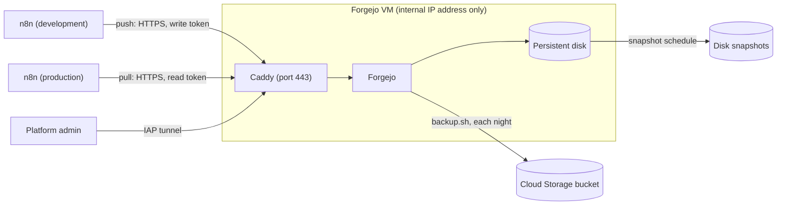

# Forgejo for n8n

Fork tooling (not in upstream n8n). This folder runs [Forgejo](https://forgejo.org/), a Git
server, on its own virtual machine (VM) in Google Cloud. The Git features of n8n use it to move
workflows from a development instance to a production instance through a private repository:

- source control (**Settings > Environments**),
- Git connections (**Settings > Environments v2**),
- Git sync (**Settings > Git sync**).

The users of n8n do not use Git. Each n8n instance connects with its own token. Only the
platform admins sign in to Forgejo.



| Service | Purpose |
|---|---|
| `forgejo` | The Git server: the repository, the users and the tokens. All its data is in the volume `forgejo-data`. |
| `caddy` | Gives Forgejo HTTPS with its own certificate authority. The authority is in the volume `caddy-data`. |

## Security

- The VM has no public IP address. The firewall lets only the n8n servers (port 443) and
  Identity-Aware Proxy (IAP, ports 22 and 443) reach it. Cloud NAT lets the VM download updates.
- SSH to the VM goes through IAP and OS Login. Git over SSH is off: n8n uses HTTPS.
- Nobody can register. All repositories are private, and Forgejo shows nothing before a sign-in.
  Mail, Actions, packages, federation and the API documentation are off.
- Each n8n instance has its own restricted user. The user can see only the repository of the
  workflows, and its token can only read or write repositories. A production instance gets read
  access, so it cannot change the repository.
- The admin user gets a random password. Turn on two-factor authentication for it.
- n8n writes credentials to the repository without their secrets. Source control and Git sync
  also leave out the values of variables, but Git connections write the values of the variables
  that the workflows use. Do not keep secrets in variables. The repository also shows the logic
  of the workflows and the names of internal systems, so keep it private.
- A backup holds the secret key of Forgejo and the hashes of the tokens. Only root can read a
  backup. The VM can add backups to the bucket and read them, but it cannot delete or replace
  them.

## What you need

- A Google Cloud project, and the [Google Cloud CLI](https://cloud.google.com/sdk/docs/install) on
  your computer. Cloud Shell has the CLI.
- For the installation: the role Owner of the project, or the roles Editor and Storage Admin.
- The internal IP addresses of the n8n servers. The n8n servers must be in the same VPC network as
  the VM, so that they can use its internal name.
- An internal name for Forgejo, for example `git.corp.internal`.

## Install

1. On your computer, in the root folder of the repository, set the values. Then see the commands
   of the script before it runs them:

   ```bash
   export PROJECT=my-project REGION=asia-southeast1 ZONE=asia-southeast1-b
   export DOMAIN=git.corp.internal N8N_SOURCE_RANGES=10.10.0.5/32,10.10.0.6/32
   export BACKUP_BUCKET=my-project-forgejo-backups
   DRY_RUN=1 deploy/forgejo/gcp-create.sh
   ```

   The comments at the top of `gcp-create.sh` describe the optional values. If the network has
   Cloud NAT already, set `CREATE_NAT=no`. If the network has a private DNS zone for the parent
   domain (`corp.internal`) already, set `DNS_ZONE` to the name of that zone.

2. Make the resources. If a step fails, correct the cause and run the script again. The script
   skips the resources that exist.

   ```bash
   deploy/forgejo/gcp-create.sh
   ```

3. Copy the folder to the VM, and connect to the VM:

   ```bash
   gcloud compute scp --recurse --tunnel-through-iap --zone=$ZONE --project=$PROJECT deploy/forgejo forgejo:~/
   gcloud compute ssh forgejo --tunnel-through-iap --zone=$ZONE --project=$PROJECT
   ```

4. On the VM, move the folder to `/opt/forgejo`, and install Docker:

   ```bash
   sudo mv ~/forgejo /opt/forgejo
   sudo chown -R root:root /opt/forgejo
   cd /opt/forgejo
   sudo ./install-docker.sh
   ```

5. Make the settings file. Set `FORGEJO_DOMAIN` to the value of `DOMAIN`, `BACKUP_BUCKET` to the
   value of `BACKUP_BUCKET`, and `FORGEJO_ADMIN_EMAIL` to the email address of the admin.

   ```bash
   sudo cp .env.example .env
   sudo nano .env
   ```

6. Start Forgejo:

   ```bash
   sudo ./setup.sh
   ```

   The script makes the admin user, the organisation `n8n` and the private repository
   `workflows`, with the branch `main`. It writes the root certificate of Caddy to
   `forgejo-root.crt`. It shows the password of the admin user one time: save it in a password
   manager.

7. Sign in to the web interface (see [Open the web interface](#open-the-web-interface)). Open
   **Settings > Security**, and set up **Two-factor authentication (TOTP)** with an authenticator
   app. After this step, the scripts ask for the two-factor code too.

8. Make the first backup, and add the nightly backup (see [Back up](#back-up)).

Docker starts Forgejo again after a restart of the VM. Ubuntu installs the security updates with
`unattended-upgrades`.

## Give an n8n instance access

Run `add-n8n-instance.sh` on the VM, one time for each n8n instance. Give the development
instance write access, and the production instance read access:

```bash
cd /opt/forgejo
sudo ./add-n8n-instance.sh n8n-dev write
sudo ./add-n8n-instance.sh n8n-prod read
```

The script makes a restricted user for the instance, gives the user access to the repository, and
shows a new token one time. Enter the token in n8n (see [Connect n8n](#connect-n8n)). Do not keep
the token in other places.

- To replace a token, run the script again with the same user name. The script deletes the old
  tokens of the user, so enter the new token in n8n immediately.
- To remove the access of an instance, delete its user:

  ```bash
  sudo docker compose exec forgejo forgejo admin user delete --username n8n-dev
  ```

## Connect n8n

Do these steps on each n8n server, in the folder of [deploy](../README.md) (for example
`/opt/n8n`).

1. Copy `forgejo-root.crt` from `/opt/forgejo` on the Forgejo VM to `certs/forgejo-root.crt` on
   the n8n server. The file is a certificate, not a secret. For example:

   ```bash
   # On your computer:
   gcloud compute scp --tunnel-through-iap --zone=$ZONE --project=$PROJECT forgejo:/opt/forgejo/forgejo-root.crt .
   scp forgejo-root.crt you@your-n8n-server:~/
   # On the n8n server:
   sudo mkdir -p /opt/n8n/certs
   sudo mv ~/forgejo-root.crt /opt/n8n/certs/
   ```

2. Let n8n trust the certificate. Copy the example override file. If `docker-compose.override.yml`
   exists, add the lines of the example to it.

   ```bash
   sudo cp forgejo/n8n-override.example.yml docker-compose.override.yml
   ```

   Git then trusts only the certificate of Forgejo. If the instance also uses another Git host,
   for example GitHub, put the certificates of the system and the certificate of Forgejo in one
   file. Then change `forgejo-root.crt` to `git-ca.crt` in the two lines of the override file.

   ```bash
   cat /etc/ssl/certs/ca-certificates.crt certs/forgejo-root.crt | sudo tee certs/git-ca.crt >/dev/null
   ```

3. For Git sync, set `GIT_SYNC_ALLOWED_HOSTS` in `.env` to the name of Forgejo, for example
   `git.corp.internal`.

4. Start n8n again, and check the connection:

   ```bash
   sudo docker compose up -d
   sudo docker compose exec -e GIT_TERMINAL_PROMPT=0 n8n git ls-remote https://git.corp.internal/n8n/workflows.git
   ```

   The correct answer is `could not read Username for 'https://git.corp.internal': terminal
   prompts disabled`: the certificate is correct, and Git needs a token. An error about the SSL
   certificate tells that n8n does not trust the certificate: do steps 1 and 2 again.

5. In n8n, enter the values that `add-n8n-instance.sh` showed:

   | Feature | Where | Values |
   |---|---|---|
   | Source control | **Settings > Environments**, with **Connection Type** HTTPS | The URL in **HTTPS Repository URL**, the user name in **Username**, and the token in **Personal Access Token** |
   | Git connections | **Settings > Environments v2**: a provider with the authentication **Username and password**, then a connection | The user name in **Username** and the token in **Password or access token** of the provider, and the URL in **Remote URL** of the connection |
   | Git sync | **Settings > Git sync** | The URL in **Repository URL**, the user name in **User name**, and the token in **Access token** |

Connect the development instance and the production instance to the same branch `main`. The
development instance pushes or promotes, and the production instance pulls or applies. In source
control, turn on **Protected instance** on the production instance. The three features write
different files, so connect only one of them to the repository.

## Open the web interface

The VM has no public IP address, so you open the web interface through a tunnel of IAP:

1. Add this line to the hosts file of your computer (`/etc/hosts`, or
   `C:\Windows\System32\drivers\etc\hosts` on Windows):

   ```text
   127.0.0.1 git.corp.internal
   ```

2. Import `forgejo-root.crt` into your browser or your system as a trusted certificate
   authority, so that the browser accepts the certificate of Forgejo.
3. Open the tunnel, and keep it open while you work:

   ```bash
   gcloud compute start-iap-tunnel forgejo 443 --local-host-port=localhost:8443 --zone=$ZONE --project=$PROJECT
   ```

4. Open `https://git.corp.internal:8443/`. Forgejo shows a note that you use another address than
   the configured address, because of the port. You can ignore it.

The tunnel needs the roles IAP-secured Tunnel User and Compute Viewer. SSH to the VM also needs the
role Compute OS Admin Login, and the role Service Account User on the service account
`forgejo-vm`. An Owner of the project has these roles.

## Back up

Two protections work together:

- **Disk snapshots.** `gcp-create.sh` adds a schedule: a snapshot of the disk each day at
  04:00 UTC, kept for 14 days (`SNAPSHOT_DAYS`). A snapshot gives back the whole VM.
- **`backup.sh`.** The script stops Forgejo for a few seconds, packs the volume `forgejo-data` into
  `backups/forgejo-<time>.tar.gz`, and starts Forgejo again. With `BACKUP_BUCKET` in `.env`, it
  also copies the backup to the bucket. It keeps the local backups for 14 days (`KEEP_DAYS`), and
  the bucket deletes the backups after 30 days (`BACKUP_DAYS` of `gcp-create.sh`).

Run `backup.sh` one time to test it:

```bash
sudo /opt/forgejo/backup.sh
```

Then run `sudo crontab -e`, and add this line, so that the script runs each night:

```text
0 3 * * * /opt/forgejo/backup.sh >> /opt/forgejo/backups/backup.log 2>&1
```

Do a test restore from time to time.

## Restore

`restore.sh` asks for a confirmation. Then it replaces all data of Forgejo with the backup, and
starts Forgejo again. The tokens of the backup work again. The tokens that you made after the
backup do not.

```bash
cd /opt/forgejo
sudo ./restore.sh backups/forgejo-<time>.tar.gz
sudo ./restore.sh gs://my-project-forgejo-backups/forgejo-<time>.tar.gz
```

If the VM is lost, make a new VM from the newest snapshot of its disk. The snapshot has all data,
also the certificate authority, so the n8n servers need no change.

Without a snapshot, make a new VM (steps 1 to 5 of [Install](#install), with the same `.env`),
restore a backup from the bucket, and run `sudo ./setup.sh`. The new VM has a new certificate
authority, so `setup.sh` writes a new `forgejo-root.crt`. Copy it to each n8n server (steps 1 and
4 of [Connect n8n](#connect-n8n)).

## Upgrade

1. Make a backup:

   ```bash
   sudo ./backup.sh
   ```

2. Set the new version in `FORGEJO_IMAGE` in `.env`. Stay on the long-term support line, for
   example a newer `15.0.x`. Before you change to a new major version, read the release notes of
   Forgejo.
3. Get the new images, and start them:

   ```bash
   sudo docker compose pull
   sudo docker compose up -d
   ```

## Review in Forgejo (optional)

The approvals happen in n8n, with workflow reviews, and only the admins of production pull or
apply. Forgejo can add a second gate:

1. Make a Forgejo user for each reviewer, and a team of reviewers in the organisation `n8n` with
   write access to the repository.
2. In the repository, open **Settings > Branches**, and add a branch protection rule for `main`.
   Keep **Disable push**, set **Required approvals**, and set the team in **Whitelisted teams for
   reviews** and in **Whitelisted teams for merging**.

The development instance then pushes to another branch, for example with **Create a branch on
promote** of Git connections. A reviewer approves a pull request into `main`, and merges it.

## Files

| File | Purpose |
|---|---|
| `gcp-create.sh` | Makes the Google Cloud resources. Run it on your computer. |
| `install-docker.sh` | Installs Docker on the VM |
| `docker-compose.yml` | Forgejo and Caddy |
| `Caddyfile` | HTTPS for Forgejo |
| `.env.example` | The settings. Copy it to `.env` |
| `setup.sh` | The first start: the admin user, the organisation, the repository and the root certificate |
| `add-n8n-instance.sh` | Access to the repository and a token for an n8n instance |
| `backup.sh` | Backs up all data of Forgejo |
| `restore.sh` | Restores a backup |
| `n8n-override.example.yml` | For the n8n servers: trust the root certificate of Forgejo |
| `lib.sh` | The helpers of the scripts |
