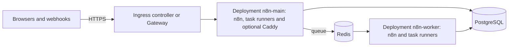

# n8n on Kubernetes

Fork tooling (not in upstream n8n). The Helm chart in `n8n/` runs the fork on a Kubernetes cluster:
one instance, or queue mode with main instances and workers. It uses a PostgreSQL database and, in
queue mode, a Redis that you give, for example Cloud SQL, Amazon RDS or Azure Database for
PostgreSQL. n8n gets the settings of [settings.yaml](../settings.yaml): the safer defaults of the VM
setup.



| Object | Purpose |
|---|---|
| Deployment `n8n-main` | The editor, the API, the webhooks and the forms. Only the leader of the main instances runs the schedules and the polling triggers. |
| Deployment `n8n-worker` | Queue mode: the workers that run the executions. |
| Service `n8n` | Port 80 of the main instances, for the Ingress, the HTTPRoute and the workers. |
| Ingress `n8n`, or HTTPRoute `n8n` | The way in for the domain. Annotations for webhooks or forms move their paths to an Ingress of their own. |
| ConfigMap `n8n-env` | The n8n settings. |
| ConfigMap `n8n-edge` | With `edge.enabled`: the rules of the Caddy container that limits the addresses of webhooks and forms. |

The names start with the name of the release, here `n8n`. Each pod runs n8n and the task runners in
two containers. The task runners run the code of the Code nodes. They get no database password and
no encryption key. The pods run as user 1000 without the token of the API of Kubernetes.

## What you need

- A cluster with Kubernetes 1.29 or later and x86-64 nodes, `kubectl`, and Helm 3.8 or later.
- PostgreSQL 18 (the version of the VM setup) or 17 that the pods can reach, with an empty database
  `n8n` and a user `n8n` that can create tables in it.
- For queue mode: Redis 6 or later, or Valkey.
- An Ingress controller or an implementation of the Gateway API, and a TLS certificate for the
  domain, for example from cert-manager. The controller must pass WebSocket connections, must add
  the address of the caller to `X-Forwarded-For`, and must let a request take some minutes.
- A domain for n8n, for example `n8n.example.com`.
- The two fork images on ghcr.io (`scripts/build-images.sh --push`), and a GitHub user with a
  personal access token (classic) that has the scope `read:packages`.

## Install

1. Make the namespace, and give the cluster the token of ghcr.io. Type the token at the prompt:

   ```bash
   kubectl create namespace n8n
   read -rs GHCR_TOKEN
   kubectl -n n8n create secret docker-registry ghcr --docker-server=ghcr.io \
     --docker-username=my-github-user --docker-password="$GHCR_TOKEN"
   unset GHCR_TOKEN
   ```

2. Make the Secret of n8n. Write the password of the database user into the file with an editor.

   ```bash
   umask 077
   printf 'N8N_ENCRYPTION_KEY=%s\nN8N_RUNNERS_AUTH_TOKEN=%s\nDB_POSTGRESDB_PASSWORD=\n' \
     "$(openssl rand -hex 32)" "$(openssl rand -hex 32)" > n8n-secrets.env
   nano n8n-secrets.env
   kubectl -n n8n create secret generic n8n-secrets --from-env-file=n8n-secrets.env
   ```

3. Keep a copy of `N8N_ENCRYPTION_KEY` outside the cluster, for example in a password manager.
   Without the key, a backup of the database cannot be restored. Then delete `n8n-secrets.env`.
4. Write a values file, for example `values-n8n.yaml`. Set the values for your cluster:

   ```yaml
   image:
     tag: 2.42.0-1a2b3c4d5e
   runnersImage:
     tag: 2.42.0-1a2b3c4d5e
   imagePullSecrets:
     - name: ghcr
   host: n8n.example.com
   existingSecret: n8n-secrets
   database:
     host: 10.0.0.5
     ssl:
       enabled: true
       # Encrypt the connection without a check of the certificate, see "Database certificate".
       rejectUnauthorized: false
   ingress:
     enabled: true
     className: <the class of your controller>
     annotations:
       cert-manager.io/cluster-issuer: <your issuer>
     tls:
       - secretName: n8n-tls
         hosts: [n8n.example.com]
   ```

5. Install the chart from a checkout of the fork, and wait until n8n is ready. The first start runs
   the migrations of the database.

   ```bash
   helm install n8n deploy/kubernetes/n8n -n n8n -f values-n8n.yaml
   kubectl -n n8n rollout status deployment/n8n-main
   ```

6. Open `https://<your domain>` and make the owner account. Until then, anyone who reaches the page
   can make it. n8n then asks you to set up two-factor authentication for the owner.

## Settings

- **n8n settings.** Set them in `settings`, with the names of [settings.yaml](../settings.yaml).
  [The table in the README of deploy/](../README.md#settings-of-the-other-options) gives the name
  for each value of `.env`. Give each value as text, for example `N8N_MFA_ENFORCED_ENABLED:
  "false"`. A value of your values file replaces the default of the chart.
- **Other variables.** `extraEnv` gives n8n more environment variables.
- **Secrets.** Add them to the Secret of `existingSecret`. The chart reads these keys:
  `QUEUE_BULL_REDIS_PASSWORD`, `N8N_SSO_OIDC_CLIENT_SECRET`, `N8N_COMMUNITY_PACKAGES_AUTH_TOKEN`
  and `N8N_DYNAMIC_CREDENTIALS_ENDPOINT_AUTH_TOKEN`. For example, the sign-in with OIDC:

  ```yaml
  settings:
    N8N_SSO_MANAGED_BY_ENV: "true"
    N8N_SSO_OIDC_LOGIN_ENABLED: "true"
    N8N_SSO_SCOPES_USE_EXPRESSION_MAPPING: "true"
    N8N_SSO_OIDC_DISCOVERY_ENDPOINT: "https://login.microsoftonline.com/<tenant ID>/v2.0/.well-known/openid-configuration"
    N8N_SSO_OIDC_CLIENT_ID: "<client ID>"
  ```

  Add the key `N8N_SSO_OIDC_CLIENT_SECRET` to the Secret first. Type the value at the prompt:

  ```bash
  umask 077
  read -rs VALUE
  printf '{"stringData":{"N8N_SSO_OIDC_CLIENT_SECRET":"%s"}}' "$VALUE" > patch.json
  kubectl -n n8n patch secret n8n-secrets --type=merge --patch-file=patch.json
  rm patch.json
  unset VALUE
  ```

  Then run `helm upgrade`. A change of the settings restarts n8n. A change of the Secret alone does
  not: then run `kubectl -n n8n rollout restart deployment/n8n-main` (and `deployment/n8n-worker`
  in queue mode).

  The values file replaces each key of `settings` alone, so the other settings keep their
  defaults.
- **Size.** `main.resources`, `worker.resources` and `runners.resources` set the CPU and the memory
  of the containers. `main.replicas`, `worker.replicas` and `worker.concurrency` set the size of
  queue mode.
- **Database certificate.** With `database.ssl.rejectUnauthorized: true`, n8n checks the certificate
  of the database with the certificate authorities of Node.js. For a database with a certificate
  authority of its own, for example RDS, give the certificates in `extraEnv`:

  ```yaml
  extraEnv:
    DB_POSTGRESDB_SSL_CA: |
      -----BEGIN CERTIFICATE-----
      ...
      -----END CERTIFICATE-----
  ```

## Single mode and queue mode

- **Single mode** (the default) runs one instance. An update stops the old pod before the new one
  starts, so two instances never run the same schedule. n8n is not available for some minutes
  during an update.
- **Queue mode** runs the main instances and the workers. Only the leader of the main instances
  runs the schedules and the polling triggers. An update starts the new pods before it stops the old
  ones.

  ```yaml
  mode: queue
  redis:
    host: redis.example.internal
    port: 6379
    tls: true
  main:
    replicas: 2
  worker:
    replicas: 2
  ```

  Add the key `QUEUE_BULL_REDIS_PASSWORD` to the Secret when Redis has a password. For a Redis with
  a certificate authority of its own, for example Memorystore, give the authority as a file:

  ```yaml
  extraVolumes:
    - name: redis-ca
      secret:
        secretName: redis-ca
  extraVolumeMounts:
    - name: redis-ca
      mountPath: /etc/n8n-redis-ca
      readOnly: true
  extraEnv:
    NODE_EXTRA_CA_CERTS: /etc/n8n-redis-ca/ca.crt
  ```

  Make the Secret with `kubectl -n n8n create secret generic redis-ca --from-file=ca.crt`.

- **To change the mode,** stop n8n first. Instances of the two modes must not run together, because
  they would both run the schedules:

  ```bash
  kubectl -n n8n scale deployment/n8n-main --replicas=0
  helm upgrade n8n deploy/kubernetes/n8n -n n8n -f values-n8n.yaml
  ```

## The address of the caller

n8n gets the address of the caller from `X-Forwarded-For`. `proxyHops` is the number of proxies
in front of n8n that add an address to it. The default 1 is for an ingress controller. When a cloud
load balancer is in front of the controller, the controller must see the address of the caller, for
example with `externalTrafficPolicy: Local` on its Service, or with the PROXY protocol.

## IP limits for webhooks and forms

There are two ways:

- **The edge container.** With `edge.enabled: true`, a Caddy container in each main pod applies the
  rules of the VM setup. `edge.webhookAllowedRanges` limits the addresses that can call webhooks,
  chats and MCP servers, and `edge.formAllowedRanges` limits the addresses that can open and send
  forms. Other addresses get 403. Set `edge.trustedProxies` to the addresses of the proxies in front
  of the pod, for example the pod range of the cluster when the controller runs in it. Keep the
  allowed ranges out of `edge.trustedProxies`: an address in it counts as a proxy, not as a caller.
- **The controller.** `ingress.webhooks.annotations` and `ingress.forms.annotations` move the paths
  to an Ingress of their own. Put the IP rule of your controller in these annotations.

## Forgejo and other private hosts

The pods reach the hosts that the network of the cluster reaches. Forgejo
([forgejo/README.md](../forgejo/README.md)) runs in Google Cloud and has only an internal address.
A cluster in the same VPC network (GKE) reaches it. Another cluster needs a VPN to that network.

1. In `gcp-create.sh`, set `N8N_SOURCE_RANGES` to the ranges that the traffic of the pods comes
   from: the pod range of a GKE cluster, or the addresses of the NAT of the cluster.
2. Give Git the root certificate of Forgejo in a Secret, and name it in `gitCaCertificate`:

   ```bash
   kubectl -n n8n create secret generic forgejo-ca --from-file=root.crt=forgejo-root.crt
   ```

   ```yaml
   gitCaCertificate:
     secretName: forgejo-ca
   ```

   Git then trusts only this file. If the instance also uses a Git host with a public certificate,
   for example GitHub, put the certificates of the system and the certificate of Forgejo in the file
   (see [Connect n8n](../forgejo/README.md#connect-n8n)).
3. For Git sync, set `N8N_GIT_SYNC_ALLOWED_HOSTS` in `settings` to the name of Forgejo.
4. For the nodes that call internal hosts over HTTP, open the hosts in `N8N_SSRF_ALLOWED_HOSTNAMES`
   or `N8N_SSRF_ALLOWED_IP_RANGES` (see [Safer defaults](../README.md#safer-defaults)).

## Move from the VM

1. On the VM, stop n8n, and make a backup. From then on, the VM takes no changes.

   ```bash
   docker compose stop n8n
   ./backup.sh
   ```

2. In step 2 of [Install](#install), use the `N8N_ENCRYPTION_KEY` of the `.env` of the VM, not a new
   key.
3. Before the install, restore the backup into the empty database with `pg_restore` of PostgreSQL
   18, the version of the VM. Run it from a host that reaches the database:

   ```bash
   pg_restore --host=<database host> --username=n8n --dbname=n8n --password --no-owner --no-acl n8n-<time>.dump
   ```

4. Install the chart. n8n starts with the data of the VM. It installs the community nodes again.
5. Point the domain at the controller. Keep the VM until the new instance works. Then delete it.

## Update n8n

1. Make a backup of the database. A new version can change the database.
2. Set `image.tag` and `runnersImage.tag` to the new tag, and run `helm upgrade n8n
   deploy/kubernetes/n8n -n n8n -f values-n8n.yaml`.

## Limits

- The chart keeps no data in the pods. The database holds all data, also the files of workflows, so
  back up the database. To keep the files in a bucket, add the settings of
  [the FORK.md of the blob storage](../../packages/@n8n/blob-storage/FORK.md#set-up) to `extraEnv`.
- Each new pod installs the community nodes from the npm registry
  (`N8N_REINSTALL_MISSING_PACKAGES`). The start then takes longer, and it needs the registry.
- The images are for x86-64 only. `nodeSelector` keeps the pods on x86-64 nodes.

## Tests

`chart.test.mjs` renders the chart with `helm template` and checks the output. It needs Helm, and
skips the tests without it:

```bash
node --test deploy/kubernetes/chart.test.mjs
```

## Files

| File | Purpose |
|---|---|
| `n8n/Chart.yaml` | The chart |
| `n8n/values.yaml` | The values and their defaults, with a copy of settings.yaml |
| `n8n/templates/` | The Deployments, the Service, the Ingress, the HTTPRoute and the ConfigMaps |
| `chart.test.mjs` | The tests of the chart |
