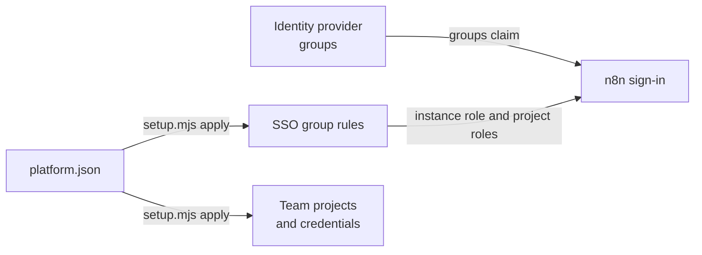

# Platform setup

Fork tool (not in upstream n8n). `setup.mjs` sets up n8n for an organisation from one config file.
It makes these items in n8n:

- **Team projects.** One project for each team.
- **SSO group rules.** The role-mapping rules of n8n. At each SSO sign-in, they give a user the
  instance role and the project roles of the groups in the identity provider.
- **Team credentials.** The credentials of each team, in its team project. The members of the
  project use them in their workflows, so no workflow depends on the account of one person.

The tool also checks the security settings of the instance. It uses the public API of n8n. It
needs Node.js 22 or later, and it installs nothing.



## Before you start

1. Set up the SSO sign-in. Use OIDC or SAML. For OIDC with deploy/, set the values of the section
   "SSO" of `.env`, or the same settings of the other options (see
   [the README of deploy/](../README.md#sso)). For SAML, or without deploy/, use the page
   Settings > SSO: set **Role assignment** to "Instance and project roles via SSO", and
   **Role mapping method** to "Map rules inside n8n".
2. In the identity provider, give the n8n application only to the groups of n8n. Then the other
   users cannot sign in.
3. Sign in to n8n as the owner. Open Settings > n8n API, and create an API key with these scopes:

   | Command | Scopes |
   |---|---|
   | `plan`, `apply` | `project:list`, `project:create`, `credential:list`, `credential:create`, `roleMappingRule:list`, `roleMappingRule:create`, `roleMappingRule:update`, `role:list` |
   | `apply --prune-rules` | also `roleMappingRule:delete` |
   | `check` | also `securitySettings:manage`, `workflow:list`, `user:list` |

4. On the computer that runs the tool, set the address of n8n and the key. `read -s` keeps the key
   out of the shell history:

   ```bash
   export N8N_URL=https://n8n.example.com
   read -rs N8N_API_KEY && export N8N_API_KEY
   ```

   A server of deploy/ does not need Node.js: the n8n image has it. In the folder of
   `docker-compose.yml`, run the tool in a container of the n8n service. It calls n8n in the
   network of the stack:

   ```bash
   read -rs N8N_API_KEY && export N8N_API_KEY
   docker compose run --rm --no-deps -v ./platform:/platform:ro -e N8N_URL=http://n8n:5678 \
     -e N8N_API_KEY --entrypoint node n8n /platform/setup.mjs plan
   ```

   Pass the environment variables of the team credentials the same way, for example
   `-e SALES_CRM_TOKEN`.

## The config

Copy `platform.example.json` to `platform.json`, and change it. The config has no secrets, so
keep it in Git with the other files of your platform, and review each change.

| Field | Default | What it is |
|---|---|---|
| `groupsClaim` | `"groups"` | The claim of the identity provider with the groups of the user. For SAML, the name of the attribute. |
| `instanceRoles` | `[]` | A list of `{ "group", "role" }`. The role is a global role: `global:admin`, `global:member`, `global:chatUser` or a custom global role. |
| `defaultInstanceRole` | none | The role of the users in no group of `instanceRoles`, for example `global:chatUser`. |
| `projects` | `[]` | A list of team projects: `name`, `description`, `roles` and `credentials`. |
| `projects[].roles` | `[]` | A list of `{ "group", "role" }`. The role is a project role: `project:admin`, `project:editor`, `project:viewer` or a custom project role. |
| `projects[].credentials` | `[]` | A list of `{ "name", "type", "data" }`. `type` is the name of a credential type, for example `httpHeaderAuth` or `postgres`. |

### The SSO group rules

The tool makes one rule for each group of the config. The expression of a rule tests the groups
claim:

```text
{{ [].concat($claims["groups"] || []).includes("n8n-sales-builders") }}
```

The order of the config is important:

- n8n gives the instance role of the first instance rule that matches. Put the group with the most
  rights first.
- In each project, n8n gives the role of the first project rule that matches. Put the admins
  first, then the editors, then the viewers.

`apply` puts the rules in the order of the config. The other rules (for example, rules that an
admin made on the page Settings > SSO) come after the rules of the config. `--prune-rules`
deletes them.

`defaultInstanceRole` becomes the last instance rule, with the expression `{{ true }}`, which
always matches. A rule, not the default role of Settings > SSO, because n8n sets the SSO settings
from `.env` again at each start (`SSO_FROM_ENV=true`), without a default role. Without
`defaultInstanceRole`, a user in no group gets `global:member`. To keep a person out of n8n, do
not give them the n8n application in the identity provider.

When instance rules exist, n8n sets the instance role at each SSO sign-in, and nobody can change
an instance role by hand (n8n answers 403). Change the groups in the identity provider, or change
the config and run `apply`.

**Project roles are all or nothing.** When one project rule exists, n8n gives each SSO user
exactly the team project roles of the project rules at each sign-in, in all team projects. So a
team project without a rule loses its SSO members, and nobody can change the members of a team
project by hand. `plan` and `check` warn about team projects without a rule. Start with `instanceRoles`
only, and let the project admins add the members in n8n. Add the `roles` of all team projects
when the teams are stable.

### The groups claim of your identity provider

The identity provider must send the groups in the ID token or in the userinfo response. Read the
documentation of your identity provider for the current steps.

- **Microsoft Entra ID.** In the app registration, open Token configuration and add a groups claim.
  Select "Groups assigned to the application", so that the token does not go over the limit of
  groups. The claim `groups` has the object IDs of the groups: put the object IDs in the config.
  Or define app roles, give them to the groups, and set `"groupsClaim": "roles"`: then the config
  has the names of the app roles.
- **Okta.** In the OpenID Connect settings of the application, add a groups claim with the name
  `groups` and a filter, for example "Starts with: n8n-".
- **Keycloak.** In the client scope of the client, add a mapper of the type "Group Membership" with
  the token claim name `groups`. Turn off "Full group path".
- **Google Workspace.** Sign-in with Google over OIDC sends no groups. Use a SAML app with a group
  membership attribute, and set `groupsClaim` to the name of that attribute.

### Team credentials

The values of `data` can be:

- A plain value, for example a host name or a port.
- `{ "env": "NAME" }`. `apply` reads the environment variable `NAME` and sends its value to n8n.
  The tool does not show the value.
- An expression of an external secret, for example `"={{ $secrets.vault.ledger_password }}"`.
  n8n reads the secret from the vault when a workflow runs. Connect the vault on the page
  Settings > External secrets first, and let the project use it: n8n refuses a credential whose
  provider the project cannot use. `plan` names the providers that each new credential needs.

Do not put a secret as a plain value in `platform.json`.

The tool only creates credentials. It does not change or delete a credential that exists. To
change a secret, change it in n8n or in the vault. When n8n refuses a credential, `apply` makes
the other changes, names the credential, and exits with 1. Fix it, and run `apply` again.

## Commands

Run the commands in the folder of `docker-compose.yml` (deploy/ in the repository):

```bash
node platform/setup.mjs plan     # Shows the changes. Changes nothing.
node platform/setup.mjs apply    # Makes the changes, then plans again.
node platform/setup.mjs check    # Checks the setup and the security settings.
```

- `--config <file>` reads another config. The default is `platform.json` next to `setup.mjs`.
- `--prune-rules` also deletes the SSO group rules that are not in the config.

`plan` and `apply` stop before a change when the config has problems: an environment variable
without a value, a credential type that n8n does not have, a credential without a required field,
a role that n8n does not have, or two team projects with the same name. A second `apply` changes
nothing.

`check` gives one line for each check, and exits with 1 when a check fails:

| Check | Fails when |
|---|---|
| The sign-in method | (a warning) users sign in with email and password |
| The personal space limits | users can publish or share from their personal spaces |
| The setup of the config | a team project, a team credential or an SSO group rule is missing, or the rules are not in the order of the config |
| The open triggers | (a warning) a published trigger without authentication has no approval |
| The owners and the admins | (information) the list of the users with these roles |

Run `check` each week, for example from cron, and read its output with the weekly governance
report (`deploy/workflows/governance-report.json`).

## What the tool does not change

- It never deletes a team project or a credential.
- It deletes SSO group rules only with `--prune-rules`.
- It adds no users to projects. The SSO group rules give the project roles at the sign-in.
- It does not change the settings of `deploy/.env`, or the same settings of the other options: the
  personal space limits, the workflow reviews and the check of open triggers. `check` reads the
  personal space limits.

## Tests

```bash
node --test deploy/platform/setup.test.mjs
```

The tests use a fake public API of n8n.
