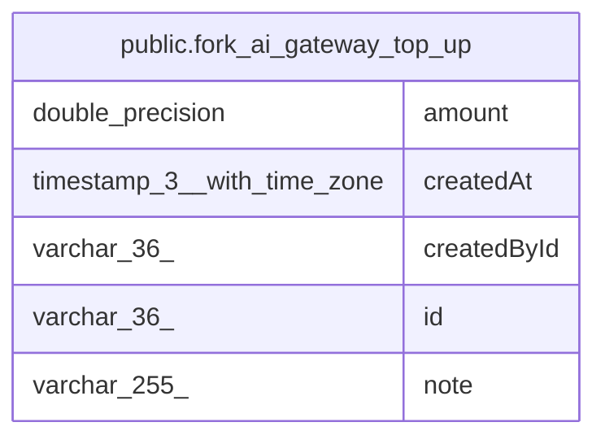

# public.fork_ai_gateway_top_up

## Columns

| Name | Type | Default | Nullable | Children | Parents | Comment |
| ---- | ---- | ------- | -------- | -------- | ------- | ------- |
| amount | double precision |  | false |  |  |  |
| createdAt | timestamp(3) with time zone |  | false |  |  |  |
| createdById | varchar(36) |  | true |  |  |  |
| id | varchar(36) |  | false |  |  |  |
| note | varchar(255) |  | true |  |  |  |

## Constraints

| Name | Type | Definition |
| ---- | ---- | ---------- |
| PK_0c1e657195d717b6f7f091220f2 | PRIMARY KEY | PRIMARY KEY (id) |
| fork_ai_gateway_top_up_amount_not_null | n | NOT NULL amount |
| fork_ai_gateway_top_up_createdAt_not_null | n | NOT NULL "createdAt" |
| fork_ai_gateway_top_up_id_not_null | n | NOT NULL id |

## Indexes

| Name | Definition |
| ---- | ---------- |
| PK_0c1e657195d717b6f7f091220f2 | CREATE UNIQUE INDEX "PK_0c1e657195d717b6f7f091220f2" ON public.fork_ai_gateway_top_up USING btree (id) |

## Relations

---

> Generated by [tbls](https://github.com/k1LoW/tbls)
