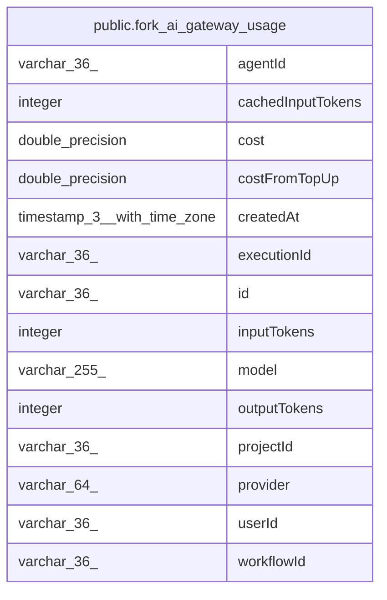

# public.fork_ai_gateway_usage

## Columns

| Name | Type | Default | Nullable | Children | Parents | Comment |
| ---- | ---- | ------- | -------- | -------- | ------- | ------- |
| agentId | varchar(36) |  | true |  |  |  |
| cachedInputTokens | integer | 0 | false |  |  |  |
| cost | double precision | 0 | false |  |  |  |
| costFromTopUp | double precision | 0 | false |  |  |  |
| createdAt | timestamp(3) with time zone |  | false |  |  |  |
| executionId | varchar(36) |  | true |  |  |  |
| id | varchar(36) |  | false |  |  |  |
| inputTokens | integer | 0 | false |  |  |  |
| model | varchar(255) |  | false |  |  |  |
| outputTokens | integer | 0 | false |  |  |  |
| projectId | varchar(36) |  | true |  |  |  |
| provider | varchar(64) |  | false |  |  |  |
| userId | varchar(36) |  | true |  |  |  |
| workflowId | varchar(36) |  | true |  |  |  |

## Constraints

| Name | Type | Definition |
| ---- | ---- | ---------- |
| PK_48d686bccbd50006e113bfd7ce4 | PRIMARY KEY | PRIMARY KEY (id) |
| fork_ai_gateway_usage_cachedInputTokens_not_null | n | NOT NULL "cachedInputTokens" |
| fork_ai_gateway_usage_costFromTopUp_not_null | n | NOT NULL "costFromTopUp" |
| fork_ai_gateway_usage_cost_not_null | n | NOT NULL cost |
| fork_ai_gateway_usage_createdAt_not_null | n | NOT NULL "createdAt" |
| fork_ai_gateway_usage_id_not_null | n | NOT NULL id |
| fork_ai_gateway_usage_inputTokens_not_null | n | NOT NULL "inputTokens" |
| fork_ai_gateway_usage_model_not_null | n | NOT NULL model |
| fork_ai_gateway_usage_outputTokens_not_null | n | NOT NULL "outputTokens" |
| fork_ai_gateway_usage_provider_not_null | n | NOT NULL provider |

## Indexes

| Name | Definition |
| ---- | ---------- |
| IDX_6e5aa1f7cbb99e0452f9abd333 | CREATE INDEX "IDX_6e5aa1f7cbb99e0452f9abd333" ON public.fork_ai_gateway_usage USING btree ("createdAt") |
| IDX_a629fdee2d09c3a80c377d40fa | CREATE INDEX "IDX_a629fdee2d09c3a80c377d40fa" ON public.fork_ai_gateway_usage USING btree ("projectId", "createdAt") |
| IDX_f6483ebf709ad8e0c972cf1fa5 | CREATE INDEX "IDX_f6483ebf709ad8e0c972cf1fa5" ON public.fork_ai_gateway_usage USING btree ("userId", "createdAt") |
| PK_48d686bccbd50006e113bfd7ce4 | CREATE UNIQUE INDEX "PK_48d686bccbd50006e113bfd7ce4" ON public.fork_ai_gateway_usage USING btree (id) |

## Relations

---

> Generated by [tbls](https://github.com/k1LoW/tbls)
