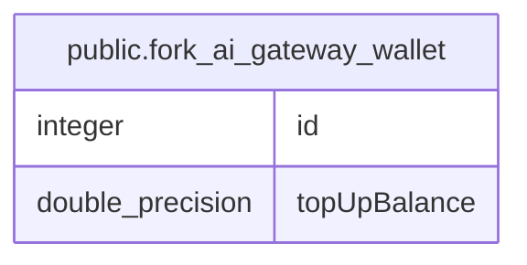

# public.fork_ai_gateway_wallet

## Columns

| Name | Type | Default | Nullable | Children | Parents | Comment |
| ---- | ---- | ------- | -------- | -------- | ------- | ------- |
| id | integer |  | false |  |  |  |
| topUpBalance | double precision | 0 | false |  |  |  |

## Constraints

| Name | Type | Definition |
| ---- | ---- | ---------- |
| PK_99a12fce40af07fdce95a6d2ae2 | PRIMARY KEY | PRIMARY KEY (id) |
| fork_ai_gateway_wallet_id_not_null | n | NOT NULL id |
| fork_ai_gateway_wallet_topUpBalance_not_null | n | NOT NULL "topUpBalance" |

## Indexes

| Name | Definition |
| ---- | ---------- |
| PK_99a12fce40af07fdce95a6d2ae2 | CREATE UNIQUE INDEX "PK_99a12fce40af07fdce95a6d2ae2" ON public.fork_ai_gateway_wallet USING btree (id) |

## Relations

---

> Generated by [tbls](https://github.com/k1LoW/tbls)
