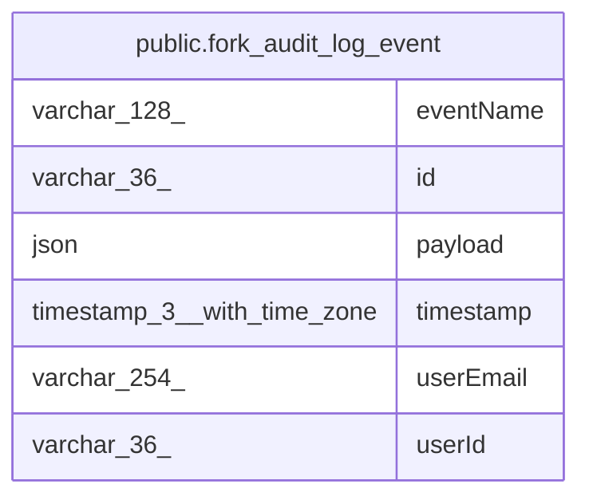

# public.fork_audit_log_event

## Columns

| Name | Type | Default | Nullable | Children | Parents | Comment |
| ---- | ---- | ------- | -------- | -------- | ------- | ------- |
| eventName | varchar(128) |  | false |  |  |  |
| id | varchar(36) |  | false |  |  | The id of the event message |
| payload | json |  | false |  |  |  |
| timestamp | timestamp(3) with time zone |  | false |  |  |  |
| userEmail | varchar(254) |  | true |  |  |  |
| userId | varchar(36) |  | true |  |  |  |

## Constraints

| Name | Type | Definition |
| ---- | ---- | ---------- |
| PK_36ee34e83b07b2c7d2a01c8bb0d | PRIMARY KEY | PRIMARY KEY (id) |
| fork_audit_log_event_eventName_not_null | n | NOT NULL "eventName" |
| fork_audit_log_event_id_not_null | n | NOT NULL id |
| fork_audit_log_event_payload_not_null | n | NOT NULL payload |
| fork_audit_log_event_timestamp_not_null | n | NOT NULL "timestamp" |

## Indexes

| Name | Definition |
| ---- | ---------- |
| IDX_3d08a445b684c9698cfead467d | CREATE INDEX "IDX_3d08a445b684c9698cfead467d" ON public.fork_audit_log_event USING btree ("userId", "timestamp") |
| IDX_adbe85b4f3d52a865176a360cd | CREATE INDEX "IDX_adbe85b4f3d52a865176a360cd" ON public.fork_audit_log_event USING btree ("timestamp") |
| IDX_fbf7b8bff8580f21e76a36a58d | CREATE INDEX "IDX_fbf7b8bff8580f21e76a36a58d" ON public.fork_audit_log_event USING btree ("eventName", "timestamp") |
| PK_36ee34e83b07b2c7d2a01c8bb0d | CREATE UNIQUE INDEX "PK_36ee34e83b07b2c7d2a01c8bb0d" ON public.fork_audit_log_event USING btree (id) |

## Relations

---

> Generated by [tbls](https://github.com/k1LoW/tbls)
