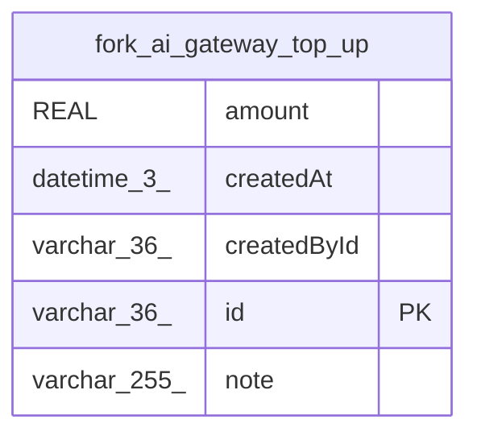

# fork_ai_gateway_top_up

## Description

<details>
<summary><strong>Table Definition</strong></summary>

```sql
CREATE TABLE "fork_ai_gateway_top_up" ("id" varchar(36) PRIMARY KEY NOT NULL, "createdAt" datetime(3) NOT NULL, "amount" real NOT NULL, "createdById" varchar(36), "note" varchar(255))
```

</details>

## Columns

| Name | Type | Default | Nullable | Children | Parents | Comment |
| ---- | ---- | ------- | -------- | -------- | ------- | ------- |
| amount | REAL |  | false |  |  |  |
| createdAt | datetime(3) |  | false |  |  |  |
| createdById | varchar(36) |  | true |  |  |  |
| id | varchar(36) |  | false |  |  |  |
| note | varchar(255) |  | true |  |  |  |

## Constraints

| Name | Type | Definition |
| ---- | ---- | ---------- |
| id | PRIMARY KEY | PRIMARY KEY (id) |
| sqlite_autoindex_fork_ai_gateway_top_up_1 | PRIMARY KEY | PRIMARY KEY (id) |

## Indexes

| Name | Definition |
| ---- | ---------- |
| sqlite_autoindex_fork_ai_gateway_top_up_1 | PRIMARY KEY (id) |

## Relations



---

> Generated by [tbls](https://github.com/k1LoW/tbls)
