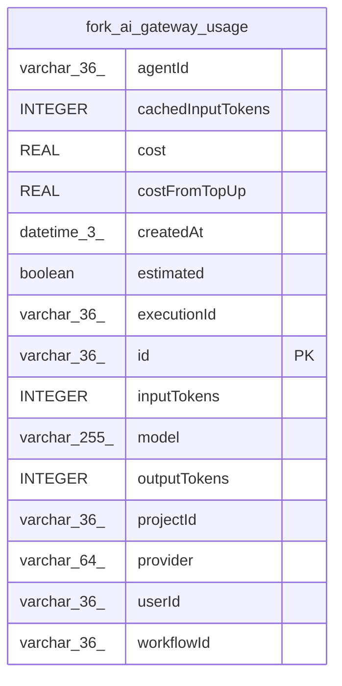

# fork_ai_gateway_usage

## Description

<details>
<summary><strong>Table Definition</strong></summary>

```sql
CREATE TABLE "fork_ai_gateway_usage" ("id" varchar(36) PRIMARY KEY NOT NULL, "createdAt" datetime(3) NOT NULL, "userId" varchar(36), "projectId" varchar(36), "workflowId" varchar(36), "executionId" varchar(36), "agentId" varchar(36), "provider" varchar(64) NOT NULL, "model" varchar(255) NOT NULL, "inputTokens" integer NOT NULL DEFAULT (0), "outputTokens" integer NOT NULL DEFAULT (0), "cachedInputTokens" integer NOT NULL DEFAULT (0), "cost" real NOT NULL DEFAULT (0), "costFromTopUp" real NOT NULL DEFAULT (0), "estimated" boolean NOT NULL DEFAULT (false))
```

</details>

## Columns

| Name | Type | Default | Nullable | Children | Parents | Comment |
| ---- | ---- | ------- | -------- | -------- | ------- | ------- |
| agentId | varchar(36) |  | true |  |  |  |
| cachedInputTokens | INTEGER | 0 | false |  |  |  |
| cost | REAL | 0 | false |  |  |  |
| costFromTopUp | REAL | 0 | false |  |  |  |
| createdAt | datetime(3) |  | false |  |  |  |
| estimated | boolean | false | false |  |  |  |
| executionId | varchar(36) |  | true |  |  |  |
| id | varchar(36) |  | false |  |  |  |
| inputTokens | INTEGER | 0 | false |  |  |  |
| model | varchar(255) |  | false |  |  |  |
| outputTokens | INTEGER | 0 | false |  |  |  |
| projectId | varchar(36) |  | true |  |  |  |
| provider | varchar(64) |  | false |  |  |  |
| userId | varchar(36) |  | true |  |  |  |
| workflowId | varchar(36) |  | true |  |  |  |

## Constraints

| Name | Type | Definition |
| ---- | ---- | ---------- |
| id | PRIMARY KEY | PRIMARY KEY (id) |
| sqlite_autoindex_fork_ai_gateway_usage_1 | PRIMARY KEY | PRIMARY KEY (id) |

## Indexes

| Name | Definition |
| ---- | ---------- |
| IDX_6e5aa1f7cbb99e0452f9abd333 | CREATE INDEX "IDX_6e5aa1f7cbb99e0452f9abd333" ON "fork_ai_gateway_usage" ("createdAt")  |
| IDX_a629fdee2d09c3a80c377d40fa | CREATE INDEX "IDX_a629fdee2d09c3a80c377d40fa" ON "fork_ai_gateway_usage" ("projectId", "createdAt")  |
| IDX_f6483ebf709ad8e0c972cf1fa5 | CREATE INDEX "IDX_f6483ebf709ad8e0c972cf1fa5" ON "fork_ai_gateway_usage" ("userId", "createdAt")  |
| sqlite_autoindex_fork_ai_gateway_usage_1 | PRIMARY KEY (id) |

## Relations



---

> Generated by [tbls](https://github.com/k1LoW/tbls)
