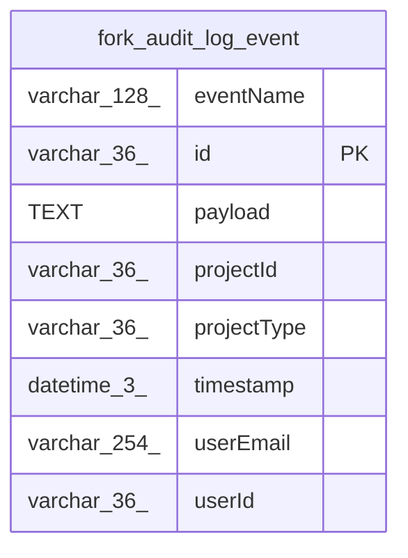

# fork_audit_log_event

## Description

<details>
<summary><strong>Table Definition</strong></summary>

```sql
CREATE TABLE "fork_audit_log_event" ("id" varchar(36) PRIMARY KEY NOT NULL, "eventName" varchar(128) NOT NULL, "timestamp" datetime(3) NOT NULL, "userId" varchar(36), "userEmail" varchar(254), "payload" text NOT NULL, "projectId" varchar(36), "projectType" varchar(36))
```

</details>

## Columns

| Name | Type | Default | Nullable | Children | Parents | Comment |
| ---- | ---- | ------- | -------- | -------- | ------- | ------- |
| eventName | varchar(128) |  | false |  |  |  |
| id | varchar(36) |  | false |  |  |  |
| payload | TEXT |  | false |  |  |  |
| projectId | varchar(36) |  | true |  |  |  |
| projectType | varchar(36) |  | true |  |  |  |
| timestamp | datetime(3) |  | false |  |  |  |
| userEmail | varchar(254) |  | true |  |  |  |
| userId | varchar(36) |  | true |  |  |  |

## Constraints

| Name | Type | Definition |
| ---- | ---- | ---------- |
| id | PRIMARY KEY | PRIMARY KEY (id) |
| sqlite_autoindex_fork_audit_log_event_1 | PRIMARY KEY | PRIMARY KEY (id) |

## Indexes

| Name | Definition |
| ---- | ---------- |
| IDX_3d08a445b684c9698cfead467d | CREATE INDEX "IDX_3d08a445b684c9698cfead467d" ON "fork_audit_log_event" ("userId", "timestamp")  |
| IDX_adbe85b4f3d52a865176a360cd | CREATE INDEX "IDX_adbe85b4f3d52a865176a360cd" ON "fork_audit_log_event" ("timestamp")  |
| IDX_fbf7b8bff8580f21e76a36a58d | CREATE INDEX "IDX_fbf7b8bff8580f21e76a36a58d" ON "fork_audit_log_event" ("eventName", "timestamp")  |
| IDX_fork_audit_log_event_projectId_timestamp | CREATE INDEX "IDX_fork_audit_log_event_projectId_timestamp" ON "fork_audit_log_event" ("projectId", "timestamp")  |
| IDX_fork_audit_log_event_projectType_timestamp | CREATE INDEX "IDX_fork_audit_log_event_projectType_timestamp" ON "fork_audit_log_event" ("projectType", "timestamp")  |
| sqlite_autoindex_fork_audit_log_event_1 | PRIMARY KEY (id) |

## Relations



---

> Generated by [tbls](https://github.com/k1LoW/tbls)
