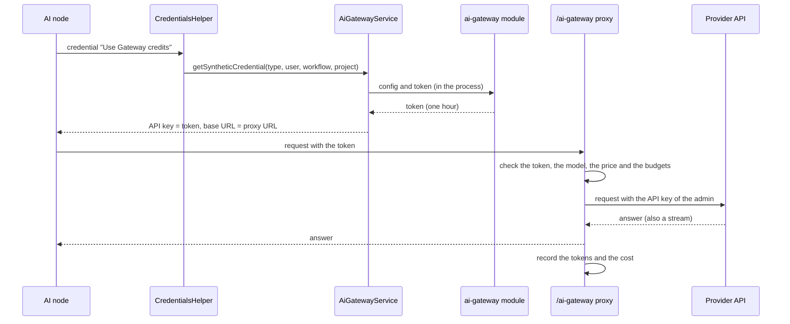

# AI gateway

Fork module (not in upstream n8n). The AI gateway lets users run AI nodes without an API key of
their own. A user picks **Use Gateway credits** in the credential field of a supported node. n8n
then sends the calls of the node through this gateway, which adds the API key of the provider,
records the tokens and the cost of each call, and stops calls when a budget is spent.

The repository owner chose this on 2026-10-15. In upstream n8n, Gateway credits need a service of
n8n that only n8n Cloud (Starter and Pro) can use, so a self-hosted instance cannot use them. The
fork keeps the ordinary code of upstream that uses the gateway (the credential field, the balance,
the page **Settings > Gateway credits**, the agents and the MCP tools) and replaces the service of
n8n with this module. The module does not use enterprise code: upstream has no enterprise files for
the gateway.

Sources: the ordinary code of upstream (`packages/cli/src/services/ai-gateway.service.ts`,
`ai-gateway-eligibility.ts`, `ai.controller.ts`, the DTOs in `@n8n/api-types`, the editor store
`aiGateway.store.ts` and its tests), the credential types and nodes of the providers, the public
n8n documentation
([Gateway credits](https://docs.n8n.io/deploy/use-n8n-cloud/gateway-credits),
[Use Gateway credits](https://docs.n8n.io/build/understand-workflows/use-gateway-credits)), and the
public API documentation of the providers.

## Set up

1. An admin creates a credential for each provider, with the API key of the organization, for
   example an OpenAI credential, or a credential of a backend of the provider (see "Backends"),
   for example an Azure OpenAI credential. Users do not need access to these credentials.
2. On the page **Settings > Gateway credits admin**, the admin turns on the gateway, picks the
   credential of each provider, and sets the budgets.
3. Users pick **Use Gateway credits** on a supported node.

The licence value `feat:aiGateway` turns on the ordinary code of the gateway. The fork switch gives
it (`packages/cli/src/fork-features.ts`). `N8N_AI_GATEWAY_ENABLED=false` turns the gateway off, as
in upstream n8n. The proxy also refuses calls (status 503) when the setting, the variable or the
licence value turns the gateway off.

| Variable | Default | Purpose |
|---|---|---|
| `N8N_AI_GATEWAY_BASE_URL` | `http://127.0.0.1:<N8N_PORT>/ai-gateway` | The URL of the gateway that the nodes call. Set it when the nodes run on other hosts (queue mode: the workers call a main instance) or when n8n serves HTTPS itself |
| `N8N_AI_GATEWAY_MAX_REQUEST_MB` | `16` | The largest request body of a call. `N8N_PAYLOAD_SIZE_MAX` also limits it |

The module is on by default. To turn it off, add `ai-gateway` to `N8N_DISABLED_MODULES`. When the
SSRF protection of n8n is on (`N8N_SSRF_PROTECTION_ENABLED=true`), allow the host of
`N8N_AI_GATEWAY_BASE_URL`, because the nodes call it.

## How a call works

- The ordinary `CredentialsHelper` gives a node with the marker `__aiGatewayManaged` a credential
  from `AiGatewayService.getSyntheticCredential`. Its API key is a token of the gateway, and its
  URL field points at the proxy. The URL holds the execution, the workflow and the project
  (`/v1/gateway/exec/<executionId>/<workflowId>|<projectId>/<provider>/...`).
- Upstream, `AiGatewayService` sends four requests to the service of n8n: the config, a token, the
  wallet and the usage. The fork adds one hook (`ForkAiGatewayBridge`): when this module is on, the
  module answers these four requests in the process, without HTTP. So the token endpoint is never
  open on the network. Each instance type (main, worker, webhook) answers them, because nodes run
  on workers in queue mode.
- The proxy is an HTTP route of the main instance (`/ai-gateway/v1/gateway/*`). It needs a token of
  the gateway. It forwards a call to the base URL of the credential that the admin picked, with the
  API key of that credential, and sends the answer back as it comes, also a stream of server-sent
  events.

## Providers

The gateway serves a credential type when its credential has a field for the base URL, because the
gateway changes that URL. The upstream editor shows the option only for the nodes and credential
types of the config that the gateway gives.

| Provider | Credential type | Gateway path | API format | The node sends the key in |
|---|---|---|---|---|
| OpenAI | `openAiApi` | `/v1/gateway/openai/v1` | OpenAI | `Authorization: Bearer` |
| Anthropic | `anthropicApi` | `/v1/gateway/anthropic` | Anthropic | `x-api-key` |
| Google Gemini | `googlePalmApi` | `/v1/gateway/google` | Gemini | `x-goog-api-key` or `?key=` |
| xAI | `xAiApi` | `/v1/gateway/xai` | OpenAI | `Authorization: Bearer` |
| DeepSeek | `deepSeekApi` | `/v1/gateway/deepseek` | OpenAI | `Authorization: Bearer` |
| OpenRouter | `openRouterApi` | `/v1/gateway/openrouter` | OpenAI | `Authorization: Bearer` |
| Moonshot | `moonshotApi` | `/v1/gateway/moonshot` | OpenAI | `Authorization: Bearer` |
| MiniMax | `minimaxApi` | `/v1/gateway/minimax` | OpenAI | `Authorization: Bearer` |
| Qwen (Alibaba Cloud) | `alibabaCloudApi` | `/v1/gateway/qwen` | OpenAI | `Authorization: Bearer` |
| NVIDIA | `nvidiaApi` | `/v1/gateway/nvidia` | OpenAI | `Authorization: Bearer` |
| Vercel AI Gateway | `vercelAiGatewayApi` | `/v1/gateway/vercel` | OpenAI | `Authorization: Bearer` |
| Ollama | `ollamaApi` | `/v1/gateway/ollama` | Ollama and OpenAI | `Authorization: Bearer` |
| Google Cloud OCR | `googleCloudOcrApi` | `/v1/gateway/google-ocr` | Cloud Vision API and Document AI | `x-goog-api-key` |

- The proxy removes the gateway path and adds the rest of the path to the base URL of the admin's
  credential: the URL field of that credential (for example `https://api.openai.com/v1`), else the
  default of the credential type. So the region of a Moonshot, MiniMax or Qwen credential and a
  custom endpoint of the admin apply.
- The proxy removes the token from the request and adds the API key of the admin's credential in
  the same place. It removes the headers `cookie`, `host`, the hop-by-hop headers, the other
  authentication headers and `x-goog-user-project`, which bills another project of Google Cloud.
- Only the endpoints of text, chat, embeddings, token counts and model lists pass. The other
  endpoints (images, audio, files, batches, fine-tuning) give the status 403 with "The AI gateway
  does not support this endpoint". The config of the gateway also limits the operations of the app
  nodes (OpenAI, Anthropic, Google Gemini) to the operations that the gateway can price.
- The document and image analysis of the Google Gemini node (OCR) uploads each file with the File
  API of Gemini first. The proxy passes the start of an upload (`POST /upload/v1beta/files`) and
  the state of a file (`GET /v1beta/files/<name>`) without a cost. The node then sends the content
  of the file to the upload URL that Google gives, not through the proxy. The proxy removes an API
  key from that URL. The files stay in the Google project of the admin's key for 48 hours.
- A model list (`GET .../models`) shows only the models that have a price.

Groq, Mistral and Cohere are not in the list: their chat nodes do not use the base URL of the
credential. The tool services of n8n Cloud (Brave Search, Firecrawl and others) are not in the
list either: their credentials have no base URL field in this version of n8n.

## Backends

A backend is another service that serves the API of a provider. The admin picks a credential of
the type of the backend for the provider. The nodes do not change: they call the gateway as
before, and the gateway sends the calls to the backend. `backends.ts` maps the calls.

| Provider | Backend | Credential type | Where the calls go |
|---|---|---|---|
| OpenAI | Azure OpenAI | `azureOpenAiApi` | The v1 API of the Azure resource, with the header `api-key` |
| OpenAI | Vertex AI | `googleApi` (service account) | The Chat Completions of the open models of Vertex AI, with an access token of the service account |
| Google Gemini | Vertex AI | `googleApi` (service account) | The Gemini models of Vertex AI, with an access token of the service account |
| Google Cloud OCR | Service account | `googleApi` (service account) | The Cloud Vision API and Document AI, with an access token of the service account |

Azure OpenAI:

- The base URL is the endpoint of the credential with `/openai/v1`, else
  `https://<resource name>.openai.azure.com/openai/v1`. An Azure AI Foundry credential gives its
  full endpoint. The v1 API needs no `api-version`.
- A call sends the name of a deployment as its model, so the prices apply to the names of the
  deployments. Name the deployments like the models (for example `gpt-4o`), and the list prices
  apply. Else set a price for each deployment on the tab **Prices**.
- The admin enters the names of the deployments on the tab **Providers**. The model list of the
  OpenAI nodes shows the deployments that have a price. Without names, the list is empty, and
  users enter the name of a deployment.

Vertex AI:

- The project comes from the e-mail of the service account (`name@<project>.iam.gserviceaccount.com`)
  and the location is the region of the credential. The tab **Providers** can set other values.
  The location `global` serves the newest Gemini models. `us` and `eu` are the multi-region
  locations.
- The gateway signs a JWT with the key of the service account and gets an access token from
  Google (scope `cloud-platform`). It keeps the token until 5 minutes before it expires. The
  service account needs the role Vertex AI User in the project.
- `generateContent`, `streamGenerateContent`, `countTokens` and `embedContent` go to the same
  action of the model on Vertex AI
  (`/v1/projects/<project>/locations/<location>/publishers/google/models/<model>:<action>`).
  Vertex AI has no `batchEmbedContents`: the gateway sends one `embedContent` call for each
  request of a batch, 4 at a time. It records the tokens of the calls that worked, also when
  another call of the batch fails.
- The model list comes from the prices: the models of Google Gemini that have a price.
- Vertex AI has no File API. The gateway refuses an upload (status 403), and the config of the
  gateway does not offer Gateway credits for the analysis of documents and images of the Google
  Gemini node while the provider uses Vertex AI.

The open models of Vertex AI (Model Garden) through the OpenAI nodes:

- The open models of Vertex AI have ids with the name of their publisher, for example
  `meta/llama-3.3-70b-instruct-maas` or `deepseek-ai/deepseek-v3.1-maas`. Vertex AI serves them
  through an OpenAI-compatible endpoint
  (`/v1/projects/<project>/locations/<location>/endpoints/openapi/chat/completions`).
- A service account as the credential of the provider OpenAI sends all calls of the OpenAI nodes
  to this endpoint. Next to an OpenAI or Azure OpenAI credential, the tab **Providers** takes a
  second credential, a service account for the open models: then a call with a model of a
  publisher goes to Vertex AI, and the other calls go to OpenAI or Azure. OpenAI models and Azure
  deployments have no `/` in their names.
- The project and the location work as for the Gemini models (see above).
- Vertex AI serves these models only through Chat Completions. The OpenAI Chat Model node uses
  the Responses API by default (option **Use Responses API**): turn it off for these models.
  The gateway refuses the other endpoints for these models (status 403) with this hint.
- The list prices have no open models. The admin sets a price for each model on the tab
  **Prices** (provider OpenAI, the full id of the model). `google/<Gemini model>` gets the list
  price of the Gemini model. The model list of the OpenAI nodes adds the open models that have a
  price.

## OCR

The fork node **Google Cloud OCR** (`packages/nodes-base/nodes/Google/CloudOcr`, see its README)
reads the text of images and documents with the Cloud Vision API and Document AI. Its credential
type `googleCloudOcrApi` has a URL field, so the gateway serves it as the provider Google Cloud
OCR. The document and image analysis of the Google Gemini node is another way to OCR (see
"Providers").

- With an API key of the admin, the gateway serves only the Cloud Vision API: Document AI takes
  no API keys. The config of the gateway then offers Gateway credits only for the operation
  **Read Text**, and the proxy refuses a call of Document AI (status 403).
- With a service account of the admin (the backend), the gateway serves the Cloud Vision API and
  the processors of Document AI (`/v1/projects/<project>/locations/<location>/processors/<id>:process`,
  to `https://<location>-documentai.googleapis.com`). The service account needs the roles of the
  two APIs in the projects of the processors. Without a list of processors (below), the users can
  call each processor that the service account can call.
- The gateway counts pages and images, not tokens, and records them as the input tokens of a
  call: one for each image of `images:annotate`, one for each page of `files:annotate`, and the
  pages of a document of Document AI. An image or a page with an error is not counted.
- The prices are in dollars for one million pages or images: the list prices `vision-ocr` and
  `document-ai` are $1,500 for one million ($1.50 for 1,000), the price of the text detection
  of the Cloud Vision API and of the Enterprise Document OCR of Document AI. The free pages of Google
  each month are not in the prices.
- Each processor of Document AI can have its own price, because some processors cost more (for
  example the Form Parser). The model of a call names the processor: `document-ai/<processor ID>`
  (the ID in the resource name `projects/<project>/locations/<location>/processors/<ID>`). An admin
  sets the price of that model for the provider Google Cloud OCR on the tab **Prices**. A
  processor without its own price gets the price of `document-ai`. To be safe, set the price of
  `document-ai` to the price of your most expensive processor, and give the cheaper processors
  their own prices. The tab **Usage** shows the model of each call, so it shows the processors that
  the users call.
- An admin can limit the processors of Document AI that the gateway serves: the field **Processors
  of Document AI** next to the service account on the tab **Providers** (the setting
  `documentAiProcessors`, up to 100 entries). An entry is a project (`projects/<project>`), a
  location of a project (`projects/<project>/locations/<location>`) or one processor
  (`projects/<project>/locations/<location>/processors/<ID>`). The proxy then refuses a call of
  another processor (status 403). The versions of a processor in the list are allowed. Without a
  list, the gateway serves all processors. The proxy compares the text of the path, so the nodes
  must name a project as the list does: with its ID or with its number (a prediction endpoint of the
  Google Cloud console has the number). The list is only for Document AI.
- Each request of the Cloud Vision API must ask for one text detection (`TEXT_DETECTION` or
  `DOCUMENT_TEXT_DETECTION`) and no other feature, because the price covers one detection. A call
  of the Cloud Vision API has only the field `requests` (no `parent`).
- The gateway reads only the content of a file or a public URL. It refuses the files of Cloud
  Storage (`gcsImageUri`, an `imageUri` with `gs://`, `inputConfig.gcsSource`), because the
  service account of the admin can read buckets that the user cannot read. A call of Document AI
  sends `rawDocument`, with only `skipHumanReview`, `processOptions`, `imagelessMode` and `labels`
  next to it: no `gcsDocument`, no `inlineDocument` and no field mask, which can remove the pages
  that the gateway counts. The proxy refuses other calls (status 403).

## Budgets

All amounts are in US dollars. The editor shows the balance in dollars.

- **Monthly budget of the instance.** The admin sets it. It starts again on the first day of each
  month (UTC).
- **Top-ups.** The admin adds an amount at any time. A top-up does not expire. The gateway uses the
  monthly budget first, then the top-ups.
- **Monthly budget of a project.** Optional. It limits what the workflows of the project spend in
  a month, inside the balance of the instance.
- **Monthly limit of a user.** Optional, the same for each user. It limits what the calls of one
  user spend in a month.

A call passes only while each budget that applies has money left. The proxy checks the budgets
before it forwards the call, so a call that starts with a small balance can spend more than the
balance (as in n8n Cloud). The top-ups pay only as far as their balance goes, so their balance
never goes below zero: the rest of the cost of that last call goes over the monthly budget. The
proxy records the cost of a call before the answer ends, so the next call sees it. The attribution follows upstream: the user is the user of the execution,
else the owner of the personal project of the workflow, else the instance owner. The project comes
from the URL of the call.

The wallet that the editor shows for a user (`GET /rest/ai/gateway/wallet`) is the smallest of the
amounts that apply to that user: what is left of the instance balance, and what is left of the
user's limit.

## Prices

The cost of a call is `input tokens × input price + output tokens × output price`, with the prices
in dollars for one million tokens. Cached input tokens use the cached input price when the price
has one. The gateway reads the tokens from the answer of the provider, also from the last events
of a stream. For a stream of the OpenAI format, the proxy asks for the usage
(`stream_options.include_usage`). OpenRouter reports the cost of a call itself; the gateway uses
that cost. The answer of a Gemini embedding has no usage: the gateway counts four characters of the
input for each token, and marks the call as estimated.

`prices.ts` holds the list prices of common models, with the date when the fork read them. The
admin changes a price or adds a model on the settings page. A model without a price is blocked
("The model <model> has no price in the AI gateway. Ask an admin to add one."), so that no call is
free by mistake. Ollama models have the price 0 unless the admin sets one.

### Estimates

Some answers do not report all the tokens that the provider bills. The gateway then records an
estimate, and marks the call as estimated. The tab **Usage** shows the mark **Estimate**.

- An answer without usage: a provider that does not report the usage of a stream, or a JSON answer
  that stops before its end. The input is the text of the request, four characters for each token,
  without images, audio and files. The output is the text that the answer gave, four characters
  for each token (a JSON answer that stops early: its size).
- A stream that stops early, because the client closed the connection or the connection to the
  provider broke. The gateway keeps the usage that the stream reported (for example the input of
  the event `message_start` of Anthropic), and takes the larger output: the reported one or the
  estimate of the text that the stream gave.
- A call that the client stops before the answer comes: an estimate of its input, without output.
- The OCR counts pages and images: an estimate is one for each image of `images:annotate`, the
  pages of each file of `files:annotate` (5 when the request names none), and one page of a
  document of Document AI.

The estimates are on by default. The switch **Estimate the usage of calls without usage** on the
tab **Prices** turns them off (the setting `estimateUsage`). Off, such a call gets no record and
costs nothing, and the proxy logs the warning "The answer of a call through the AI gateway had no
usage". The estimate of Gemini embeddings stays, because their answers never have usage. An
estimate does not count the hidden reasoning tokens of a model or the tokens of images.

## The settings page

The frontend module `packages/modules/ai-gateway/frontend` adds the page **Settings > Gateway
credits admin** for users with the scope `aiAssistant:manage`: the switch of the gateway, an
overview of the month, the credential of each provider, the budgets, the top-ups, the prices and
the calls. Other users
keep the ordinary page **Settings > Gateway credits**: their balance and their calls.

## Settings and tables

- The settings are one JSON value in the table `settings` (key `fork.aiGateway`): on or off, the
  credential of each provider with its type and the options of its backend (the deployments of Azure
  OpenAI, the project and the location of Vertex AI, the processors of Document AI, and the service
  account of the open models of Vertex AI), the monthly budget, the monthly limit of a user, the
  budgets of projects, the prices that the admin set and the switch of the estimates
  (`estimateUsage`, on when it is missing).
- `fork_ai_gateway_usage` keeps one row for each call that the gateway priced: the time, the user,
  the project, the workflow, the execution, the provider, the model, the tokens, the cost, the
  part of the cost that came from top-ups, and whether the gateway estimated the tokens
  (`estimated`). The fork migrations `CreateForkAiGatewayTables` and
  `AddEstimatedToForkAiGatewayUsage` in `packages/@n8n/db/src/migrations/common` create them.
- `fork_ai_gateway_top_up` keeps each top-up: the time, the amount, the admin and a note.
- `fork_ai_gateway_wallet` keeps the balance of the top-ups in one row. The gateway records a call
  and takes its part from the balance in one transaction, with an update that cannot make the
  balance negative.

## REST API

The routes need the scope `aiAssistant:manage` ("Manage AI usage"), which the owner and the admins
have.

| Route | Purpose |
|---|---|
| `GET /rest/ai-gateway/settings` | The settings, the providers and their credentials |
| `PUT /rest/ai-gateway/settings` | Change the settings |
| `GET /rest/ai-gateway/overview` | The month, the budgets, the spend of the month, the balance of the top-ups, and the spend of each project |
| `GET /rest/ai-gateway/top-ups` | The top-ups |
| `POST /rest/ai-gateway/top-ups` | Add a top-up |
| `GET /rest/ai-gateway/prices` | The list prices and the prices of the admin |
| `GET /rest/ai-gateway/usage` | The calls, with filters and pages |

The ordinary routes of upstream stay: `GET /rest/ai/gateway/config`, `GET /rest/ai/gateway/wallet`
and `GET /rest/ai/gateway/usage`. The module answers them through the hook. A user who is not an
admin sees only their own calls in the usage.

## Security

- A change of the settings and a top-up send an audit event (`n8n.audit.ai-gateway.*`) to log
  streaming and the audit log, with the user. The event of the settings names the settings that
  changed, the providers, the switch and the budgets, but no credential.
- A token of the gateway is a JWT of the ordinary `JwtService` with the audience
  `n8n:fork-ai-gateway`. It holds the user and expires after one hour. The tokens for sign-in, for
  invitations and for OAuth have other audiences, so a token cannot serve another purpose.
- Users never get the API keys of the providers. The proxy reads them from the credentials that the
  admin picked, as `CredentialsHelper` does for an execution, so expressions such as `$secrets`
  work.
- The proxy forwards only to the base URL of the picked credential, with a path that it checks:
  no `..`, no absolute URL, and only the supported endpoints.
- To the APIs of Google (the Gemini API, Vertex AI and the OCR), the proxy passes only the query
  parameters that the nodes use: `alt` (`sse` or `json`), `pageSize` and `pageToken`. It drops the
  headers `x-goog-user-project`, `openai-organization`, `openai-project`, `x-goog-fieldmask`,
  `x-http-method-override`, `x-http-method` and `x-method-override` of all calls. The other
  system parameters of Google and these headers can change the project or the organization that
  pays, the credential, the fields or the format of an answer, or the method of a call. The
  organization of an OpenAI call comes only from the credential of the admin.
- A service account of the admin can often call more than the users need, for example the
  processors of Document AI in other projects. The list of processors limits the calls of
  Document AI (see "OCR").
- The proxy writes no API key, token or request body to the log.
- The access tokens of Vertex AI stay in the memory of the process. The nodes never get them.
- The proxy does not pass back the headers that name the organization of the admin's API key
  (`openai-organization`, `openai-project`, `anthropic-organization-id`). When it cannot reach a
  provider, the answer has no details; the log has them.
- The proxy reads the request body that n8n parsed, so `N8N_PAYLOAD_SIZE_MAX` and
  `N8N_AI_GATEWAY_MAX_REQUEST_MB` limit it. It forwards with the outbound HTTP client of n8n, which
  applies the SSRF protection when it is on, and it does not follow redirects.

## Upstream files that the fork changes

- `packages/cli/src/services/ai-gateway.service.ts`: the hook in `gatewayRequest` and the base URL
  of the gateway.
- `packages/cli/src/services/frontend.service.ts`: the hook also turns on the setting `aiGateway` of
  the editor, and the setting goes when an admin turns the gateway off.
- `packages/@n8n/backend-common/src/modules/modules.config.ts` and `module-registry.ts`: the module
  name `ai-gateway`, on by default.
- `packages/cli/src/services/ownership-transfer/ownership-transfer.manifest.json`: the usage table
  stays with the project when a project changes owner.
- `packages/frontend/editor-ui/src/app/composables/useAiGatewayTopUp.ts`: when the module settings
  of this module say `selfHosted: true` and the instance is not n8n Cloud, **Top up** opens the page
  **Settings > Gateway credits admin** for a user with the scope `aiAssistant:manage`, and asks
  other users to contact an admin.
- `packages/@n8n/api-types/src/frontend-settings.ts`: the module settings `'ai-gateway'` with
  `selfHosted`.
- `packages/nodes-base/package.json`: the fork node Google Cloud OCR and its credential type
  `googleCloudOcrApi`.
- The registrations of the frontend module `packages/modules/ai-gateway/frontend` (the page
  **Settings > Gateway credits admin**) in `@n8n/frontend-vite-config` and editor-ui, and its texts
  in `@n8n/i18n`. Its README describes the page.

## Tests

- `__tests__/gateway-routes.test.ts`, `usage-meter.test.ts` and `prices.test.ts`: the paths and
  endpoints of each API format, the usage of answers and streams, and the prices.
- `packages/nodes-base/nodes/Google/CloudOcr/test`: the node Google Cloud OCR.
- `__tests__/backends.test.ts` and `ai-gateway-vertex.service.test.ts`: the base URLs of Azure
  OpenAI, the paths, the projects and the locations of Vertex AI, the model lists, the entries of
  the processors of Document AI, and the sign-in of a service account.
- `__tests__/ai-gateway.integration.test.ts`: an in-memory server in place of the providers. It
  checks the settings and their access, the config and the token of the ordinary routes, the proxy
  of each API format (JSON and streams), the query parameters and headers that go to Google, the
  upload of a Gemini file, the prices, the budgets, the top-ups, the off switches, the backends
  Azure OpenAI and Vertex AI with the open models (with a replaced sign-in), the OCR of Google Cloud
  with an API key and with a service account, with the checks of its requests, the price of each
  processor of Document AI and the list of processors, and the estimates (an answer without usage, a
  stream that stops early, a client that stops before the answer, and the switch).

## Upstream updates

- When upstream changes `ai-gateway.service.ts`, keep the hook and the base URL of the fork.
- When upstream changes the protocol of the gateway (the config, the token, the wallet or the
  usage), change the answers of this module.
- When upstream changes the credential types `azureOpenAiApi` or `googleApi`, check the fields
  that `backends.ts` and `ai-gateway-vertex.service.ts` read.
- When upstream adds a credential type or a node to Gateway credits, add it to the providers of
  this module when its credential has a base URL field.
