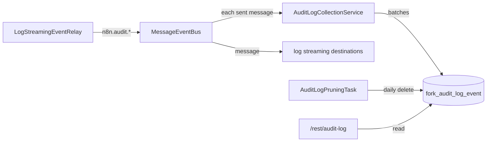

# Audit log

Fork module (not in upstream n8n). The audit log stores the audit events of n8n (`n8n.audit.*`) in
the database. The instance owner and admins read them in the REST API, filter them, and export them
as CSV or JSON. The module deletes an event after 90 days.

The repository owner chose this on 2026-10-11: the fork builds an audit log and a new log
streaming, the audit log is on by default, and it keeps the events for 90 days. The settings page of
the audit log comes in the next pull request, as a frontend module.

This module does not use enterprise code. Upstream n8n has no audit log of its own. The table
`activity_event` of upstream is a different feed: it keeps a short history of workflows and
credentials for the n8n Assistant.

## Set up

The module is on by default. To turn it off, add `audit-log` to `N8N_DISABLED_MODULES`.

| Variable | Default | Purpose |
|---|---|---|
| `N8N_AUDIT_LOG_RETENTION_DAYS` | `90` | Days to keep an event. `0` keeps all events |
| `N8N_AUDIT_LOG_PRUNE_INTERVAL_HOURS` | `24` | Hours between two runs of the task that deletes old events |
| `N8N_AUDIT_LOG_EXCLUDED_EVENTS` | empty | Events not to store: names, or prefixes that end with a dot |

For example, `N8N_AUDIT_LOG_EXCLUDED_EVENTS=n8n.audit.workflow.executed` stops the event that n8n
sends for each execution of a workflow.

## How it works

- The ordinary relay `LogStreamingEventRelay` sends the audit events to the event bus of each
  process: main, webhook and worker. The bus writes each message to its log file, and emits it.
- The module listens to the event `metrics.eventBus.event` of the bus, which the bus emits for each
  message that it sends. It does not listen to the event `message`: a listener of `message`
  confirms the delivery of each message, and that belongs to the destinations of log streaming.
- The module keeps the messages whose name starts with `n8n.audit.`, also the events of the MCP
  server (`n8n.audit.mcp.*`), and leaves out the excluded events. It writes them in batches of up
  to 100, at least once a second, and on shutdown.
- The id of the event message is the key of the row. A message that comes again is stored once.
- When a write fails, the events stay in the buffer for the next write, up to 10,000 events. When
  the buffer is full, the module drops new events and logs their number after the next write.
- The row keeps the name, the time of the event, the user id, the e-mail address and the payload.
  The user id comes from `userId` in the payload. The e-mail address comes from `_email`, else from
  `userEmail`. A user id of more than 36 characters, or an e-mail address of more than 254
  characters, does not fit its column, so the row keeps null and the payload keeps the value. A
  value that is too long thus cannot stop the writes.
- The system task `audit-log-pruning` deletes the events older than the retention. It runs on one
  main instance of the cluster.

The table is `fork_audit_log_event`. The prefix keeps it apart from tables that upstream may add.
The migration `CreateForkAuditLogEventTable1791734727111` creates it in
`packages/@n8n/db/src/migrations/common`.

## REST API

All routes need the global scope `auditLogs:manage`. The owner and admins have it, and a custom
role can have it.

| Route | Result |
|---|---|
| `GET /rest/audit-log/events` | `{ count, events }`: one page of the events, newest first |
| `GET /rest/audit-log/event-names` | The names of the audit events of this n8n version |
| `GET /rest/audit-log/export` | A file with all events that match, newest first |

The filters of `events` and `export`:

| Query parameter | Meaning |
|---|---|
| `from`, `to` | Times in ISO 8601 with an offset, for example `2026-10-01T00:00:00.000Z`. Both include the bound |
| `eventName` | An event name, or a prefix that ends with a dot, for example `n8n.audit.user.` |
| `userId` | The id of a user |

`events` also takes `skip` (default 0) and `take` (default 50, at most 250). An event has `id`,
`eventName`, `timestamp`, `userId`, `userEmail` and `payload`.

`export` also takes `format`: `csv` (the default) or `json`. The file name is
`audit-log-<date>.csv` or `audit-log-<date>.json`. The CSV file has the columns `timestamp`,
`eventName`, `userId`, `userEmail` and `payload` (the payload as JSON). A spreadsheet reads a cell
that starts with `=`, `+`, `-`, `@`, a tab or a carriage return as a formula, so the export puts a
single quote before such a cell. The JSON file is an array of events. The export reads the
database in batches of 1,000 events and streams the file.

## Files

| File | Purpose |
|---|---|
| `audit-log.module.ts` | The entrypoint |
| `audit-log.config.ts` | The environment variables |
| `audit-log-collection.service.ts` | Listens to the event bus and writes the events in batches |
| `audit-log-pruning.service.ts`, `audit-log-pruning.task.ts` | Delete old events |
| `audit-log.service.ts` | The list, the event names and the export |
| `audit-log.controller.ts`, `audit-log.dto.ts` | The REST API |
| `database/` | The entity and the repository of the table |

## Sources

- The ordinary event bus (`packages/cli/src/eventbus`): the message classes, the names of the events
  (`eventNamesAll`, of which the audit events start with `n8n.audit.`), and the send path of
  `MessageEventBus`.
- The ordinary relay `packages/cli/src/events/relays/log-streaming.event-relay.ts`, and the
  decorator `Redactable`, which give the payloads of the audit events.
- The scope `auditLogs:manage` in the permission data of the fork.
- The public n8n documentation of log streaming, for the audit events.
