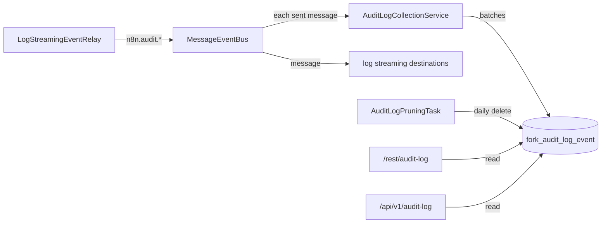

# Audit log

Fork module (not in upstream n8n). The audit log stores the audit events of n8n (`n8n.audit.*`) in
the database. The instance owner and admins read them on the page **Settings > Audit log**, in
the REST API and in the public API, filter them, and export them as CSV or JSON. The module deletes
an event after 90 days.

The repository owner chose this on 2026-10-11: the fork builds an audit log and a new log
streaming, the audit log is on by default, and it keeps the events for 90 days. The settings page is
the frontend module `packages/modules/audit-log/frontend`. Its README describes it. On 2026-10-23
the owner put the module under the fork switch: it starts with the licence value of log streaming,
`feat:logStreaming`, which `N8N_FORK_FEATURES_ENABLED` gives.

This module does not use enterprise code. Upstream n8n has no audit log of its own. The table
`activity_event` of upstream is a different feed: it keeps a short history of workflows and
credentials for the n8n Assistant.

## Set up

The module is on by default. To turn it off, add `audit-log` to `N8N_DISABLED_MODULES`.

| Variable | Default | Purpose |
|---|---|---|
| `N8N_AUDIT_LOG_RETENTION_DAYS` | `90` | Days to keep an event. `0` keeps all events |
| `N8N_AUDIT_LOG_PRUNE_INTERVAL_HOURS` | `24` | Hours between two runs of the task that deletes old events |
| `N8N_AUDIT_LOG_EXCLUDED_EVENTS` | empty | Events not to store: names, or prefixes that end with a dot |

For example, `N8N_AUDIT_LOG_EXCLUDED_EVENTS=n8n.audit.workflow.executed` stops the event that n8n
sends for each execution of a workflow.

## How it works



- The ordinary relay `LogStreamingEventRelay` sends the audit events to the event bus of each
  process: main, webhook and worker. The bus writes each message to its log file, and emits it.
- The fork relay `ForkGovernanceEventRelay` (`packages/cli/src/events/relays`) sends the
  governance actions of the fork features in the same way, on the main instances:
  `n8n.audit.git-sync.*` (settings saved, disconnected, pushed, pulled), `n8n.audit.ai-gateway.*`
  (settings updated, top-up added), `n8n.audit.log-streaming.destination.*` (created, updated,
  deleted) and `n8n.audit.git-connection.*` (providers and connections created, updated and
  deleted, promoted, applied). The list is in
  `packages/cli/src/eventbus/event-message-classes/fork-audit-event-names.ts`. No payload holds a
  token, a password or a key, and repository URLs lose any user and password.
- The module listens to the event `metrics.eventBus.event` of the bus, which the bus emits for each
  message that it sends. It does not listen to the event `message`: a listener of `message`
  confirms the delivery of each message, and that belongs to the destinations of log streaming.
- The module keeps the messages whose name starts with `n8n.audit.`, also the events of the MCP
  server (`n8n.audit.mcp.*`), and leaves out the excluded events. It writes them in batches of up
  to 100, at least once a second, and on shutdown.
- The id of the event message is the key of the row. A message that comes again is stored once.
- When a write fails, the events stay in the buffer for the next write, up to 10,000 events. When
  the buffer is full, the module drops new events and logs their number after the next write.
- The row keeps the name, the time of the event, the user id, the e-mail address and the payload.
  The user id comes from `userId` in the payload. The e-mail address comes from `_email`, else from
  `userEmail`. A user id of more than 36 characters, or an e-mail address of more than 254
  characters, does not fit its column, so the row keeps null and the payload keeps the value. A
  value that is too long thus cannot stop the writes.
- The row also keeps the project of the event and its type (`personal` or `team`), so that a query
  can ask what happened in the personal spaces of users. See "The project of an event".
- The system task `audit-log-pruning` deletes the events older than the retention. It runs on one
  main instance of the cluster.

The table is `fork_audit_log_event`. The prefix keeps it apart from tables that upstream may add.
The migration `CreateForkAuditLogEventTable1791734727111` creates it, and the migration
`AddProjectToForkAuditLogEvent1791905061817` adds the columns `projectId` and `projectType`, both
in `packages/@n8n/db/src/migrations/common`.

### The project of an event

`AuditLogProjectsService` finds the project of each event of a batch before the write:

1. The project that the payload names (`projectId`), for example in `n8n.audit.workflow.executed`
   and `n8n.audit.user.credentials.created`. The type comes from `projectType` in the payload, else
   from the table `project`.
2. Else the home project of the workflow (`workflowId`) or credential (`credentialId`) that the
   payload names: the project with the role `workflow:owner` or `credential:owner`. Most workflow
   and credential events name only the workflow or the credential. One query for each kind reads
   the home projects of the whole batch.
3. Else no project, for example for a sign-in.

A deleted workflow or credential has no home project in the database. n8n sends the events
`workflow-deleted` and `credentials-deleted` of the event service with the project that the
workflow or credential had, before the audit events. The service keeps these projects, and the
last home project of each workflow and credential that it found, for the 10,000 newest workflows
and credentials. So the events of a delete get the project too. The project types stay in memory
for 10,000 projects, because a project keeps its type.

The project is the project at the time of the event. When a workflow moves to another project, the
older events keep the old project. A transfer of the resources of a deleted user does not change
the events either (`ownership-transfer.manifest.json` lists the entity as not transferred). The
events that the audit log stored before this change have no project.

When the search for the projects fails, the module stores the events without a project, and logs
one warning until a search works again.

## REST API

All routes need the global scope `auditLogs:manage`. The owner and admins have it, and a custom
role can have it.

| Route | Result |
|---|---|
| `GET /rest/audit-log/events` | `{ count, events }`: one page of the events, newest first |
| `GET /rest/audit-log/event-names` | The names of the audit events of this n8n version |
| `GET /rest/audit-log/export` | A file with all events that match, newest first |

The filters of `events` and `export`:

| Query parameter | Meaning |
|---|---|
| `from`, `to` | Times in ISO 8601 with an offset, for example `2026-10-01T00:00:00.000Z`. Both include the bound |
| `eventName` | An event name, or a prefix that ends with a dot, for example `n8n.audit.user.` |
| `userId` | The id of a user |
| `projectId` | The id of a project |
| `projectType` | `personal` (the personal spaces of users) or `team` |

`events` also takes `skip` (default 0) and `take` (default 50, at most 250). An event has `id`,
`eventName`, `timestamp`, `userId`, `userEmail`, `projectId`, `projectType` and `payload`.

`export` also takes `format`: `csv` (the default) or `json`. The file name is
`audit-log-<date>.csv` or `audit-log-<date>.json`. The CSV file has the columns `timestamp`,
`eventName`, `userId`, `userEmail`, `payload` (the payload as JSON), `projectId` and
`projectType`. The project columns come last, so that a reader of the older files finds the same
columns at the same places. A spreadsheet reads a cell
that starts with `=`, `+`, `-`, `@`, a tab or a carriage return as a formula, so the export puts a
single quote before such a cell. The JSON file is an array of events. The export reads the
database in batches of 1,000 events and streams the file.

## Public API

The public API gives the same events to scripts and tools, for example a SIEM that collects the
audit events every hour. The routes need an API key with the scope `auditLogs:manage`, or the
session cookie of the editor. The user of the key must hold the global scope `auditLogs:manage`
too: the owner, an admin, or a user with a custom instance role that holds it. A member gets 403,
also with the scope on the key. `packages/@n8n/permissions/FORK.md` ("Fork scopes") tells how the
fork adds the scope to API keys.

| Route | Result |
|---|---|
| `GET /api/v1/audit-log/events` | `{ data, nextCursor }`: one page of the events, newest first |
| `GET /api/v1/audit-log/export` | A file with all events that match, newest first, as in the REST API |

Both routes take the filters of the REST API: `from`, `to`, `eventName`, `userId`, `projectId`
and `projectType`. `events`
pages as the other routes of the public API: `limit` (default 100, at most 250) and `cursor` (the
`nextCursor` of the previous page). `nextCursor` is null on the last page. The table can hold many
events, so a page must have 1 to 250 events: the route answers 400 for `limit=0`, and for a cursor
that a client changed to a larger page or to an offset that is not a whole number of 0 or more.
`export` takes `format`: `csv` (the default) or `json`.

When the module is off, the routes answer 503. The public API documentation
(`/api/v1/docs`) lists the routes under the tag **AuditLog**.

For example, read the workflow events of one day in the personal spaces of users:

```sh
curl -H "X-N8N-API-KEY: $N8N_API_KEY" \
  "https://n8n.example.com/api/v1/audit-log/events?eventName=n8n.audit.workflow.&projectType=personal&from=2026-10-01T00:00:00Z&to=2026-10-01T23:59:59Z"
```

## Files

| File | Purpose |
|---|---|
| `audit-log.module.ts` | The entrypoint |
| `audit-log.config.ts` | The environment variables |
| `audit-log-collection.service.ts` | Listens to the event bus and writes the events in batches |
| `audit-log-projects.service.ts` | Finds the project of each event |
| `audit-log-pruning.service.ts`, `audit-log-pruning.task.ts` | Delete old events |
| `audit-log.service.ts` | The list, the event names and the export |
| `audit-log.controller.ts`, `audit-log.dto.ts` | The REST API |
| `packages/cli/src/public-api/v1/controllers/audit-log.public.controller.ts` | The public API |
| `packages/@n8n/api-types/src/dto/audit-log/` | The query and response types of the public API |
| `database/` | The entity and the repository of the table |

## Sources

- The ordinary event bus (`packages/cli/src/eventbus`): the message classes, the names of the events
  (`eventNamesAll`, of which the audit events start with `n8n.audit.`), and the send path of
  `MessageEventBus`.
- The ordinary relay `packages/cli/src/events/relays/log-streaming.event-relay.ts`, and the
  decorator `Redactable`, which give the payloads of the audit events.
- The scope `auditLogs:manage` in the permission data of the fork.
- The public n8n documentation of log streaming, for the audit events.
