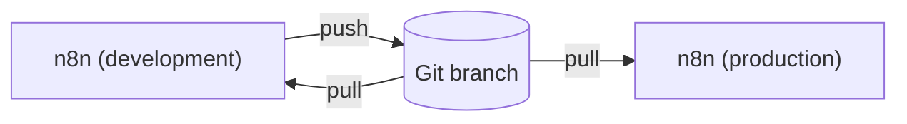

# Git sync

Fork module (not in upstream n8n). Git sync connects one n8n project to one branch
of a Git repository. The instance owner and admins push the workflows of the project
to the branch, and pull changes from the branch. Use it to keep a history of your
workflows, and to move workflows from a development instance to a production instance.

This module does not use enterprise code. It uses the package export and import of
n8n (`packages/cli/src/modules/n8n-packages`) through one adapter file, and runs the
`git` program of the host.



## Set up

1. Install Git 2.31 or later on the n8n host. The Docker image of n8n contains Git.
2. Create an access token with write access to the repository. Give it access to
   this repository only.
3. In n8n, open **Settings > Git sync**. Enter the repository URL, the branch, the
   folder in the repository, the project, and the token. Select **Test connection**,
   then **Save**.

| Variable | Default | Purpose |
|---|---|---|
| `N8N_GIT_SYNC_DIR` | `<n8n folder>/git-sync` | Folder for the working copy |
| `N8N_GIT_SYNC_ALLOWED_PROTOCOLS` | `https` | Protocols that Git can use. Use `file` for tests only |
| `N8N_GIT_SYNC_ALLOWED_HOSTS` | empty (any host) | Hosts that a repository URL can use, for example `github.com` |
| `N8N_GIT_SYNC_TIMEOUT_SECONDS` | `120` | Maximum duration of one Git command |

To turn the module off, add `git-sync` to `N8N_DISABLED_MODULES`.

## How it works

The branch holds a workflow package, as the package export writes it:
`manifest.json`, `workflows/<name>-<id>/`, `credentials/<name>-<id>/`, `tags/`, and
`data-tables/`. Other files in the folder, for example a README, stay as they are.

- **Status** fetches the branch and compares three things: the workflows in n8n, the
  workflows in Git, and the state of the last sync. It lists the workflows that
  changed in n8n, the workflows that changed in Git, and the workflows that changed
  in both places.
- **Push** exports all workflows of the project, archived workflows included, and
  commits them on top of the branch. It never uses `--force`. If the branch has
  changes in the package that are not in n8n yet, the push stops with
  `GIT_SYNC_PULL_FIRST`. **Replace content in Git** commits the n8n content on top
  of the branch anyway.
- **Pull** imports the workflows that changed in Git since the last sync. The
  workflow IDs stay the same on every instance, so a second pull updates the same
  workflows. If a workflow also changed in n8n, the pull stops with
  `GIT_SYNC_LOCAL_CHANGES`. Pull again with **Replace my changes** to continue.
- A new workflow from Git stays unpublished. A pull republishes an update only when
  the workflow is already published here and the source publishes the same version.

Credentials travel without their values: `credential.json` holds the ID, the name,
and the type only. A pull matches credentials by name and type (or by ID), and
creates an empty credential for each one that is missing. Fill in these credentials
once on each instance. A workflow that uses an empty credential cannot be published.

## Security

- Only the instance owner and admins can use Git sync.
- n8n stores the token encrypted. The API never returns it.
- Git gets the token as an HTTP header for the repository origin only. The token is
  never in the URL, in `.git/config`, in a log, or in an error message.
- Git runs without a shell, with an empty environment and no system or user
  configuration. Hooks, submodules, symbolic links, redirects and credential helpers
  are off.
- Write access to the branch is the same as write access to the workflows of every
  instance that pulls from it. Protect the branch, and use a token with the
  smallest possible permissions.

## Limits

- One connection for each instance, and one project for each connection.
- The package has no folders. A pull puts new workflows at the root of the project.
- A pull never deletes a workflow. It reports workflows that Git no longer has.
  Archive or delete them in n8n, or push to put them back in Git.
- Variables are never synced. Data tables travel as their schema only.
- HTTPS only. SSH keys are not supported.
- SHA-256 repositories are not supported.
- Workflows that use credentials with different IDs on each instance change on
  every push from another instance. To sync in both directions, use the
  **Match credentials by ID** setting on every instance.

## Code

| File | Purpose |
|---|---|
| `git-sync.service.ts` | Status, push, pull, and the settings |
| `git-sync.controller.ts` | REST routes under `/rest/git-sync`, for the owner and admins only |
| `git-sync-settings.service.ts` | Connection and sync state in the settings table |
| `git/git-client.ts` | Runs Git with a fixed, minimal environment |
| `git/git-validation.ts` | Checks the URL, the branch, and the folder |
| `package/n8n-packages.adapter.ts` | The only connection to the package export and import |
| `package/package-changes.ts` | Finds changed workflows (pure functions) |

Run the tests:

```bash
pnpm --filter n8n test src/modules/git-sync
pnpm --filter n8n test:integration src/modules/git-sync/__tests__/git-sync.integration.test.ts
```
