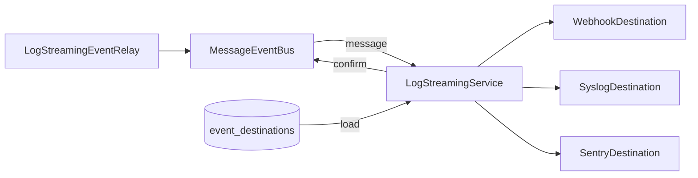

# Log streaming

Fork module (not in upstream n8n). Log streaming sends the events of n8n to external destinations:
a webhook, a syslog server or Sentry. The instance owner and admins manage the destinations on the
page **Settings > Log streaming**, in the REST API and in the public API. The settings page is in
`packages/frontend/editor-ui/src/features/integrations/logStreaming`. Its FORK.md describes it.

The repository owner chose this on 2026-10-11: the fork builds an audit log and a new log
streaming, and both are on by default. The audit log is the module `audit-log`. On 2026-10-23 the
owner put both under the fork switch: the modules start with the licence value
`feat:logStreaming`, which `N8N_FORK_FEATURES_ENABLED` gives, so the switch turns them off with the
other rebuilt features.

This module does not use enterprise code. It replaces the enterprise module `log-streaming.ee`,
which the fork removed. It uses the ordinary table `event_destinations`, the ordinary types of the
destinations, and the REST API that the ordinary Playwright tests use.

## Set up

The module is on by default. To turn it off, add `log-streaming` to `N8N_DISABLED_MODULES`. It
starts only with the licence value `feat:logStreaming`, which the fork switch gives. With
`N8N_FORK_FEATURES_ENABLED=false`, the licence decides, as in upstream n8n. While the module is
off, the page Settings > Log streaming tells which of the two settings turns it on.

Environment variables can manage the destinations:

| Variable | Default | Purpose |
|---|---|---|
| `N8N_LOG_STREAMING_MANAGED_BY_ENV` | `false` | When `true`, the destinations come from `N8N_LOG_STREAMING_DESTINATIONS`, and the REST API cannot change them |
| `N8N_LOG_STREAMING_DESTINATIONS` | empty | A JSON array of destinations in the format of the public API |

For example:

```json
[
  { "type": "webhook", "label": "Audit", "url": "https://hooks.example.com/audit", "subscribedEvents": ["n8n.audit"] },
  { "type": "syslog", "label": "SIEM", "host": "syslog.example.com", "protocol": "tls" },
  { "type": "sentry", "label": "Ops", "dsn": "https://public@sentry.example.com/1", "enabled": false }
]
```

- At each start, a main instance replaces all stored destinations with the destinations of the
  list. Then it asks the other instances to load them.
- A destination of the list is on, unless it sets `"enabled": false`.
- The id of a destination comes from its position in the list. Each main instance thus gives the
  same ids.
- When the value is not valid, the instance does not start, and the log tells the error.

## How it works



- Each process (main, worker and webhook) loads the destinations from the table, and listens to
  the event `message` of its own event bus.
- A destination takes an event when it is on and subscribes to the event. An entry of
  `subscribedEvents` is an event name, a group such as `n8n.audit` (with or without the last dot),
  or `*` for all events.
- The module confirms a message when each destination that takes it delivered it. It confirms a
  message that no destination takes at once.
- A message that a destination did not take stays unconfirmed in the event log of the process.
  The event bus sends it again every `N8N_EVENTBUS_CHECKUNSENTINTERVAL` milliseconds when this
  variable is set. A main instance also sends it again at its next start (see the limits for the
  other processes). The delivery is thus "at least once": a destination can get an event two
  times.
- Each destination has a circuit breaker. The defaults come from `@n8n/constants`: after 5
  failures in 1 minute, the destination stops the deliveries for 3 minutes. Then it tries again
  with 1 delivery at a time, and 2 successes close the circuit. The option `circuitBreaker` of a
  destination changes these values.
- A webhook or Sentry destination runs up to 5 deliveries at the same time. A syslog destination
  runs 1, so that the server gets the events in order. Up to 1,000 deliveries can wait. More fail at
  once.
- A destination logs a failed delivery as a warning at most once a minute, with the number of
  failures.
- After a change in the REST API, the main instance loads the destinations again, and publishes
  the command `restart-event-bus`. The other instances then load them too. A destination whose
  options did not change keeps its connections.
- When `anonymizeAuditMessages` is set, the values of the payload keys that start with `_` become
  `*` in the audit events (`n8n.audit.*`).

### Webhook

- The destination sends one request for each event. The body is the event as JSON: `__type`, `id`,
  `ts`, `eventName`, `message` and `payload`. When `sendPayload` is `false`, the body has no
  `payload`.
- `method` sets the method: `GET`, `POST` (the default), `PUT`, `PATCH`, `DELETE` or `HEAD`.
- When `sendHeaders` is set, the request has the headers of `headerParameters`, or of the JSON
  object `jsonHeaders` when `specifyHeaders` is `json`. `sendQuery`, `queryParameters`,
  `specifyQuery` and `jsonQuery` work in the same way for the query parameters.
- A response with a 2xx status code is a success. When `responseCodeMustMatch` is set, only
  `expectedStatusCode` is a success.
- The options `timeout` (default 5,000 ms), `allowUnauthorizedCerts`, `queryParameterArrays`,
  `redirect` and `proxy` apply to the request. The module ignores `batch`, `response` and
  `socket`: it sends one event in each request, and opens a new connection for each request.
- For authentication, set `authentication` to `genericCredentialType`, `genericAuthType` to the
  credential type, and `credentials` to `{ "<type>": { "id": "...", "name": "..." } }`. The
  supported types are `httpBasicAuth`, `httpBearerAuth`, `httpHeaderAuth`, `httpQueryAuth` and
  `httpCustomAuth`. The REST API rejects predefined credential types.
- A destination sends the data of its credential to its URL. Thus the user who saves the
  destination must have the scope `credential:read` on the credential.
- The module reads the data of a credential at most once a minute. It does not resolve
  expressions in the values of the credential, for example external secrets.
- The outbound network policy of the instance (SSRF protection) does not apply. An admin sets the
  destinations, and a destination often is in the internal network.

### Syslog

- The destination sends each event as an RFC 5424 message:
  `<PRI>1 TIMESTAMP HOSTNAME APP-NAME PROCID - - MSG`. `MSG` is the event as JSON.
- `PRI` is `facility` × 8 + the severity. The severity is 3 (error) for the events whose names end
  with `.failed` or `.crashed`, else 6 (informational).
- Over UDP, each event is one datagram. Over TCP and TLS, one connection stays open, and `eol` ends
  each message (RFC 6587).
- Over TLS, `tlsCa` replaces the default certificate authorities when it is set. The destination
  checks the host name of the certificate.
- The defaults are port 514, protocol `tcp`, facility 16 (local0) and the app name `n8n`. The
  module ignores `expectedStatusCode`.

### Sentry

- The destination sends one Sentry event for each event, in an envelope to the endpoint of the DSN
  (`/api/<project>/envelope/`), with the public key of the DSN.
- The level is `error` for the events whose names end with `.failed` or `.crashed`, else `info`.
  The message is the message of the event, the tag `event` is the event name, and `extra` is the
  event. When `sendPayload` is `false`, `extra` has no `payload`.
- The Sentry event id comes from the id of the message. Sentry thus drops an event that the module
  sends again.
- A response with a 2xx status code is a success. The module ignores `tracesSampleRate`.

## REST API

All routes need the global scope `logStreaming:manage`. The owner and admins have it, and a custom
role can have it.

| Route | Result |
|---|---|
| `GET /rest/eventbus/eventnames` | The names of the events of this n8n version |
| `GET /rest/eventbus/destination` | The destinations. With `?id=`, an array with the destination |
| `POST /rest/eventbus/destination` | Adds a destination, or changes the destination with the `id` of the body. Gives the stored destination |
| `DELETE /rest/eventbus/destination?id=` | Deletes a destination |
| `GET /rest/eventbus/testmessage?id=` | Sends the event `n8n.destination.test`, and tells if the destination took it |

- The body of `POST` is a destination with `__type`: `$$MessageEventBusDestinationWebhook`,
  `$$MessageEventBusDestinationSyslog` or `$$MessageEventBusDestinationSentry`. The fields of the
  body change the stored destination. A new destination gets the defaults of its kind, and is off
  until the body sets `enabled` to `true`. The id of a destination is a UUID.
- The test ignores `enabled`, the subscriptions and the circuit breaker.
- When the environment manages the destinations, `POST` and `DELETE` answer with the status 409.
- Each added, changed or deleted destination sends an audit event
  (`n8n.audit.log-streaming.destination.*`) with the user, the id, the kind, the label and the
  switch. The event has no URL and no credential.
- The test sends the data of the credential of the destination. Thus the user must have the scope
  `credential:read` on the credential.

## Public API

The public API has the routes of upstream n8n under `/api/v1/settings/log-streaming`. The handler
`packages/cli/src/public-api/v1/handlers/log-streaming/log-streaming.handler.ts` is fork code at
the path of the upstream handler, and calls this module. The OpenAPI files next to it are the
files of upstream.

| Route | API key scope | Result |
|---|---|---|
| `GET /settings/log-streaming/event-types` | `eventBusDestination:list` | `{ data }`: the names of the events |
| `GET /settings/log-streaming/destinations` | `eventBusDestination:list` | `{ data }`: the destinations |
| `POST /settings/log-streaming/destinations` | `eventBusDestination:create` | Adds a destination, and gives it |
| `GET /settings/log-streaming/destinations/{id}` | `eventBusDestination:read` | The destination |
| `PUT /settings/log-streaming/destinations/{id}` | `eventBusDestination:update` | Changes a destination, and gives it |
| `DELETE /settings/log-streaming/destinations/{id}` | `eventBusDestination:delete` | Deletes a destination, and gives it |
| `POST /settings/log-streaming/destinations/{id}/test` | `eventBusDestination:test` | `{ success }`: whether the destination took the test event |

- A destination of the public API has `type` (`webhook`, `syslog` or `sentry`) in place of
  `__type`. The public API does not show or take the credentials and some other fields, for
  example `sendPayload`.
- A new destination is off, unless the body sets `enabled` to `true`.
- `PUT` changes the fields of the body. The fields that the body leaves out keep their values, also
  the fields that the public API does not show.
- When the environment manages the destinations, `POST`, `PUT` and `DELETE` answer with the status
  409.
- A change sends the same audit event as a change in the REST API, and the other instances load
  the destinations again in the same way.
- As in upstream n8n, the routes need the licence value `feat:logStreaming`, which the fork switch
  gives (`packages/cli/src/fork-features.ts`). Without it, they answer with the status 403. While
  the module is off, they answer with the status 503, as the promotions routes of n8n do.

## Limits

- The event bus of a worker or a webhook process starts before the modules. At its start, the bus
  of such a process thus confirms the unsent messages of the previous run before a destination
  listens, and these messages reach no destination. The same applies to the events that the process
  sends before the modules start, for example `n8n.worker.started`. A main instance starts its
  modules first, so it does not have this limit.
- Over TCP, a write that the operating system accepted counts as a success. When the connection
  breaks, the server can miss the last messages.

## Files

| File | Purpose |
|---|---|
| `log-streaming.module.ts` | The entrypoint |
| `log-streaming.service.ts` | Loads the destinations, delivers the events and confirms them, and changes the destinations |
| `log-streaming.controller.ts` | The REST API |
| `packages/cli/src/public-api/v1/handlers/log-streaming/log-streaming.handler.ts` | The public API |
| `log-streaming.constants.ts` | The limits and the defaults |
| `destinations/log-streaming-destination.ts` | The base class: subscriptions, circuit breaker, queue, anonymization |
| `destinations/webhook.destination.ts`, `syslog.destination.ts`, `sentry.destination.ts` | The kinds of destinations |
| `destinations/destination-options.ts` | The options: defaults, validation and subscriptions |
| `destinations/destination.factory.ts` | Makes the destination of stored options |
| `destinations/destination-credentials.ts` | Reads the credentials of webhook destinations |
| `destinations/circuit-breaker.ts`, `delivery-queue.ts` | The protection of each destination |
| `database/` | The entity and the repository of the table `event_destinations` |

## Sources

- The ordinary event bus (`packages/cli/src/eventbus`): the message classes, the anonymization of
  the payloads, the confirmation of messages, and the send path of `MessageEventBus`.
- The ordinary types, schemas and defaults of the destinations: `message-event-bus.ts` in
  `n8n-workflow`, and the DTOs in `packages/@n8n/api-types/src/dto/log-streaming`.
- The ordinary constants in `packages/@n8n/constants/src/logstreaming.ts`.
- The ordinary migration `MessageEventBusDestinations1671535397530`, which creates the table.
- The ordinary settings `InstanceSettingsLoaderConfig` (the environment variables) and
  `logStreaming.managedByEnv` in `frontend.service.ts`.
- The ordinary public API files that the fork removed, at the upstream commit in
  `scripts/sync-upstream.base`: the handler, the mapper and the OpenAPI files in
  `packages/cli/src/public-api/v1/handlers/log-streaming`.
- The ordinary Playwright API helper and the specs in
  `packages/quality/testing/playwright/tests/e2e/settings/log-streaming`, for the REST API and the
  delivery.
- The public n8n documentation of log streaming, RFC 5424 and RFC 6587 for syslog, and the public
  Sentry documentation of envelopes.

## Upstream updates

- The OpenAPI files of the public API and the lines in `openapi.yml`, `eslint.config.mjs` and
  `oxlint.config.mts` are the same as upstream. Take the upstream changes.
- When an upstream update changes `log-streaming.handler.ts`, keep the fork version, which calls
  this module. Then make the same change of behaviour in the fork version.
